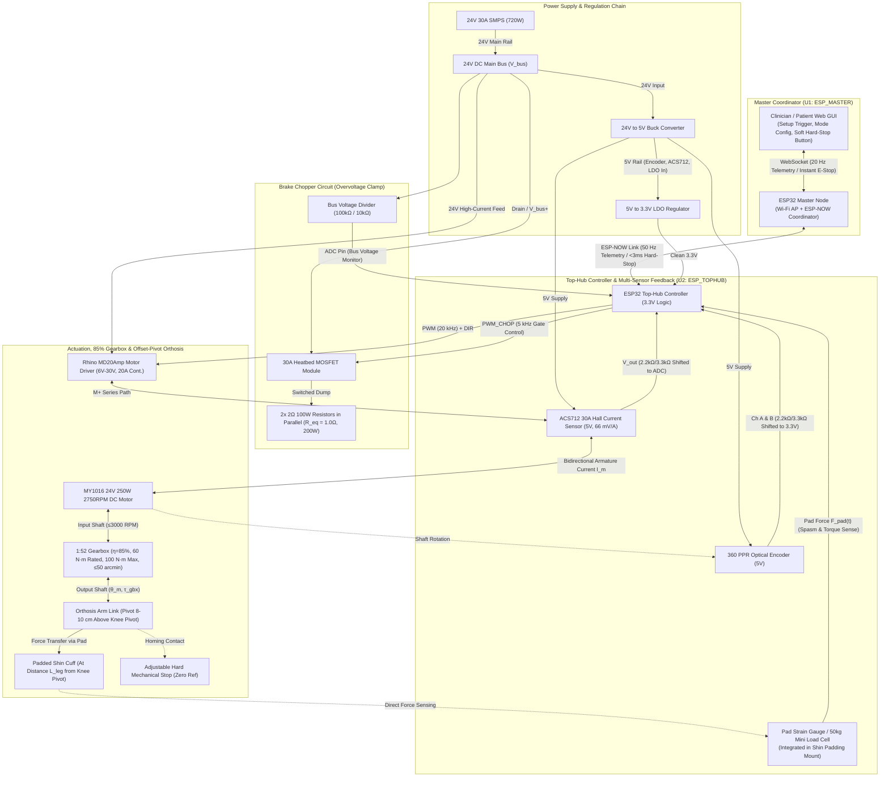
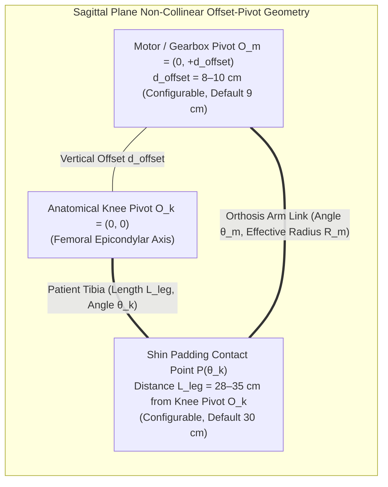
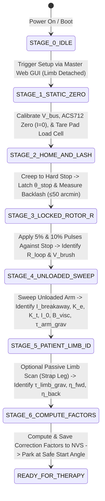
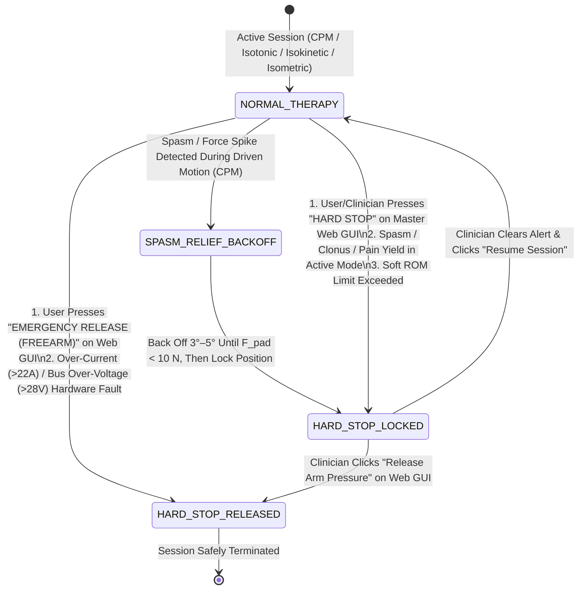
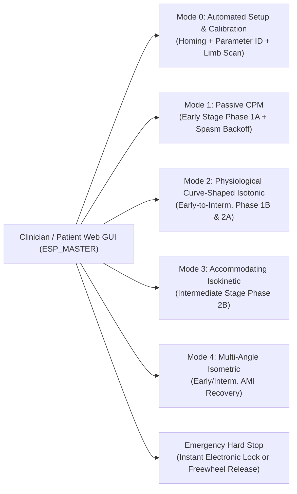
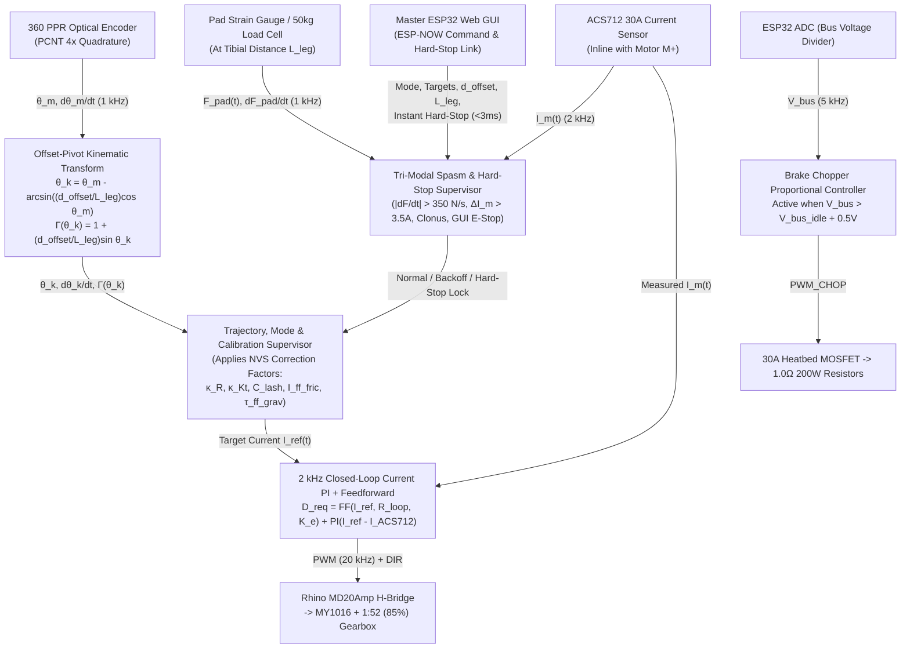

# Single-Arm Motorized Knee Rehabilitation System — Top Hub Motor Control, Offset-Pivot Kinematics, Automated Calibration & Clinical Biomechanics Specification

## 1. System Overview

This document details the complete electro-mechanical architecture, non-collinear offset-pivot biomechanics, closed-loop current/force control theory, automated setup & parameter identification routine, multi-sensor spasm/hard-stop protection system, and clinical rehabilitation targets for the **Single-Arm Motorized Knee Rehabilitation System (`ESP_TOPHUB`)**.

The system is engineered to administer medical-standard **Early-Stage** and **Intermediate-Stage** knee flexion/extension rehabilitation protocols (post-ACL reconstruction, Total Knee Arthroplasty, meniscal repair, and general orthopedic recovery) on one limb at a time, coordinated by the **Master ESP32 (`ESP_MASTER`) Clinical Web GUI** over a deterministic **ESP-NOW** wireless link.

### Key Architectural Highlights
1. **Closed-Loop Armature Current Sensing (`ACS712-30A`):** An inline $\pm 30\,\text{A}$ Hall-effect current sensor module (`ACS712ELCTR-30A-T`) measures bidirectional motor armature current $I_m(t)$ across all four operating quadrants (motoring, low-side dynamic shorting, active plugging, and regenerative braking), eliminating open-loop thermal drift.
2. **High-Efficiency $1:52$ Gearbox ($85\%$ Efficiency, $60\,\text{N}\cdot\text{m}$ Rated / $100\,\text{N}\cdot\text{m}$ Peak):** Incorporates exact datasheet transmission bounds—efficiency $\eta = 85\%$, continuous rated torque $60\,\text{N}\cdot\text{m}$, peak torque $100\,\text{N}\cdot\text{m}$, backlash $\le 50\,\text{arcmin}$ ($\le 0.833^\circ$), and rated input speed $\le 3000\,\text{RPM}$.
3. **Non-Collinear Offset-Pivot Biomechanics ($d_{\text{offset}} = 8\text{–}10\,\text{cm}$) & Pad Force Modeling ($L_{\text{leg}}$):** Explicitly accounts for the mechanical vertical offset between the orthosis arm pivot and the anatomical knee joint center (`PIVOT_OFFSET_Y_M`, default $9.0\,\text{cm}$, configurable) as well as the patient's tibial contact lever arm (`LEG_PAD_DIST_M`, default $30.0\,\text{cm}$), mapping linear patient leg force $F_{\text{pad}}$ ($\text{N}$ / $\text{kgf}$) to both anatomical knee torque ($\tau_{\text{knee}}$) and gearbox shaft torque ($\tau_{\text{gbx}}$).
4. **Multi-Modal Spasm Control & Emergency Hard-Stop Feature:** Integrates a compact **Low-Profile Strain Gauge / Mini Load Cell ($50\,\text{kg} / 500\,\text{N}$)** directly behind the shin padding alongside the **ACS712-30A** current sensor and **360 PPR Optical Encoder**. Provides instantaneous spasm relief (halt + tension-relieving backoff) and a dual-mode **Hard Stop** triggered either by medically relevant sensed anomalies (spasm, clonus, pain yield) or immediately via user/clinician input on the **Master ESP Web GUI**.
5. **Automated 6-Stage Setup & Parameter Identification Routine:** Prior to therapy, an automated setup sequence homes the encoder, empirically identifies all non-datasheet/assumed physical constants ($\hat{V}_{\text{ACS,0}}, \hat{R}_{\text{loop}}, V_{\text{brush}}, \hat{K}_e, \hat{K}_t, \hat{I}_0, \hat{\tau}_{\text{stiction}}, \hat{B}_{\text{visc}}, \hat{\theta}_{\text{backlash}}, \hat{\eta}_{\text{fwd}}, \hat{\eta}_{\text{back}}, \hat{\tau}_{\text{grav}}$), and computes real-time **Smooth-Working Correction Factors** for zero-jerk operation.

---

## 2. Hardware Architecture & Bill of Materials

### 2.1 Core Component Specifications

| Subsystem | Component | Key Ratings & Specifications | Functional Role |
| :--- | :--- | :--- | :--- |
| **Main Actuator** | **MY1016 Brushed DC Motor** | $24\,\text{V}$ DC, $250\,\text{W}$ rated, $2750\,\text{RPM}$ rated ($\sim 3300\,\text{RPM}$ no-load), $I_{\text{rated}} \approx 13.5\,\text{A}$, $\tau_{m,\text{rated}} \approx 0.87\,\text{N}\cdot\text{m}$, $R_a \approx 0.33\,\Omega$ | Primary electro-mechanical torque source (driving & back-driven braking) |
| **Transmission** | **1:52 Reduction Gearbox** | Ratio $G = 52:1$, Efficiency $\eta = \mathbf{85\%}$, Rated Torque $= \mathbf{60\,\text{N}\cdot\text{m}}$, Max Torque $= \mathbf{100\,\text{N}\cdot\text{m}}$, Backlash $\le \mathbf{50\,\text{arcmin}}$ ($0.833^\circ$), Rated Input Speed $\le \mathbf{3000\,\text{RPM}}$ | Amplifies motor torque by $52\times$ and scales speed to physiological knee velocities |
| **Motor Driver** | **Rhino MD20Amp DC Motor Driver** | $6\,\text{V}\text{–}30\,\text{V}$ DC, 1-Channel Full NMOS H-Bridge, $20\,\text{A}$ Continuous / $60\,\text{A}$ Peak ($10\,\text{s}$), PWM up to $20\,\text{kHz}$, `PWM` + `DIR` logic ($1.8\,\text{V}\text{–}12\,\text{V}$) | Bidirectional motor drive, hardware overcurrent clamp ($20\,\text{A}$), and low-side dynamic shorting |
| **Armature Current Sensor** | **ACS712 30A Current Sensor Module** | $\pm 30\,\text{A}$ bidirectional Hall-effect (`ACS712ELCTR-30A`), $5.0\,\text{V}$ supply, $V_{\text{zero}} = 2.50\,\text{V}$, Sensitivity $S = \mathbf{66\,\text{mV/A}}$, $80\,\text{kHz}$ bandwidth | Inline with motor terminal `M+`; measures true armature current $I_m$ in all 4 quadrants for closed-loop PI torque control, setup identification, and spasm detection |
| **Pad Force / Spasm Sensor** | **Compact Strain Gauge / Mini Load Cell + Amplifier** | $50\,\text{kg}$ ($490\,\text{N}$) low-profile bending-beam/button load cell integrated into shin padding mount + `INA125` ($1\,\text{kHz}$ analog) or `HX711` ($80\,\text{Hz}$ high-rate mode) | Directly measures normal force $F_{\text{pad}}(t)$ applied by the user's leg at the padding for spasm detection, gravity tare, and gearbox efficiency calibration |
| **Main Power Supply** | **24V 30A SMPS** | $24\,\text{V}$ DC, $30\,\text{A}$ max ($720\,\text{W}$) | Supplies primary DC power bus ($V_{\text{bus}}$) |
| **Brake Chopper Switch** | **3D Printer 30A Heatbed MOSFET Module** | High-current NMOS module ($30\,\text{A}$ continuous), opto-isolated/buffered PWM control input | Switches regenerative braking energy from the $24\,\text{V}$ bus into the braking resistor bank |
| **Braking Resistors** | **2$\times$ $2\,\Omega$, $100\,\text{W}$ Aluminum-Shell Resistors** | Wired **in parallel** $\implies R_{\text{eq}} = 1.0\,\Omega$, $P_{\text{rated}} = 200\,\text{W}$ continuous ($625\,\text{W}$ peak at $25\,\text{V}$) | Dissipates regenerative energy as heat when back-driven by the patient, clamping $V_{\text{bus}} < 26.5\,\text{V}$ |
| **Position Sensor** | **2-Phase Incremental Optical Rotary Encoder** | $360\,\text{PPR}$ (Pulses Per Revolution), Quadrature A/B channels ($1440\,\text{CPR}$ at $4\times$ decoding), $5\,\text{V}$ supply | Tracks shaft angle ($\theta_m$) and angular velocity ($\dot{\theta}_m$) for closed-loop control |
| **Power Regulation** | **24V$\rightarrow$5V Buck + 5V$\rightarrow$3.3V LDO** | Stage 1: $24\,\text{V}$ to $5\,\text{V}$ DC-DC Buck Converter Stage 2: $5\,\text{V}$ to $3.3\,\text{V}$ Linear LDO Regulator | Buck supplies $5\,\text{V}$ to Optical Encoder, ACS712-30A, & LDO input; LDO provides low-ripple $3.3\,\text{V}$ for ESP32 & load cell reference |
| **Controllers** | **Local `ESP_TOPHUB` + Master `ESP_MASTER` (ESP32)** | Dual-core $240\,\text{MHz}$, hardware `MCPWM`, hardware `PCNT` quadrature decoder, $12\text{-bit}$ SAR ADC, ESP-NOW RF link | `ESP_TOPHUB` runs $2\,\text{kHz}$ current loop, $1\,\text{kHz}$ kinematic/spasm loop, and $5\,\text{kHz}$ chopper loop; `ESP_MASTER` hosts Clinical Web GUI & remote Hard-Stop trigger |

---

### 2.2 System Block & Power/Signal Flow Diagram

---

## 3. Electro-Mechanical Modeling, Gearbox Rating Analysis & Offset-Pivot Kinematics

### 3.1 MY1016 Motor Constants & ACS712-30A Current Sensing Model

#### Nominal Motor Constants (Refined Empirically During Setup Routine)
From the MY1016 rated specifications ($V_{\text{rated}} = 24\,\text{V}$, $P_{\text{mech}} = 250\,\text{W}$, $N_{\text{rated}} = 2750\,\text{RPM}$, $N_0 \approx 3300\,\text{RPM}$, $I_{\text{rated}} \approx 13.5\,\text{A}$, $I_0 \approx 1.0\,\text{A}$):
1. **Rated & No-Load Angular Velocities:**
   $$\omega_{m,\text{rated}} = \frac{2750 \times 2\pi}{60} \approx 287.98\,\text{rad/s}, \qquad \omega_{m,0} = \frac{3300 \times 2\pi}{60} \approx 345.58\,\text{rad/s}$$
2. **Rated Motor Shaft Torque ($\tau_{m,\text{rated}}$):**
   $$\tau_{m,\text{rated}} = \frac{P_{\text{mech}}}{\omega_{m,\text{rated}}} = \frac{250\,\text{W}}{287.98\,\text{rad/s}} \approx 0.868\,\text{N}\cdot\text{m}$$
3. **Nominal Back-EMF Constant ($K_{e,\text{nom}}$) & Torque Constant ($K_{t,\text{nom}}$):**
   $$K_{e,\text{nom}} = K_{t,\text{nom}} \approx \frac{V_{\text{rated}}}{\omega_{m,0}} \approx 0.0694\,\text{V}/(\text{rad/s}) = 0.0694\,\text{N}\cdot\text{m/A} \quad (\approx 0.00727\,\text{V/RPM})$$
4. **Nominal Armature Loop Resistance ($R_{\text{loop,nom}}$):**
   $$R_a = \frac{24.0 - 20.0}{13.5} \approx 0.30\text{–}0.35\,\Omega, \qquad R_{\text{loop,nom}} = R_a + R_{\text{DS(on)}} + R_{\text{ACS712}} + R_{\text{wire}} \approx 0.40\,\Omega$$
   *(Note: The internal copper conduction path of the ACS712 possesses an ultra-low primary resistance of $R_{\text{ACS712}} = 1.2\,\text{m}\Omega$, adding negligible loss).*

#### ACS712 30A Current Sensor Signal Conditioning & Transfer Function
* **Placement Requirement:** The `ACS712-30A` is wired **in series with the motor terminal (`M+`)** between the Rhino MD20Amp output and the MY1016 motor—*not* on the $24\,\text{V}$ supply rail. This placement is essential so the sensor measures circulating armature current $I_m$ during **Mode 2 (low-side H-bridge shorting)** when supply current is zero.
* **Sensor Output Equation ($5.0\,\text{V}$ Supply):**
  $$V_{\text{ACS}}(I_m) = V_{\text{zero}} + S_{\text{ACS}} \cdot I_m = 2.50\,\text{V} + 0.066\,\frac{\text{V}}{\text{A}} \cdot I_m \quad \in [0.52\,\text{V},\; 4.48\,\text{V}] \text{ for } I_m \in [-30\,\text{A},\; +30\,\text{A}]$$
* **3.3V ESP32 ADC Level Shifting ($R_{\text{top}} = 2.2\,\text{k}\Omega$, $R_{\text{bot}} = 3.3\,\text{k}\Omega$):**
  To protect the $3.3\,\text{V}$ ESP32 ADC and place the zero-current midpoint inside the highly linear region of the ESP32 SAR ADC (`ADC_ATTEN_DB_11`, linear range $0.15\,\text{V}\text{–}2.80\,\text{V}$), a precision $1\%$ voltage divider scales the output by $\alpha_{\text{div}} = \frac{3.3}{2.2 + 3.3} = 0.60$:
  $$V_{\text{ADC}}(I_m) = 0.60 \times V_{\text{ACS}}(I_m) = 1.500\,\text{V} + 0.0396\,\frac{\text{V}}{\text{A}} \cdot I_m$$
  * **At $I_m = 0\,\text{A}$:** $V_{\text{ADC}} = 1.500\,\text{V}$ (exact center of ESP32 ADC linear range).
  * **At $I_m = \pm 20\,\text{A}$ (Driver Limit):** $V_{\text{ADC}} \in [0.708\,\text{V},\; 2.292\,\text{V}]$.
  * **At $I_m = \pm 30\,\text{A}$ (Full Scale):** $V_{\text{ADC}} \in [0.312\,\text{V},\; 2.688\,\text{V}]$.
* **Reconstructed Current in Firmware (with Calibrated Offset $\hat{V}_{\text{ADC,0}}$ & Gain Factor $\kappa_{\text{ACS}}$):**
  $$I_m(t) = \kappa_{\text{ACS}} \cdot \frac{V_{\text{ADC}}(t) - \hat{V}_{\text{ADC,0}}}{0.0396\,\text{V/A}} \qquad (\text{12-bit ADC resolution} \approx 20.4\,\text{mA/LSB}, \text{ or } \sim 5\,\text{mA} \text{ with } 16\times \text{ oversampling})$$

---

### 3.2 Gearbox ($1:52$) Specifications, Efficiency ($85\%$), Backlash ($\le 50\,\text{arcmin}$) & Input Speed Analysis

The system uses a high-torque **$1:52$ Reduction Gearbox** with the following explicit mechanical ratings:
* **Gear Reduction Ratio:** $G = 52:1$
* **Nominal Mechanical Efficiency:** $\eta_{\text{gbx}} = 85\%$ ($\eta_{\text{fwd}} = 0.85$; back-driving efficiency $\eta_{\text{back}} \approx 0.82\text{–}0.85$)
* **Continuous Rated Output Torque:** $\tau_{\text{gbx,rated}} = \mathbf{60\,\text{N}\cdot\text{m}}$
* **Maximum Peak Output Torque:** $\tau_{\text{gbx,max}} = \mathbf{100\,\text{N}\cdot\text{m}}$
* **Output Backlash:** $\Delta\theta_{\text{lash}} \le \mathbf{50\,\text{arcmin}} = \frac{50^\circ}{60} = \mathbf{0.833^\circ}$
* **Rated Input Speed:** $N_{\text{in,rated}} \le \mathbf{3000\,\text{RPM}}$

#### 1. Input Speed Ceiling & Output Kinematics
$$\text{RPM}_{\text{out}} = \frac{\text{RPM}_{\text{motor}}}{52}, \qquad \dot{\theta}_m\,(^\circ/\text{s}) = 6 \times \text{RPM}_{\text{out}} = \frac{6}{52}\,\text{RPM}_{\text{motor}} \approx 0.11538 \times \text{RPM}_{\text{motor}}$$
* **At MY1016 Rated Speed ($2750\,\text{RPM} \le 3000\,\text{RPM}$ Gearbox Limit):** $\text{RPM}_{\text{out}} = 52.88\,\text{RPM} \implies \dot{\theta}_m = \mathbf{317.3^\circ/\text{s}}$.
* **At Gearbox Maximum Rated Input Speed ($3000\,\text{RPM}$):** $\text{RPM}_{\text{out}} = 57.69\,\text{RPM} \implies \dot{\theta}_m = \mathbf{346.2^\circ/\text{s}}$.
* **Software Input-Speed Protection:** Because the MY1016 unloaded free-run speed at $24\,\text{V}$ is $\sim 3300\,\text{RPM}$, the ESP32 clamps maximum unloaded motor speed to $\le 2900\,\text{RPM}$ ($\dot{\theta}_m \le 334^\circ/\text{s}$, and in clinical practice $\le 120^\circ/\text{s} = 1040\,\text{RPM}_{\text{motor}}$), guaranteeing the gearbox never exceeds its $3000\,\text{RPM}$ input rating.

#### 2. Gearbox Output Shaft Torque: Forward Driving vs. Back-Driven Resistance (with $\eta = 85\%$)
With $\eta_{\text{fwd}} = 0.85$, the internal friction loss of the gearbox is lower than a standard $80\%$ unit, yielding a baseline reflected static/breakaway drag of $\tau_{\text{fric}} \approx 2.5\,\text{N}\cdot\text{m}$ (calibrated exactly during the Setup Routine):

* **When Motor Drives the Arm (Active-Assist / CPM Mode — Quadrant I & III):**
  $$\tau_{\text{gbx,drive}}(I_m) = G \cdot \eta_{\text{fwd}} \cdot K_t (I_m - I_0) = 52 \times 0.85 \times 0.0694 \cdot (I_m - 1.0) = \mathbf{3.068\,(I_m - 1.0)\;\text{[N}\cdot\text{m]}}$$
  * At Motor Continuous Rated Current ($I_m = 13.5\,\text{A}$): $\tau_{\text{gbx,drive}} = 3.068 \times 12.5 = \mathbf{38.35\,\text{N}\cdot\text{m}}$ ($63.9\%$ of gearbox $60\,\text{N}\cdot\text{m}$ continuous rating).
  * At Rhino MD20Amp Continuous Limit ($I_m = 20.0\,\text{A}$): $\tau_{\text{gbx,drive}} = 3.068 \times 19.0 = \mathbf{58.29\,\text{N}\cdot\text{m}}$ (safely inside the **$60\,\text{N}\cdot\text{m}$ continuous gearbox rating**!).

* **When Patient Back-Drives the Gearbox (Resistive Isotonic / Isokinetic / Isometric Mode — Quadrant II & IV):**
  The patient must overcome both the gearbox's $85\%$ back-driving efficiency and the motor's electromagnetic counter-torque:
  $$\tau_{\text{gbx,resist}}(I_m) = \frac{G}{\eta_{\text{back}}} \cdot K_t I_m + \tau_{\text{fric}} = \frac{52}{0.85} \times 0.0694 \cdot I_m + 2.5 = \mathbf{(4.246 \cdot I_m + 2.5)\;\text{[N}\cdot\text{m]}}$$
  * **At $I_m = 13.5\,\text{A}$ (Motor Continuous Rated Current):**
    $$\tau_{\text{gbx,resist}}(13.5\,\text{A}) = 4.246 \times 13.5 + 2.5 = \mathbf{59.82\,\text{N}\cdot\text{m}} \approx \mathbf{60.0\,\text{N}\cdot\text{m}}$$
    *(Remarkable hardware match: The MY1016 continuous thermal rating of $13.5\,\text{A}$ corresponds almost identically to the gearbox's continuous rated torque of $60\,\text{N}\cdot\text{m}$!)*
  * **At $I_m = 20.0\,\text{A}$ (Rhino MD20Amp Continuous Current Clamp):**
    $$\tau_{\text{gbx,resist}}(20.0\,\text{A}) = 4.246 \times 20.0 + 2.5 = \mathbf{87.42\,\text{N}\cdot\text{m}} \quad (< \mathbf{100\,\text{N}\cdot\text{m}} \text{ Gearbox Max Torque!})$$
  * **Current Corresponding to Gearbox Max Torque ($100\,\text{N}\cdot\text{m}$):**
    $$I_{m,\text{100Nm}} = \frac{100.0 - 2.5}{4.246} = 22.96\,\text{A}$$
    Thus, capping peak motor current in software to $I_{m,\text{peak}} \le 20.0\,\text{A}$ ($\tau_{\text{gbx}} \le 87.4\,\text{N}\cdot\text{m}$) provides an inherent $12.6\%$ safety margin below the $100\,\text{N}\cdot\text{m}$ mechanical shear ceiling!

#### 3. Backlash ($\le 50\,\text{arcmin} = 0.833^\circ$) Mechanical Impact
* A maximum output backlash of $50\,\text{arcmin}$ ($0.833^\circ$) means that when torque reverses sign (e.g., transitioning from flexion to extension or engaging resistive braking), the motor shaft rotates through $\Delta\theta_{m,\text{lash}} \le 52 \times 0.833^\circ = 43.3^\circ$ ($\approx 173$ encoder counts if motor-mounted) before the gear teeth re-engage on the opposite flank.
* Without compensation, rapid current reversal across this $0.833^\circ$ deadband causes an audible gear "clunk" and a sharp impact force spike at the shin pad (which could falsely trigger the spasm detector). Section 5.3 details the **Anti-Backlash Sigmoidal Soft-Engagement Law** that eliminates this impact.

---

### 3.3 Non-Collinear Offset-Pivot Kinematics ($d_{\text{offset}} = 8\text{–}10\,\text{cm}$) & Patient Leg Force Analysis

In the physical mechanical assembly, the **Orthosis Arm Link Pivot ($O_m$, Gearbox Output Shaft)** is mounted vertically **higher** than the user's **Anatomical Knee Joint Pivot ($O_k$, femoral epicondylar axis)** by a configurable vertical offset $d_{\text{offset}} \approx 8\text{–}10\,\text{cm}$, and transfers force to the patient's lower leg via a padded shin cuff located at an average tibial distance $L_{\text{leg}}$ from the knee joint pivot $O_k$.

#### 1. Configurable Geometric Parameters in Firmware
Because the exact mechanical mounting height and patient tibial strap position can be adjusted, both parameters are defined as runtime-configurable variables (adjustable via the `ESP_MASTER` Web GUI and stored in ESP32 NVS):
* **`d_offset_m` ($d_{\text{offset}}$):** Vertical distance of the arm link pivot $O_m$ above the knee pivot $O_k$.
  * **Default:** $d_{\text{offset}} = 0.090\,\text{m}$ ($9.0\,\text{cm}$), configurable across $[0.00\,\text{m},\; 0.15\,\text{m}]$ (nominal design window: **$8.0\text{–}10.0\,\text{cm}$**).
* **`L_leg_m` ($L_{\text{leg}}$):** Average distance from the anatomical knee pivot $O_k$ along the tibia to the center of the shin padding where the user applies force.
  * **Anthropometric Average & Default:** For an adult tibia ($\sim 37\text{–}41\,\text{cm}$ total length), mid-to-distal shin padding placement yields an average force application lever arm of **$L_{\text{leg}} = 0.300\,\text{m}$ ($30.0\,\text{cm}$)**, configurable across $[0.20\,\text{m},\; 0.40\,\text{m}]$.

#### 2. Exact Angle & Velocity Mapping ($\theta_k \leftrightarrow \theta_m$)
Place the anatomical knee pivot at the origin $O_k = (0, 0)$ and the gearbox pivot at $O_m = (0, d_{\text{offset}})$. Let $\theta_k$ be the anatomical knee flexion angle ($0^\circ$ = full horizontal extension along $+x$, $90^\circ$ = downward vertical flexion along $-y$). The padding contact point on the tibia is:
$$P(\theta_k) = \begin{pmatrix} L_{\text{leg}} \cos\theta_k \\ -L_{\text{leg}} \sin\theta_k \end{pmatrix}$$
The vector from the **Gearbox Arm Pivot $O_m$** to the **Pad Force Point $P$** is:
$$\vec{r}_m(\theta_k) = P(\theta_k) - O_m = \begin{pmatrix} L_{\text{leg}} \cos\theta_k \\ -(L_{\text{leg}} \sin\theta_k + d_{\text{offset}}) \end{pmatrix}$$

From $\vec{r}_m(\theta_k)$, we obtain the exact closed-form kinematic transformations executed at $1\,\text{kHz}$ on `ESP_TOPHUB`:

1. **Forward Angle Mapping (Anatomical Knee Angle $\theta_k \rightarrow$ Arm Link Angle $\theta_m$):**
   $$\theta_m(\theta_k) = \arctan2\left(L_{\text{leg}}\sin\theta_k + d_{\text{offset}},\; L_{\text{leg}}\cos\theta_k\right)$$
   * *Key Geometric Insight:* When the patient's knee is at **full anatomical extension ($\theta_k = 0^\circ$)**, the orthosis arm link is already inclined downward at:
     $$\theta_{m,0} = \arctan\left(\frac{d_{\text{offset}}}{L_{\text{leg}}}\right) = \arctan\left(\frac{9.0\,\text{cm}}{30.0\,\text{cm}}\right) = \mathbf{16.70^\circ}$$
     When the patient's knee reaches **$\theta_k = 90^\circ$**, both axes align vertically with the pad ($\theta_m = \mathbf{90.00^\circ}$). Thus, a $90^\circ$ anatomical knee excursion ($0^\circ \rightarrow 90^\circ$) corresponds to a $73.3^\circ$ rotation of the gearbox output shaft!

2. **Inverse Angle Mapping (Encoder Arm Angle $\theta_m \rightarrow$ True Anatomical Knee Angle $\theta_k$):**
   Cross-multiplying the $\tan\theta_m$ relation yields the exact non-iterative inverse formula:
   $$\boxed{\theta_k(\theta_m) = \theta_m - \arcsin\left(\frac{d_{\text{offset}}}{L_{\text{leg}}}\cos\theta_m\right)}$$

3. **Radial Distance from Gearbox Pivot to Pad ($R_m(\theta_k)$) & Compliant Pad Travel:**
   $$R_m(\theta_k) = \|\vec{r}_m(\theta_k)\| = \sqrt{L_{\text{leg}}^2 + d_{\text{offset}}^2 + 2 L_{\text{leg}} d_{\text{offset}} \sin\theta_k}$$
   As the knee flexes from $0^\circ$ to $90^\circ$ (with $L_{\text{leg}} = 30\,\text{cm}, d_{\text{offset}} = 9\,\text{cm}$), the distance from $O_m$ to $P$ increases from $31.32\,\text{cm}$ to $39.00\,\text{cm}$ ($\Delta R_m = 7.68\,\text{cm}$, accommodated by the pivoting/floating shin cuff or natural sliding of the foam pad along the shin guard).

#### 3. Patient Applied Force ($F_{\text{pad}}$) and Offset-Pivot Torque Amplification Factor ($\Gamma(\theta_k)$)
When the user pushes against the padding with a normal tibial force $F_{\text{pad}}$ (perpendicular to the lower leg, along unit vector $\hat{u}_{\perp} = (\sin\theta_k, \cos\theta_k)$):
* **Anatomical Knee Torque ($\tau_{\text{knee}}$) vs. Linear User Force ($F_{\text{pad}}$):**
  $$\tau_{\text{knee}} = F_{\text{pad}} \cdot L_{\text{leg}} \quad \Longleftrightarrow \quad \boxed{F_{\text{pad}} = \frac{\tau_{\text{knee}}}{L_{\text{leg}}}\;\text{[Newtons]} \quad \left(F_{\text{pad,kgf}} = \frac{F_{\text{pad}}}{9.81}\;\text{[kgf]}\right)}$$
* **Gearbox Shaft Torque ($\tau_{\text{gbx}}$) Produced by User Force $F_{\text{pad}}$ at Offset Pivot $O_m$:**
  Taking the 2D moment $\tau_{\text{gbx}} = (\vec{r}_m(\theta_k) \times \vec{F}_{\text{pad}})_z$:
  $$\tau_{\text{gbx}}(\theta_k) = F_{\text{pad}} \left[ L_{\text{leg}}\cos^2\theta_k + (L_{\text{leg}}\sin\theta_k + d_{\text{offset}})\sin\theta_k \right] = F_{\text{pad}} \cdot \underbrace{\left( L_{\text{leg}} + d_{\text{offset}}\sin\theta_k \right)}_{L_{\text{eff}}(\theta_k)}$$
  Dividing $\tau_{\text{gbx}}(\theta_k)$ by $\tau_{\text{knee}} = F_{\text{pad}} L_{\text{leg}}$ defines the **Kinematic Torque Amplification Factor $\Gamma(\theta_k)$**:
  $$\boxed{\Gamma(\theta_k) \triangleq \frac{\tau_{\text{gbx}}(\theta_k)}{\tau_{\text{knee}}(\theta_k)} = \frac{L_{\text{eff}}(\theta_k)}{L_{\text{leg}}} = 1 + \left(\frac{d_{\text{offset}}}{L_{\text{leg}}}\right)\sin\theta_k}$$

> [!IMPORTANT]
> **Critical Biomechanical Consequence of the $8\text{–}10\,\text{cm}$ Higher Arm Pivot:**
> Because $O_m$ is above $O_k$ by $d_{\text{offset}} = 8\text{–}10\,\text{cm}$, the effective moment arm of the patient's leg force about the gearbox shaft is $L_{\text{eff}}(\theta_k) = L_{\text{leg}} + d_{\text{offset}}\sin\theta_k$.
> * At **$\theta_k = 0^\circ$ (Full Extension)**, the user pushes vertically, parallel to the vertical offset $d_{\text{offset}}$, so $\Gamma(0^\circ) = 1.00$ ($\tau_{\text{gbx}} = \tau_{\text{knee}}$).
> * At **$\theta_k = 60^\circ$ (Peak Quadriceps Angle)**, for $d_{\text{offset}} = 9\,\text{cm}$ and $L_{\text{leg}} = 30\,\text{cm}$, $\Gamma(60^\circ) = 1 + 0.30\sin 60^\circ = \mathbf{1.260}$ (**the gearbox shaft experiences $26\%$ more torque than the anatomical knee joint!**).
> * At **$\theta_k = 90^\circ$ (Seated Flexion)**, the user pushes horizontally, so $d_{\text{offset}}$ adds directly to $L_{\text{leg}}$: $L_{\text{eff}}(90^\circ) = 39\,\text{cm}$ and $\Gamma(90^\circ) = \mathbf{1.300}$ (**$30\%$ torque amplification at the gearbox**).
> *(Note: If the pad is rigidly fixed at a constant radius $R_{\text{arm}}$ from the motor pivot $O_m$ and slides along the patient's shin, the effective contact distance on the shin becomes $L_{\text{leg}}(\theta_k) = \sqrt{R_{\text{arm}}^2 - d_{\text{offset}}^2\cos^2\theta_k} - d_{\text{offset}}\sin\theta_k$, yielding the exact same torque ratio $\Gamma(\theta_k) = R_{\text{arm}} / L_{\text{leg}}(\theta_k)$!)*

#### Table 3.3: Kinematic Mapping, Moment Arms, Gearbox Torque Ceilings & Patient Applied Force ($L_{\text{leg}} = 30\,\text{cm}$, $d_{\text{offset}} = 9\,\text{cm}$, Range $8\text{–}10\,\text{cm}$)

| Anatomical Knee Angle ($\theta_k$) | Motor Arm Angle ($\theta_m$) | Effective Gearbox Lever Arm ($L_{\text{eff}}$) | Torque Amplification $\Gamma(\theta_k) = \frac{\tau_{\text{gbx}}}{\tau_{\text{knee}}}$ *(for $d_{\text{offset}} = 8 / 9 / 10\,\text{cm}$)* | Max Knee Torque at **$60\,\text{N}\cdot\text{m}$ Gearbox Rated** ($\tau_{\text{knee,rated}}$) | User Pad Force at $60\,\text{N}\cdot\text{m}$ Gearbox Rated ($F_{\text{pad,rated}}$) | Max Knee Torque at **$87.4\,\text{N}\cdot\text{m}$ ($20\,\text{A}$) / $100\,\text{N}\cdot\text{m}$ Max** | Max User Pad Force at $20\,\text{A}$ Limit ($F_{\text{pad,20A}}$) |
| :---: | :---: | :---: | :---: | :---: | :---: | :---: | :---: |
| **$0^\circ$ (Full Ext)** | $16.70^\circ$ | $30.00\,\text{cm}$ | $1.000 \;/\; \mathbf{1.000} \;/\; 1.000$ | **$60.0\,\text{N}\cdot\text{m}$** | **$200.0\,\text{N}$** ($20.4\,\text{kgf}$) | **$87.4\,\text{N}\cdot\text{m}$** ($100.0\,\text{N}\cdot\text{m}$) | **$291.4\,\text{N}$** ($29.7\,\text{kgf}$) |
| **$15^\circ$** | $29.10^\circ$ | $32.33\,\text{cm}$ | $1.069 \;/\; \mathbf{1.078} \;/\; 1.086$ | **$55.7\,\text{N}\cdot\text{m}$** | **$185.6\,\text{N}$** ($18.9\,\text{kgf}$) | **$81.1\,\text{N}\cdot\text{m}$** ($92.8\,\text{N}\cdot\text{m}$) | **$270.4\,\text{N}$** ($27.6\,\text{kgf}$) |
| **$30^\circ$** | $42.71^\circ$ | $34.50\,\text{cm}$ | $1.133 \;/\; \mathbf{1.150} \;/\; 1.167$ | **$52.2\,\text{N}\cdot\text{m}$** | **$173.9\,\text{N}$** ($17.7\,\text{kgf}$) | **$76.0\,\text{N}\cdot\text{m}$** ($87.0\,\text{N}\cdot\text{m}$) | **$253.4\,\text{N}$** ($25.8\,\text{kgf}$) |
| **$45^\circ$** | $55.06^\circ$ | $36.36\,\text{cm}$ | $1.189 \;/\; \mathbf{1.212} \;/\; 1.236$ | **$49.5\,\text{N}\cdot\text{m}$** | **$165.0\,\text{N}$** ($16.8\,\text{kgf}$) | **$72.1\,\text{N}\cdot\text{m}$** ($82.5\,\text{N}\cdot\text{m}$) | **$240.4\,\text{N}$** ($24.5\,\text{kgf}$) |
| **$60^\circ$ (Peak Quad)** | $66.79^\circ$ | $37.79\,\text{cm}$ | $1.231 \;/\; \mathbf{1.260} \;/\; 1.289$ | **$47.6\,\text{N}\cdot\text{m}$** | **$158.8\,\text{N}$** ($16.2\,\text{kgf}$) | **$69.4\,\text{N}\cdot\text{m}$** ($79.4\,\text{N}\cdot\text{m}$) | **$231.3\,\text{N}$** ($23.6\,\text{kgf}$) |
| **$75^\circ$** | $78.42^\circ$ | $38.69\,\text{cm}$ | $1.258 \;/\; \mathbf{1.290} \;/\; 1.322$ | **$46.5\,\text{N}\cdot\text{m}$** | **$155.1\,\text{N}$** ($15.8\,\text{kgf}$) | **$67.8\,\text{N}\cdot\text{m}$** ($77.5\,\text{N}\cdot\text{m}$) | **$225.9\,\text{N}$** ($23.0\,\text{kgf}$) |
| **$90^\circ$ (Neutral)** | $90.00^\circ$ | $39.00\,\text{cm}$ | $1.267 \;/\; \mathbf{1.300} \;/\; 1.333$ | **$46.2\,\text{N}\cdot\text{m}$** | **$153.8\,\text{N}$** ($15.7\,\text{kgf}$) | **$67.2\,\text{N}\cdot\text{m}$** ($76.9\,\text{N}\cdot\text{m}$) | **$224.2\,\text{N}$** ($22.9\,\text{kgf}$) |
| **$105^\circ$** | $101.58^\circ$ | $38.69\,\text{cm}$ | $1.258 \;/\; \mathbf{1.290} \;/\; 1.322$ | **$46.5\,\text{N}\cdot\text{m}$** | **$155.1\,\text{N}$** ($15.8\,\text{kgf}$) | **$67.8\,\text{N}\cdot\text{m}$** ($77.5\,\text{N}\cdot\text{m}$) | **$225.9\,\text{N}$** ($23.0\,\text{kgf}$) |
| **$120^\circ$ (Deep Flex)** | $113.21^\circ$ | $37.79\,\text{cm}$ | $1.231 \;/\; \mathbf{1.260} \;/\; 1.289$ | **$47.6\,\text{N}\cdot\text{m}$** | **$158.8\,\text{N}$** ($16.2\,\text{kgf}$) | **$69.4\,\text{N}\cdot\text{m}$** ($79.4\,\text{N}\cdot\text{m}$) | **$231.3\,\text{N}$** ($23.6\,\text{kgf}$) |

---

### 3.4 Summary of Hardware Torque, Speed & Patient Force Envelope

| Operating Regime | Motor Current ($I_m$, Measured by ACS712) | Motor Shaft Torque ($\tau_m$) | Gearbox Output Driving Torque ($\tau_{\text{gbx,drive}}$, $\eta=85\%$) | Gearbox Output Resistive Torque ($\tau_{\text{gbx,resist}}$, $\eta=85\%$) | Anatomical Knee Torque @ $\theta_k=60^\circ$ ($\tau_{\text{knee}} = \tau_{\text{gbx}}/1.26$) | User Force at Pad @ $L_{\text{leg}}=30\,\text{cm}$ ($F_{\text{pad}}$) | Thermal & Mechanical Status |
| :--- | :---: | :---: | :---: | :---: | :---: | :---: | :--- |
| **Passive Freewheel (Coast)** | $0.0\,\text{A}$ | $0.00\,\text{N}\cdot\text{m}$ | $0.0\,\text{N}\cdot\text{m}$ | $\sim 2.5\,\text{N}\cdot\text{m}$ | $\sim 2.0\,\text{N}\cdot\text{m}$ | $\sim 6.6\,\text{N}$ ($0.7\,\text{kgf}$) | Continuous ($100\%$ duty) |
| **Continuous Rated (MY1016 & Gearbox Rated Limit)** | **$13.5\,\text{A}$** | $0.87\,\text{N}\cdot\text{m}$ | **$38.4\,\text{N}\cdot\text{m}$** | **$59.8\,\text{N}\cdot\text{m}$** *(Matches $60\,\text{N}\cdot\text{m}$ Rated)* | **$30.4\,\text{N}\cdot\text{m}$** (Drive) **$47.5\,\text{N}\cdot\text{m}$** (Resist) | **$101.5\,\text{N}$** ($10.3\,\text{kgf}$) **$158.3\,\text{N}$** ($16.1\,\text{kgf}$) | **$100\%$ Continuous Rating** for both Motor & Gearbox |
| **High-Load Intermittent (Rhino MD20A Limit)** | **$20.0\,\text{A}$** | $1.32\,\text{N}\cdot\text{m}$ | **$58.3\,\text{N}\cdot\text{m}$** | **$87.4\,\text{N}\cdot\text{m}$** *($< 100\,\text{N}\cdot\text{m}$ Max)* | **$46.3\,\text{N}\cdot\text{m}$** (Drive) **$69.4\,\text{N}\cdot\text{m}$** (Resist) | **$154.2\,\text{N}$** ($15.7\,\text{kgf}$) **$231.3\,\text{N}$** ($23.6\,\text{kgf}$) | Continuous for Driver; $\le 3\text{–}5\,\text{min}$ intermittent for Motor; safely below $100\,\text{N}\cdot\text{m}$ Gearbox Max |
| **Absolute Mechanical Peak Ceiling** | $22.96\,\text{A}$ *(Clamped in SW to $20\,\text{A}$)* | $1.52\,\text{N}\cdot\text{m}$ | $67.4\,\text{N}\cdot\text{m}$ | **$100.0\,\text{N}\cdot\text{m}$** | $79.4\,\text{N}\cdot\text{m}$ | $264.6\,\text{N}$ ($27.0\,\text{kgf}$) | Hardware peak ceiling (never exceeded due to $20\,\text{A}$ ACS712 + Rhino clamp) |

---

## 4. Operating Modes for Closed-Loop Motor Control & Resistance Generation

With the **ACS712 30A Current Sensor** and **Pad Strain Gauge / Load Cell** integrated into the control loop, the ESP32 no longer relies on open-loop voltage-resistance estimation alone. Instead, it combines **Inverse Motor Model Feedforward** (using calibrated constants $\hat{R}_{\text{loop}}, \hat{K}_e$) with a fast **$2\,\text{kHz}$ Closed-Loop PI Current Regulator** on $I_m(t)$ and an outer **Pad Force / Torque Verification Loop**.

### Mode 1: Active Forward Driving (Motoring — Quadrant I & III)
* **Use Case:** Continuous Passive Motion (CPM), Active-Assisted ROM, and Automated Setup Sweeps.
* **Control Law:** To deliver a target anatomical driving torque $\tau_{\text{knee,ref}}$ (which requires gearbox torque $\tau_{\text{gbx,ref}} = \Gamma(\theta_k)\tau_{\text{knee,ref}}$):
  $$I_{\text{ref}} = \hat{I}_0 + \frac{\Gamma(\theta_k) \cdot \tau_{\text{knee,ref}}}{G \cdot \hat{\eta}_{\text{fwd}} \cdot \hat{K}_t}$$
  $$D_{\text{motor}} = \underbrace{\frac{I_{\text{ref}} \hat{R}_{\text{loop}} + \hat{K}_e G \omega_m + V_{\text{brush}}}{V_{\text{bus}}}}_{\text{Calibrated Model Feedforward}} + \underbrace{K_{p,I}(I_{\text{ref}} - I_{\text{ACS712}}) + K_{i,I}\int (I_{\text{ref}} - I_{\text{ACS712}})\,dt}_{\text{ACS712 Closed-Loop PI Correction}}$$

---

### Mode 2: Dynamic Braking / Armature Shorting (Passive Electromagnetic Damping)
* **Use Case:** Medium-to-high velocity resistive training ($45^\circ/\text{s} \text{ to } 180^\circ/\text{s}$) with zero power drawn from the $24\,\text{V}$ supply.
* **Mechanism:** Holding `PWM = LOW` ($D = 0\%$) on the Rhino MD20Amp turns ON both low-side NMOS FETs, short-circuiting the motor across $\hat{R}_{\text{loop}} \approx 0.40\,\Omega$. At motor shaft angular velocity $\dot{\theta}_m = J_\omega(\theta_k)\dot{\theta}_k$:
  $$E_{\text{bemf}}(\dot{\theta}_m) = \hat{K}_e G \omega_m \approx 0.0629 \times \dot{\theta}_m\,(^\circ/\text{s})\;\text{[Volts]}, \qquad I_{\text{short}}(\dot{\theta}_m) = \frac{E_{\text{bemf}}(\dot{\theta}_m)}{\hat{R}_{\text{loop}}} \approx 0.157 \times \dot{\theta}_m\,(^\circ/\text{s})\;\text{[Amps]}$$
  $$\tau_{\text{gbx,short}}(\dot{\theta}_m) = \frac{G}{\hat{\eta}_{\text{back}}} \hat{K}_t I_{\text{short}} + \hat{\tau}_{\text{fric}} \approx \mathbf{0.668 \times \dot{\theta}_m\,(^\circ/\text{s}) + 2.5\;\text{[N}\cdot\text{m]}}$$
* **Closed-Loop Verification via ACS712:** Because the ACS712-30A is wired in series with `M+`, it directly reads $I_{\text{short}}$ even when `PWM = 0%`!

#### Performance of Pure Armature Shorting Across Speeds (with $\eta = 85\%$ Gearbox)
| Arm Angular Speed ($\dot{\theta}_m$) | Output Shaft Speed ($\text{RPM}_{\text{out}}$) | Motor Speed ($\text{RPM}_{\text{motor}}$) | Generated $E_{\text{bemf}}$ | Max Shorting Current ($I_{\text{short}}$) | Max Shorting Gearbox Torque ($\tau_{\text{gbx,short}}$) | Equivalent Knee Torque @ $60^\circ$ ($\tau_{\text{knee}}$) | Equivalent Pad Force @ $30\,\text{cm}$ ($F_{\text{pad}}$) |
| :---: | :---: | :---: | :---: | :---: | :---: | :---: | :---: |
| **$0^\circ/\text{s}$ (Isometric)** | $0.0\,\text{RPM}$ | $0\,\text{RPM}$ | $0.00\,\text{V}$ | $0.00\,\text{A}$ | **$2.5\,\text{N}\cdot\text{m}$** | **$2.0\,\text{N}\cdot\text{m}$** | $6.6\,\text{N}$ ($0.7\,\text{kgf}$) |
| **$15^\circ/\text{s}$** | $2.5\,\text{RPM}$ | $130\,\text{RPM}$ | $0.94\,\text{V}$ | $2.36\,\text{A}$ | **$12.5\,\text{N}\cdot\text{m}$** | **$9.9\,\text{N}\cdot\text{m}$** | $33.1\,\text{N}$ ($3.4\,\text{kgf}$) |
| **$30^\circ/\text{s}$** | $5.0\,\text{RPM}$ | $260\,\text{RPM}$ | $1.89\,\text{V}$ | $4.72\,\text{A}$ | **$22.5\,\text{N}\cdot\text{m}$** | **$17.9\,\text{N}\cdot\text{m}$** | $59.6\,\text{N}$ ($6.1\,\text{kgf}$) |
| **$60^\circ/\text{s}$** | $10.0\,\text{RPM}$ | $520\,\text{RPM}$ | $3.78\,\text{V}$ | $9.45\,\text{A}$ | **$42.6\,\text{N}\cdot\text{m}$** | **$33.8\,\text{N}\cdot\text{m}$** | $112.7\,\text{N}$ ($11.5\,\text{kgf}$) |
| **$90^\circ/\text{s}$** | $15.0\,\text{RPM}$ | $780\,\text{RPM}$ | $5.67\,\text{V}$ | $14.17\,\text{A}$ | **$62.7\,\text{N}\cdot\text{m}$** | **$49.7\,\text{N}\cdot\text{m}$** | $165.8\,\text{N}$ ($16.9\,\text{kgf}$) |
| **$120^\circ/\text{s}$** | $20.0\,\text{RPM}$ | $1040\,\text{RPM}$ | $7.56\,\text{V}$ | $18.90\,\text{A}$ | **$82.7\,\text{N}\cdot\text{m}$** | **$65.7\,\text{N}\cdot\text{m}$** | $218.9\,\text{N}$ ($22.3\,\text{kgf}$) |

---

### Mode 3: Active Counter-Current Braking / Plugging (Quadrant II & IV)
* **Use Case:** Isometric holds ($0^\circ/\text{s}$), low-speed Isotonic resistance ($5^\circ/\text{s}\text{–}60^\circ/\text{s}$), high-torque Isokinetic resistance where target torque exceeds $\tau_{\text{gbx,short}}(\dot{\theta}_m)$, and **Electronic Hard-Stop Position Locking**.
* **Mechanism:** The ESP32 sets `DIR` **opposite** to the patient's motion and regulates plugging duty cycle $D_{\text{plug}}$ via the ACS712 PI controller so that $D_{\text{plug}} V_{\text{bus}}$ and $E_{\text{bemf}}(\dot{\theta}_m)$ sum across $\hat{R}_{\text{loop}}$:
  $$I_{\text{req}}(\theta_k) = \frac{\Gamma(\theta_k) \cdot \tau_{\text{knee,target}} - \hat{\tau}_{\text{fric}}}{4.246}\;\text{[Amps]}$$
  $$D_{\text{plug}} = \frac{I_{\text{req}} \cdot \hat{R}_{\text{loop}} - 0.0629 \cdot \dot{\theta}_m}{V_{\text{bus}}} + \text{PI}_{\text{ACS712}}(I_{\text{req}} - |I_m|)$$

---

### Mode 4: Regenerative Boosting & Brake Chopper Activation
* **Mechanism:** When the motor is back-driven at moderate-to-high speeds ($\ge 60^\circ/\text{s}$) where $I_{\text{short}}(\dot{\theta}_m) > I_{\text{req}}$, or during rapid deceleration / Hard-Stop clamping, PWM switching across the motor inductance $L_a$ pumps current back into the unidirectional $24\,\text{V}$ DC bus.
* **Proportional Chopper Control Law ($5\,\text{kHz}$ ISR using Calibrated Idle Voltage $\hat{V}_{\text{bus,idle}}$):**
  With two $2\,\Omega, 100\,\text{W}$ resistors in parallel ($R_{\text{chop}} = 1.0\,\Omega, 200\,\text{W}$ continuous, $625\,\text{W}$ peak at $25\,\text{V}$):
  $$D_{\text{chop}}(V_{\text{bus}}) = \begin{cases} 0\% & \text{if } V_{\text{bus}} \le V_{\text{chop,on}} \;\;(\hat{V}_{\text{bus,idle}} + 0.5\,\text{V} \approx 24.5\,\text{V}) \\ \left(\dfrac{V_{\text{bus}} - V_{\text{chop,on}}}{V_{\text{chop,max}} - V_{\text{chop,on}}}\right) \times 100\% & \text{if } V_{\text{chop,on}} < V_{\text{bus}} < V_{\text{chop,max}} \\ 100\% & \text{if } V_{\text{bus}} \ge V_{\text{chop,max}} \;\;(\hat{V}_{\text{bus,idle}} + 2.5\,\text{V} \approx 26.5\,\text{V}) \end{cases}$$

---

## 5. Automated Setup, Calibration & System Identification Routine

### 5.1 Optical Encoder Resolution Analysis
Using the **360 PPR Two-Phase Incremental Optical Encoder** in $4\times$ quadrature decoding mode on the ESP32 hardware `PCNT` peripheral yields $1440\,\text{counts/rev}$:
1. **Mounted on Motor Shaft (High-Speed Side):** $1440 \times 52 = 74,880\,\text{counts/output rev} \implies \Delta\theta_m = \mathbf{0.00481^\circ/\text{count}}$ ($\approx 208\,\text{counts/deg}$), with output backlash bounded by $\le 50\,\text{arcmin} = 0.833^\circ$ ($\le 173\,\text{counts}$).
2. **Mounted on Gearbox Output Shaft (Low-Speed Side):** $1440\,\text{counts/output rev} \implies \Delta\theta_m = \mathbf{0.25^\circ/\text{count}}$ ($4\,\text{counts/deg}$) with zero backlash position error.

---

### 5.2 The 6-Stage Automated Setup & Parameter Identification Routine

Because critical electro-mechanical parameters—such as total wiring/brush loop resistance ($R_{\text{loop}}$), H-bridge dead-zone drop ($V_{\text{brush}}$), motor torque/EMF constants ($K_e, K_t$), gearbox static breakaway friction ($\tau_{\text{stiction}}$), viscous damping ($B_{\text{visc}}$), directional efficiencies ($\eta_{\text{fwd}}, \eta_{\text{back}}$), backlash deadband ($\theta_{\text{backlash}}$), and patient limb gravity ($\tau_{\text{grav}}$)—were previously assumed or subject to assembly and temperature variations, the firmware implements a comprehensive **Automated Setup & Calibration Routine**.

This routine can be triggered from the **`ESP_MASTER` Web GUI** at power-up (Full Calibration takes $\sim 25\,\text{s}$; Quick Startup Homing + Zeroing takes $\sim 6\,\text{s}$) and stores all identified parameters and **Correction Factors** in non-volatile flash (`Preferences` NVS).

#### Stage 1: Static Sensor Zero-Offset & Bus Reference Calibration ($\sim 1.0\,\text{s}$, Motor Off)
* **Condition:** Motor disabled (`PWM = 0%`), arm stationary ($\dot{\theta}_m = 0$), patient limb detached.
* **What It Measures ($N = 2000$ samples over $400\,\text{ms}$):**
  1. **ACS712 Zero-Current Voltage Offset ($\hat{V}_{\text{ADC,0}}$) & Noise Floor ($\sigma_I$):** Eliminates $5\,\text{V}$ buck regulator tolerance and resistor divider tolerance errors:
     $$\hat{V}_{\text{ADC,0}} = \frac{1}{N}\sum_{k=1}^{N} V_{\text{ADC,ACS}}[k], \qquad \Delta I_{\text{offset}} = \frac{\hat{V}_{\text{ADC,0}} - 1.500\,\text{V}}{0.0396\,\text{V/A}}$$
  2. **Idle Bus Voltage Baseline ($\hat{V}_{\text{bus,idle}}$):** Reads the unloaded SMPS bus voltage and sets dynamic brake chopper thresholds $V_{\text{chop,on}} = \hat{V}_{\text{bus,idle}} + 0.50\,\text{V}$ and $V_{\text{chop,max}} = \hat{V}_{\text{bus,idle}} + 2.50\,\text{V}$.
  3. **Pad Load Cell Zero Tare ($F_{\text{pad,tare}}$):** Tares the unloaded strain gauge / load cell at the shin pad.

#### Stage 2: Hard-Stop Encoder Homing, Polarity Verification & Backlash Measurement ($\sim 5.0\,\text{s}$)
* **Step 2A — Current-Limited Homing Creep:** The ESP32 creeps the arm toward the mechanical hard stop at a low speed ($\sim 3^\circ/\text{s}$) while the **ACS712** actively caps motor current to $I_{\text{home}} \le 2.5\,\text{A}$ ($\tau_{\text{gbx}} < 5\,\text{N}\cdot\text{m}$).
* **Step 2B — Polarity Auto-Correction ($s_{\text{dir}}, s_{\text{enc}} \in \{+1, -1\}$):** During the first $100\,\text{ms}$ of motion, if the encoder count changes opposite to the expected direction, software automatically flips the encoder/direction polarity flag $s_{\text{enc}}$ so reversed A/B encoder wires never cause positive-feedback runaway.
* **Step 2C — Contact Detection & Elastic Windup Release:** When $|\dot{\theta}_m| < 0.2^\circ/\text{s}$ and $|I_m| \ge 2.0\,\text{A}$ continuously for $250\,\text{ms}$, hard-stop contact is confirmed. Motor PWM is set to $0\%$ for $250\,\text{ms}$ to release elastic shaft windup, and the `PCNT` register is latched to `THETA_HARD_STOP_DEG` ($\theta_{\text{stop}}$).
* **Step 2D — Empirical Gearbox Backlash Identification ($\hat{\theta}_{\text{backlash}}$):** By applying a tiny reverse micro-current ($-0.6\,\text{A}$) until gear teeth lightly kiss the opposite flank and then pulsing $+0.6\,\text{A}$ back against the stop, the controller measures the exact angular play $\hat{\theta}_{\text{backlash}}$ (verifying $\hat{\theta}_{\text{backlash}} \le 50\,\text{arcmin} = 0.833^\circ$).

#### Stage 3: Blocked-Rotor Armature Loop Resistance ($\hat{R}_{\text{loop}}$) & Dead-Zone ($V_{\text{brush}}$) Identification ($\sim 0.8\,\text{s}$)
* **Why Needed:** Assumed $R_{\text{loop}} = 0.40\,\Omega$ can vary between $0.33\,\Omega$ and $0.58\,\Omega$ due to wiring length, connector resistance, brush wear, and copper temperature ($+0.393\%/^\circ\text{C}$).
* **Procedure:** While the arm remains seated against the hard mechanical stop ($\omega_m = 0 \implies E_{\text{bemf}} = 0$), the controller applies two brief ($150\,\text{ms}$) low-duty test pulses: $D_1 = 6\%$ ($\sim 3.5\,\text{A}$) and $D_2 = 12\%$ ($\sim 7.0\,\text{A}$, producing $< 18\,\text{N}\cdot\text{m}$, well below the $60\,\text{N}\cdot\text{m}$ continuous gearbox rating).
* **Exact Differential Calculation:** Using the steady-state ACS712 currents $I_1, I_2$ and bus voltages $V_{\text{bus},1}, V_{\text{bus},2}$:
  $$\boxed{\hat{R}_{\text{loop}} = \frac{D_2 V_{\text{bus},2} - D_1 V_{\text{bus},1}}{I_2 - I_1}, \qquad \hat{V}_{\text{brush}} = D_1 V_{\text{bus},1} - \hat{R}_{\text{loop}} I_1}$$
  *(Differential two-point measurement cancels out non-linear brush contact voltage drop $\hat{V}_{\text{brush}}$ and MOSFET switching dead-time!)*

#### Stage 4: Unloaded Arm Sweep — Identifying $\hat{K}_e, \hat{K}_t, \hat{I}_0, \hat{\tau}_{\text{stiction}}, \hat{B}_{\text{visc}}, \hat{\tau}_{\text{arm,grav}}$ ($\sim 10\,\text{s}$)
* **Step 4A — Static Breakaway Stiction Identification ($\hat{I}_{\text{breakaway}}, \hat{\tau}_{\text{stiction}}$):**
  The arm moves to $\theta_m = 90^\circ$ (vertical hang, where gravitational torque of the arm link is zero). Starting from $D = 0\%$, PWM ramps slowly ($1\%/\text{s}$) until the encoder registers initial motion ($|\dot{\theta}_m| > 0.5^\circ/\text{s}$). The ACS712 current at breakaway gives $\hat{I}_{\text{breakaway}}$ and static friction torque $\hat{\tau}_{\text{stiction}} = G \eta_{\text{fwd}} \hat{K}_t \hat{I}_{\text{breakaway}}$.
* **Step 4B — Bidirectional Two-Speed Sweep ($\hat{K}_e, \hat{K}_t, \hat{I}_0, \hat{B}_{\text{visc}}, \hat{\tau}_{\text{arm,grav}}$):**
  The controller sweeps the unloaded arm between $\theta_k = 80^\circ$ and $\theta_k = 20^\circ$ in both extension and flexion at two constant voltage duties ($D_A = 25\%$ and $D_B = 45\%$). Recording $(\omega_m, I_m, V_{\text{bus}})$ across the mid-arc yields:
  1. **Empirical Back-EMF & Torque Constant ($\hat{K}_e = \hat{K}_t$):**
     $$\boxed{\hat{K}_e = \hat{K}_t = \frac{D \cdot V_{\text{bus}} - I_m \hat{R}_{\text{loop}} - \hat{V}_{\text{brush}}}{\omega_m}\;\left[\frac{\text{V}}{\text{rad/s}} = \frac{\text{N}\cdot\text{m}}{\text{A}}\right]}$$
  2. **Separation of Coulomb/Viscous Friction ($\hat{I}_0, \hat{B}_{\text{visc}}$) from Metal Arm Gravity ($\hat{M}_{\text{arm}}$):**
     At the same angle $\theta_m$ and speed $\omega_m$, gravity opposes extension ($I_{\text{ext}}$) and assists flexion ($I_{\text{flex}}$). Therefore, **averaging** the two directions cancels gravity to isolate pure drivetrain friction, while **subtracting** them cancels friction to isolate the metal arm's gravitational moment:
     $$I_{\text{fric}}(\omega_m) = \frac{I_{\text{ext}}(\theta_m, \omega_m) + I_{\text{flex}}(\theta_m, \omega_m)}{2} = \hat{I}_0 + \hat{b}_{\text{visc}}\omega_m$$
     $$\hat{\tau}_{\text{arm,grav}}(\theta_m) = G \eta_{\text{fwd}} \hat{K}_t \left(\frac{I_{\text{ext}}(\theta_m, \omega_m) - I_{\text{flex}}(\theta_m, \omega_m)}{2}\right) = \hat{\tau}_{\text{arm},0}\cos\theta_m$$

#### Stage 5: Patient Limb Gravity Scan & Empirical Gearbox Efficiency Calibration ($\sim 8\,\text{s}$, Limb Strapped In)
* **Procedure:** Once the patient's leg is strapped into the padded cuff (and $d_{\text{offset}}, L_{\text{leg}}$ are confirmed on the Web GUI), the controller performs one slow, gentle passive sweep ($2.5^\circ/\text{s}$) across the patient's safe ROM while the patient relaxes completely.
* **What It Identifies Using Dual Sensor Fusion (Pad Load Cell $F_{\text{pad}}$ + ACS712 Current $I_m$):**
  1. **Patient-Specific Limb Gravity Curve ($\hat{\tau}_{\text{limb,grav}}(\theta_k)$):**
     Measured directly at the shin pad by the load cell:
     $$\hat{\tau}_{\text{limb,grav}}(\theta_k) = F_{\text{pad,passive}}(\theta_k) \cdot L_{\text{leg}} \approx \hat{\tau}_{g,0}\cos\theta_k$$
  2. **Empirical Forward & Back-Driving Gearbox Efficiencies ($\hat{\eta}_{\text{fwd}}, \hat{\eta}_{\text{back}}$):**
     During the upward extension lift (motor driving the heavy leg against gravity, Quadrant I), the load cell measures true output torque delivered to the leg $\tau_{\text{gbx,meas}} = F_{\text{pad}}(\theta_k) L_{\text{eff}}(\theta_k) + \hat{\tau}_{\text{arm,grav}}(\theta_m)$, while the ACS712 measures motor current $I_{m,\text{up}}$:
     $$\boxed{\hat{\eta}_{\text{fwd}} = \frac{F_{\text{pad,up}}(\theta_k) L_{\text{eff}}(\theta_k) + \hat{\tau}_{\text{arm,grav}}(\theta_m)}{G \hat{K}_t (I_{m,\text{up}} - \hat{I}_0)}}$$
     During the downward flexion lowering (heavy leg back-driving the motor, Quadrant IV), comparing pad torque against motor braking current $I_{m,\text{down}}$ yields the empirical back-driving efficiency $\hat{\eta}_{\text{back}}$ and dynamic friction $\hat{\tau}_{\text{fric}}$!

---

### 5.3 Summary of Assumed Constants vs. Calibrated Values & Smooth-Working Correction Factors

#### Table 5.3: Complete Parameter Identification & Correction Factor Matrix
| Symbol | Physical Parameter | Previously Assumed Value | How Setup Routine Identifies It | Calculated Correction Factor Applied in $1\,\text{kHz}$ Loop | Purpose for Smooth Operation |
| :---: | :--- | :---: | :--- | :--- | :--- |
| **$\hat{V}_{\text{ADC,0}}$** | ACS712 $0\,\text{A}$ ADC Midpoint | $1.500\,\text{V}$ ($2.50\,\text{V}$ pre-divider) | Stage 1: $2000\text{-sample}$ average at PWM $= 0\%$ | $\Delta I_{\text{offset}} = \frac{\hat{V}_{\text{ADC,0}} - 1.500}{0.0396}$ | Eliminates steady-state torque bias & false current readings at rest |
| **$\hat{V}_{\text{bus,idle}}$** | Main DC Bus Idle Voltage | $24.00\,\text{V}$ | Stage 1: ADC average at idle | $\kappa_{\text{Vbus}} = \frac{\hat{V}_{\text{bus,idle}}}{24.0}$ | Scales PWM feedforward & auto-tracks chopper threshold $V_{\text{chop,on}}$ |
| **$\hat{\theta}_{\text{stop}}, s_{\text{enc}}$** | Encoder Datum & Polarity | Manual zero, assumed $+1$ | Stage 2: Current-limited stall against stop | $s_{\text{enc}} \in \{+1, -1\}$, $\text{Count}_{\text{init}}$ | Guarantees repeatable absolute angle & prevents inverted-wire runaway |
| **$\hat{\theta}_{\text{backlash}}$** | Gearbox Output Backlash | $\le 50\,\text{arcmin}$ ($0.833^\circ$) | Stage 2: Bidirectional micro-current kiss test | $C_{\text{lash}}(\Delta\theta_{\text{rev}}) = 1 - 0.7 e^{-(\Delta\theta_{\text{rev}}/\hat{\theta}_{\text{backlash}})^2}$ | Softens torque ramp across gear tooth gap to eliminate mechanical clunk |
| **$\hat{R}_{\text{loop}}$** | Total Armature Loop Resistance | $0.40\,\Omega$ | Stage 3: Blocked-rotor two-point pulse ($D_1, D_2$) | $\kappa_R(T) = \frac{\hat{R}_{\text{loop}}}{0.40\,\Omega}$ *(updated at holds)* | Compensates wire resistance & thermal copper heating ($\Delta R_a(T)$) |
| **$\hat{V}_{\text{brush}}$** | Brush + H-Bridge Dead-Zone Drop | $0.00\,\text{V}$ (ignored) | Stage 3: Zero-current intercept of $V\text{–}I$ line | $D_{\text{dead}} = \frac{\hat{V}_{\text{brush}}}{V_{\text{bus}}}\,\text{sign}(I_{\text{ref}})$ | Eliminates low-speed deadband stalling during slow $1^\circ/\text{s}$ CPM |
| **$\hat{K}_e, \hat{K}_t$** | Motor EMF & Torque Constant | $0.0694\,\text{N}\cdot\text{m/A}$ | Stage 4: Unloaded two-speed steady-state sweep | $\kappa_{Kt} = \frac{\hat{K}_t}{0.0694}$ | Ensures $1:1$ accuracy between commanded current and electromagnetic torque |
| **$\hat{I}_{\text{breakaway}}$** | Static Breakaway Stiction Current | $1.00\,\text{A}$ ($\tau_{\text{fric}} \approx 2.5\,\text{N}\cdot\text{m}$) | Stage 4: Slow PWM ramp at $\theta_m = 90^\circ$ until motion | $I_{\text{ff,fric}}(\dot{\theta}_m) = (\hat{I}_0 + \hat{b}_{\text{visc}}|\dot{\theta}_m|)\tanh\!\left(\frac{\dot{\theta}_m}{\omega_\epsilon}\right)$ | Smooth hyperbolic-tangent friction compensation eliminates stick-slip jerk |
| **$\hat{\eta}_{\text{fwd}}, \hat{\eta}_{\text{back}}$** | Forward & Back-Drive Efficiency | $0.85 \;/\; 0.85$ | Stage 5: Pad Load Cell vs. ACS712 current ratio | $\kappa_{\eta,\text{fwd}} = \frac{\hat{\eta}_{\text{fwd}}}{0.85}, \quad \kappa_{\eta,\text{back}} = \frac{\hat{\eta}_{\text{back}}}{0.85}$ | Matches actual mechanical pad force to target clinical prescription |
| **$\hat{\tau}_{\text{grav}}(\theta_k)$** | Arm + Patient Lower-Leg Weight | $12.0\cos\theta_k\,\text{N}\cdot\text{m}$ | Stage 4 & 5: Bidirectional passive scan | $\tau_{\text{ff,grav}}(\theta_k) = \hat{\tau}_{\text{arm,grav}}(\theta_m) + \Gamma(\theta_k)\hat{\tau}_{\text{limb,grav}}(\theta_k)$ | Makes the patient's leg feel weightless or accurately gravity-compensated |
| **$\Gamma(\theta_k)$** | Offset-Pivot Moment Arm Factor | $1.00$ (collinear assumed) | Stage 5: Configured $d_{\text{offset}}$ ($8\text{–}10\,\text{cm}$) & $L_{\text{leg}}$ | $\Gamma(\theta_k) = 1 + \frac{d_{\text{offset}}}{L_{\text{leg}}}\sin\theta_k$ | Converts desired anatomical knee torque into required gearbox shaft torque |

#### Online Thermal Resistance Tracking During Therapy Sessions
Even after Stage 3 identifies cold loop resistance $\hat{R}_{\text{loop,cold}}$, sustained high-current operation ($10\text{–}20\,\text{A}$) warms the MY1016 copper windings ($R_a(T) = R_{a,20^\circ\text{C}}[1 + 0.00393(T - 20)]$). Whenever the arm pauses at an isometric hold or end-of-ROM pause ($\dot{\theta}_m = 0 \implies E_{\text{bemf}} = 0$) with $|I_m| > 2.0\,\text{A}$, the controller updates $\hat{R}_{\text{loop}}(t)$ online via an exponentially weighted moving average:
$$\hat{R}_{\text{loop}}^{(k)} = 0.95\,\hat{R}_{\text{loop}}^{(k-1)} + 0.05\,\left(\frac{D \cdot V_{\text{bus}} - \hat{V}_{\text{brush}}}{|I_{\text{ACS712}}|}\right)$$

---

## 6. Spasm Control & Emergency Hard-Stop Architecture

Post-operative orthopedic and neurological patients frequently exhibit involuntary **muscle spasms, pain-guarding reflexes, extensor/flexor catches, or rhythmic clonus**. Furthermore, at any instant during therapy, either a medically sensed anomaly or a direct user/clinician command from the **Master ESP Web GUI (`ESP_MASTER`)** must be able to trigger an immediate, safe **Hard Stop**.

### 6.1 Integration of the Pad Strain Gauge / Mini Load Cell Sensor
While the **ACS712-30A** senses motor armature current, a $1:52$ gearbox reflects $52^2 = 2704\times$ the motor's rotor inertia and possesses $\sim 2.5\,\text{N}\cdot\text{m}$ of breakaway friction plus $\le 50\,\text{arcmin}$ backlash. Consequently, when a patient's muscle suddenly spasms, the force spike appears **immediately at the shin padding** several milliseconds before it overcomes gearbox friction/backlash to register on the motor shaft.

* **Mechanical Integration:** A compact **$50\,\text{kg}$ ($490\,\text{N}$) Low-Profile Bending-Beam or Mini Button Load Cell (Strain Gauge Bridge)** is mounted directly between the structural metal orthosis arm link and the padded shin cuff carrier where the user's leg applies force (at distance $L_{\text{leg}}$ from the knee pivot).
* **Signal Conditioning:** Driven by an instrumentation amplifier (`INA125` / `AD623` sampled at $1\,\text{kHz}$ by the ESP32 ADC, or `HX711` configured with `RATE = DVDD` for $80\,\text{Hz}$ low-latency conversion), providing direct normal force measurement $F_{\text{pad}}(t)$ with $\pm 0.5\,\text{N}$ resolution.
* **Direct Torque & Force Relationships:**
  $$\tau_{\text{knee,meas}}(t) = F_{\text{pad}}(t) \cdot L_{\text{leg}}, \qquad \tau_{\text{gbx,meas}}(t) = F_{\text{pad}}(t) \cdot \left(L_{\text{leg}} + d_{\text{offset}}\sin\theta_k\right)$$

---

### 6.2 Tri-Modal Spasm & Medical Anomaly Detection Algorithm ($1\,\text{kHz}$ Supervisor)

The `ESP_TOPHUB` safety supervisor evaluates four parallel medical anomaly detectors every $1\,\text{ms}$:

| Detector Channel | Sensor Source | Mathematical Trigger Condition | Clinical / Biomechanical Meaning |
| :--- | :--- | :--- | :--- |
| **1. Pad Force Rate Spike (Acute Spasm / Reflex Catch)** | Pad Strain Gauge / Load Cell ($F_{\text{pad}}$) | $\left|\dfrac{dF_{\text{pad}}}{dt}\right| > \dot{F}_{\text{spasm}} \;\;(\text{default } 350\,\text{N/s})$ OR $|F_{\text{pad}} - F_{\text{expected}}(\theta_k)| > F_{\text{spasm,lim}}$ *(e.g., $> 50\,\text{N} \implies 15\,\text{N}\cdot\text{m}$ in CPM)* | Sudden involuntary muscle contraction or sharp pain-guarding catch against the pad |
| **2. Armature Current Residual Spike** | ACS712-30A ($I_m$) | $|I_{\text{ACS712}}(t) - I_{\text{model}}(\theta_k, \dot{\theta}_k)| > \Delta I_{\text{spasm}}$ *(default $3.5\,\text{A}$ for $> 30\,\text{ms}$)* | Redundant motor-side torque overload detection (protects even if load cell wire is faulted) |
| **3. Clonus Oscillation Detector ($5\text{–}8\,\text{Hz}$)** | Pad Load Cell ($F_{\text{pad}}$) + Optical Encoder ($\dot{\theta}_k$) | $\ge 3$ alternating force/velocity reversals within $600\,\text{ms}$ in the $4\text{–}9\,\text{Hz}$ band | Pathological stretch-reflex clonus triggered by excessive dorsiflexion/knee stretch speed |
| **4. Sudden Pain Yield / "Giving Way" Drop-Off** | Pad Load Cell ($F_{\text{pad}}$) + Optical Encoder ($\dot{\theta}_k$) | During active resistive push ($F_{\text{pad}} > 60\,\text{N}$), $\dfrac{dF_{\text{pad}}}{dt} < -500\,\text{N/s}$ with sudden velocity drop | Acute joint pain causing instant quadriceps/hamstring arthrogenic inhibition (patient gives way) |

---

### 6.3 Two-Tier Safety Response: Active Spasm Relief vs. Hard Stop Architecture

Depending on the trigger source and clinical operating mode, the controller executes either **Active Spasm Relief followed by Hard Stop Hold** or an **Immediate Electronic Hard Stop**:

#### 1. Spasm Relief Protocol (Triggered by Spasm During Driven CPM Mode)
When the motor is actively moving the patient's leg in CPM and a spasm/catch is detected ($F_{\text{pad}} > F_{\text{spasm,lim}}$ or $|dF_{\text{pad}}/dt| > 350\,\text{N/s}$):
1. **Instantaneous Drive Halt ($< 1\,\text{ms}$):** Forward driving PWM is immediately terminated.
2. **Controlled Tension-Relieving Back-Off ($3^\circ\text{–}5^\circ$ Reversal):** Holding a spasming muscle at the stretched angle causes severe pain and tendon/graft strain. Therefore, the controller immediately reverses direction at low speed ($4^\circ/\text{s}$, torque capped at $8\,\text{N}\cdot\text{m}$) for $3^\circ\text{–}5^\circ$ until the pad load cell confirms contact force has dropped to a relaxed baseline ($|F_{\text{pad}}| < 10\,\text{N}$).
3. **Transition to `HARD_STOP_LOCKED`:** Once tissue tension is relieved, the arm locks at that safe angle, sets `STATE_FLAG_SPASM_STOP` in the ESP-NOW telemetry packet to `ESP_MASTER`, triggers an audible/visual alert on the Web GUI, and awaits clinician action.

#### 2. The Hard-Stop Feature (Triggered by Medical Anomaly OR User Input via Master ESP Web GUI)
A **Hard Stop** can be initiated by:
* **Autonomous Medical / Safety Detection on `ESP_TOPHUB`:** Spasm detection, clonus detection, sudden pain yield, patient pushing past software ROM boundaries $[\theta_{\text{min}} - 1.5^\circ, \theta_{\text{max}} + 1.5^\circ]$, or ESP-NOW heartbeat loss ($> 500\,\text{ms}$).
* **User / Clinician Input on `ESP_MASTER` Web GUI:** Pressing the prominent red **"HARD STOP"** button on the touchscreen/browser UI (or pressing the `Spacebar` / `Esc` key). `ESP_MASTER` immediately transmits a 3-packet high-priority ESP-NOW burst (`estop_active = 1` or `2`), reaching `ESP_TOPHUB` in **$< 3\,\text{ms}$**.

To ensure maximum patient safety in all postures, the Hard Stop implements **two selectable/automatic physical sub-modes**:

1. **`HARD_STOP_LOCKED` (Electronic Brake Hold with Compliant Yield Ceiling — Default for GUI Hard Stop & Mid-Air Spasm):**
   * **Why needed:** If a patient's leg is elevated at $\theta_k = 25^\circ$ and a Hard Stop occurs, simply cutting motor power to zero would allow gravity to drop the heavy leg downward! Conversely, in Isotonic/Isokinetic mode, the user wants the arm to **stop moving immediately** ($\dot{\theta}_k \rightarrow 0^\circ/\text{s}$).
   * **How it works:**
     * **Phase A — Rapid Kinetic Deceleration ($< 25\,\text{ms}$):** The Rhino MD20Amp engages **100% low-side dynamic shorting (`PWM = 0%`)** reinforced by velocity-opposing plugging current, bringing $\dot{\theta}_m \rightarrow 0^\circ/\text{s}$ almost instantaneously while the brake chopper dumps kinetic energy into the $1.0\,\Omega$ resistor bank.
     * **Phase B — Compliant Position Lock at $\theta_{\text{freeze}}$:** The controller locks the shaft at the stopped angle $\theta_{\text{freeze}}$ using a stiff PID position loop ($\tau_{\text{lock}} = K_p(\theta_{\text{freeze}} - \theta_m) - K_d\dot{\theta}_m + \hat{\tau}_{\text{grav}}(\theta_k)$) **with a compliant safety yield ceiling** ($|F_{\text{pad}}| \le 75\,\text{N} \implies \tau_{\text{knee}} \le 22.5\,\text{N}\cdot\text{m}$). This supports the full weight of the leg in mid-air so it never falls, while smoothly yielding if the patient suffers a violent secondary spasm exceeding $75\,\text{N}$!
2. **`HARD_STOP_RELEASED` (Zero-Torque Freewheel / Pressure Release):**
   * Triggered via the **"RELEASE / UNLOCK ARM"** button on the Web GUI (or on electrical over-current/over-voltage fault). Sets `PWM = 0%` with zero counter-current so the clinician can freely move the arm by hand or unstrap the patient's leg.

---

## 7. Medical Biomechanics of the Knee & Physiological Resistance Curve

### 7.1 Angle Convention
* **$\theta_k = 0^\circ$:** Full anatomical knee extension (leg straight; motor arm angle $\theta_m \approx 16.7^\circ$ for $d_{\text{offset}} = 9\,\text{cm}, L_{\text{leg}} = 30\,\text{cm}$).
* **$\theta_k = 90^\circ$:** Seated neutral flexion (tibia perpendicular to femur; $\theta_m = 90.0^\circ$).
* **$\theta_k = 120^\circ$:** Deep knee flexion ($\theta_m \approx 113.2^\circ$).

### 7.2 Clinical Torque-Angle Relationships
1. **Quadriceps (Knee Extension: $120^\circ \rightarrow 0^\circ$):**
   * **Peak Torque Zone ($50^\circ\text{–}70^\circ$):** Peak quadriceps torque occurs near **$60^\circ$ of flexion** ($100\%$ capacity).
   * **Terminal Extension & ACL Shear Precaution Zone ($40^\circ \rightarrow 0^\circ$):** Mechanical advantage drops to $\sim 70\%$ at $30^\circ$, $\sim 45\%$ at $15^\circ$, and $\sim 25\%$ at $0^\circ$. In Open Kinetic Chain (OKC) extension between $40^\circ$ and $0^\circ$, patellar tendon pull generates peak **anterior tibial shear force**, requiring mandatory torque tapering to protect healing ACL grafts.
   * **Deep Flexion Drop-Off ($75^\circ \rightarrow 120^\circ$):** Declines to $\sim 60\%$ at $90^\circ$ and $\sim 35\%$ at $120^\circ$.
2. **Hamstrings (Knee Flexion: $0^\circ \rightarrow 120^\circ$):**
   * **Hamstring-to-Quadriceps (H/Q) Ratio:** Peak hamstring torque is **$50\%\text{–}60\%$ of peak quadriceps torque** ($H/Q \approx 0.55$).
   * **Peak Torque Zone ($20^\circ\text{–}35^\circ$):** Maximum flexion torque occurs near **$30^\circ$ of flexion** ($100\%$ of hamstring peak), tapering to $\sim 70\%$ at $60^\circ$, $\sim 50\%$ at $90^\circ$, and $\sim 30\%$ at $120^\circ$.

---

### 7.3 Master Target Tables: Anatomical Knee Torque, Patient Pad Force ($F_{\text{pad}}$), Gearbox Torque ($\tau_{\text{gbx}}$) & Motor Control Parameters

The tables below incorporate **all updated hardware and kinematic constraints**:
* **Gearbox Ratings:** $\eta = 85\%$, Continuous Rated Torque $= \mathbf{60\,\text{N}\cdot\text{m}}$, Max Peak Torque $= \mathbf{100\,\text{N}\cdot\text{m}}$.
* **Offset-Pivot Geometry:** $d_{\text{offset}} = 9.0\,\text{cm}$, $L_{\text{leg}} = 30.0\,\text{cm} \implies \Gamma(\theta_k) = 1 + 0.30\sin\theta_k$ and $F_{\text{pad}} = \tau_{\text{knee}} / 0.30\,\text{m}$.
* **Stage 2B Peak Knee Torque Scaling:** Peak anatomical extension torque at $\theta_k = 60^\circ$ is set to **$\tau_{\text{knee,ext,peak}} = 68.0\,\text{N}\cdot\text{m}$** ($F_{\text{pad}} = 226.7\,\text{N} = 23.1\,\text{kgf}$), which—after multiplication by the offset-pivot amplification factor $\Gamma(60^\circ) = 1.260$—places the **Gearbox Shaft Torque at $\tau_{\text{gbx}} = 85.7\,\text{N}\cdot\text{m}$** ($I_m = 19.6\,\text{A}$), safely within the $20\,\text{A}$ Rhino MD20Amp limit and well below the **$100\,\text{N}\cdot\text{m}$ Gearbox Max Torque**! Meanwhile, **Stage 2A** ($\tau_{\text{knee,ext,peak}} = 45.0\,\text{N}\cdot\text{m}$) produces $\tau_{\text{gbx}} = 56.7\,\text{N}\cdot\text{m}$ ($I_m = 12.8\,\text{A}$), remaining **100% within the $60\,\text{N}\cdot\text{m}$ Continuous Rated Gearbox Torque and $13.5\,\text{A}$ MY1016 Continuous Motor Rating!**

#### Table 7.3A: Angle-Specific Knee Torque, Patient Applied Pad Force ($F_{\text{pad}}$) & Gearbox Shaft Torque ($\tau_{\text{gbx}}$) Across Rehab Stages
*(Evaluated for nominal geometry $L_{\text{leg}} = 30.0\,\text{cm}$ and $d_{\text{offset}} = 9.0\,\text{cm}$; values format: **Extension / Flexion**)*

| Knee Angle ($\theta_k$) | Arm Angle ($\theta_m$) | Offset Ratio $\Gamma(\theta_k)$ | Curve Mult. (Ext / Flex) | **Stage 1A: Early CPM** Driving Knee Torque $\tau_k$ [$\tau_{\text{gbx}}$] & Pad Support Force $F_{\text{pad}}$ | **Stage 1B: Early Active** Knee $\tau_k$ ($\text{N}\cdot\text{m}$) \| **User Force $F_{\text{pad}}$ ($\text{N}$)** \| *[Gearbox $\tau_{\text{gbx}}$]* | **Stage 2A: Interm. L1 (Continuous Rated $\le 60\,\text{N}\cdot\text{m}$)** Knee $\tau_k$ ($\text{N}\cdot\text{m}$) \| **User Force $F_{\text{pad}}$ ($\text{N}$)** \| *[Gearbox $\tau_{\text{gbx}}$]* | **Stage 2B: Interm. L2 (High-Load $\le 86\,\text{N}\cdot\text{m}$ Gbx)** Knee $\tau_k$ ($\text{N}\cdot\text{m}$) \| **User Force $F_{\text{pad}}$ ($\text{N}$)** \| *[Gearbox $\tau_{\text{gbx}}$]* |
| :---: | :---: | :---: | :---: | :---: | :---: | :---: | :---: |
| **$0^\circ$ (Full Ext)** | $16.7^\circ$ | $1.000$ | $25\% / 80\%$ | $+15.0\,\text{N}\cdot\text{m}$ [$15.0$] **$50.0\,\text{N}$** ($5.1\,\text{kgf}$) | $5.0 / 9.6\,\text{N}\cdot\text{m}$ **$16.7 / 32.0\,\text{N}$** *[$5.0 / 9.6\,\text{N}\cdot\text{m}$]* | $11.3 / 20.0\,\text{N}\cdot\text{m}$ **$37.7 / 66.7\,\text{N}$** *[$11.3 / 20.0\,\text{N}\cdot\text{m}$]* | $17.0 / 32.0\,\text{N}\cdot\text{m}$ **$56.7 / 106.7\,\text{N}$** *[$17.0 / 32.0\,\text{N}\cdot\text{m}$]* |
| **$15^\circ$** | $29.1^\circ$ | $1.078$ | $45\% / 95\%$ | $+14.5\,\text{N}\cdot\text{m}$ [$15.6$] **$48.3\,\text{N}$** ($4.9\,\text{kgf}$) | $9.0 / 11.4\,\text{N}\cdot\text{m}$ **$30.0 / 38.0\,\text{N}$** *[$9.7 / 12.3\,\text{N}\cdot\text{m}$]* | $20.3 / 23.8\,\text{N}\cdot\text{m}$ **$67.7 / 79.3\,\text{N}$** *[$21.9 / 25.6\,\text{N}\cdot\text{m}$]* | $30.6 / 38.0\,\text{N}\cdot\text{m}$ **$102.0 / 126.7\,\text{N}$** *[$33.0 / 41.0\,\text{N}\cdot\text{m}$]* |
| **$30^\circ$ (Peak Flex)** | $42.7^\circ$ | $1.150$ | $70\% / 100\%$ | $+13.0\,\text{N}\cdot\text{m}$ [$15.0$] **$43.3\,\text{N}$** ($4.4\,\text{kgf}$) | $14.0 / 12.0\,\text{N}\cdot\text{m}$ **$46.7 / 40.0\,\text{N}$** *[$16.1 / 13.8\,\text{N}\cdot\text{m}$]* | $31.5 / 25.0\,\text{N}\cdot\text{m}$ **$105.0 / 83.3\,\text{N}$** *[$36.2 / 28.8\,\text{N}\cdot\text{m}$]* | $47.6 / 40.0\,\text{N}\cdot\text{m}$ **$158.7 / 133.3\,\text{N}$** *[$54.7 / 46.0\,\text{N}\cdot\text{m}$]* |
| **$45^\circ$** | $55.1^\circ$ | $1.212$ | $90\% / 85\%$ | $+10.5\,\text{N}\cdot\text{m}$ [$12.7$] **$35.0\,\text{N}$** ($3.6\,\text{kgf}$) | $18.0 / 10.2\,\text{N}\cdot\text{m}$ **$60.0 / 34.0\,\text{N}$** *[$21.8 / 12.4\,\text{N}\cdot\text{m}$]* | $40.5 / 21.3\,\text{N}\cdot\text{m}$ **$135.0 / 71.0\,\text{N}$** *[$49.1 / 25.8\,\text{N}\cdot\text{m}$]* | $61.2 / 34.0\,\text{N}\cdot\text{m}$ **$204.0 / 113.3\,\text{N}$** *[$74.2 / 41.2\,\text{N}\cdot\text{m}$]* |
| **$60^\circ$ (Peak Ext)** | $66.8^\circ$ | $1.260$ | $100\% / 70\%$ | $+7.5\,\text{N}\cdot\text{m}$ [$9.5$] **$25.0\,\text{N}$** ($2.5\,\text{kgf}$) | $20.0 / 8.4\,\text{N}\cdot\text{m}$ **$66.7 / 28.0\,\text{N}$** *[$25.2 / 10.6\,\text{N}\cdot\text{m}$]* | $45.0 / 17.5\,\text{N}\cdot\text{m}$ **$150.0 / 58.3\,\text{N}$** *[**$56.7$** $/ 22.1\,\text{N}\cdot\text{m}$]* | **$68.0 / 28.0\,\text{N}\cdot\text{m}$** **$226.7 / 93.3\,\text{N}$** *[**$85.7$** $/ 35.3\,\text{N}\cdot\text{m}$]* |
| **$75^\circ$** | $78.4^\circ$ | $1.290$ | $85\% / 60\%$ | $+4.5\,\text{N}\cdot\text{m}$ [$5.8$] **$15.0\,\text{N}$** ($1.5\,\text{kgf}$) | $17.0 / 7.2\,\text{N}\cdot\text{m}$ **$56.7 / 24.0\,\text{N}$** *[$21.9 / 9.3\,\text{N}\cdot\text{m}$]* | $38.3 / 15.0\,\text{N}\cdot\text{m}$ **$127.7 / 50.0\,\text{N}$** *[$49.4 / 19.4\,\text{N}\cdot\text{m}$]* | $57.8 / 24.0\,\text{N}\cdot\text{m}$ **$192.7 / 80.0\,\text{N}$** *[$74.6 / 31.0\,\text{N}\cdot\text{m}$]* |
| **$90^\circ$ (Neutral)** | $90.0^\circ$ | $1.300$ | $60\% / 50\%$ | $+2.0\,\text{N}\cdot\text{m}$ [$2.6$] **$6.7\,\text{N}$** ($0.7\,\text{kgf}$) | $12.0 / 6.0\,\text{N}\cdot\text{m}$ **$40.0 / 20.0\,\text{N}$** *[$15.6 / 7.8\,\text{N}\cdot\text{m}$]* | $27.0 / 12.5\,\text{N}\cdot\text{m}$ **$90.0 / 41.7\,\text{N}$** *[$35.1 / 16.3\,\text{N}\cdot\text{m}$]* | $40.8 / 20.0\,\text{N}\cdot\text{m}$ **$136.0 / 66.7\,\text{N}$** *[$53.0 / 26.0\,\text{N}\cdot\text{m}$]* |
| **$105^\circ$** | $101.6^\circ$ | $1.290$ | $45\% / 40\%$ | $-1.5\,\text{N}\cdot\text{m}$ [$-1.9$] **$-5.0\,\text{N}$** ($0.5\,\text{kgf}$) | $9.0 / 4.8\,\text{N}\cdot\text{m}$ **$30.0 / 16.0\,\text{N}$** *[$11.6 / 6.2\,\text{N}\cdot\text{m}$]* | $20.3 / 10.0\,\text{N}\cdot\text{m}$ **$67.7 / 33.3\,\text{N}$** *[$26.2 / 12.9\,\text{N}\cdot\text{m}$]* | $30.6 / 16.0\,\text{N}\cdot\text{m}$ **$102.0 / 53.3\,\text{N}$** *[$39.5 / 20.6\,\text{N}\cdot\text{m}$]* |
| **$120^\circ$ (Deep Flex)** | $113.2^\circ$ | $1.260$ | $35\% / 30\%$ | $-4.0\,\text{N}\cdot\text{m}$ [$-5.0$] **$-13.3\,\text{N}$** ($1.4\,\text{kgf}$) | $7.0 / 3.6\,\text{N}\cdot\text{m}$ **$23.3 / 12.0\,\text{N}$** *[$8.8 / 4.5\,\text{N}\cdot\text{m}$]* | $15.8 / 7.5\,\text{N}\cdot\text{m}$ **$52.7 / 25.0\,\text{N}$** *[$19.9 / 9.5\,\text{N}\cdot\text{m}$]* | $23.8 / 12.0\,\text{N}\cdot\text{m}$ **$79.3 / 40.0\,\text{N}$** *[$30.0 / 15.1\,\text{N}\cdot\text{m}$]* |

---

#### Table 7.3B: Motor Control Execution Table (RPMs, User Force, Gearbox Torque, ACS712 Currents & PWM Targets)
*(Computed with Gearbox $\eta = 85\%$, $G = 52$, $R_{\text{loop}} = 0.40\,\Omega$, $L_{\text{leg}} = 30\,\text{cm}$, $d_{\text{offset}} = 9\,\text{cm}$)*

| Rehab Stage & Exercise Type | Knee Speed ($\dot{\theta}_k$) | Motor Speed ($\text{RPM}_{\text{motor}}$) | Knee Angle ($\theta_k$) | Target Knee Torque ($\tau_{\text{knee}}$) | User Applied Pad Force ($F_{\text{pad}}$) | Required Gearbox Torque ($\tau_{\text{gbx}} = \Gamma\tau_k$) | ACS712 Target Current ($I_m$) | Electrical Operating Mode | Nominal PWM Duty ($D_{\text{motor}}$) | Brake Chopper Status ($D_{\text{chop}}$) |
| :--- | :---: | :---: | :---: | :---: | :---: | :---: | :---: | :--- | :---: | :---: |
| **Stage 1A: CPM (Passive Ext)** | $1.8^\circ/\text{s}$ | $13.0\,\text{RPM}$ | $60^\circ \rightarrow 0^\circ$ | $+7.5 \rightarrow +15.0\,\text{N}\cdot\text{m}$ | $25.0 \rightarrow 50.0\,\text{N}$ *(Motor Lift)* | $+9.5 \rightarrow +15.0\,\text{N}\cdot\text{m}$ | $4.08 \rightarrow 5.89\,\text{A}$ | **Mode 1: Active Forward Drive** | $7.2\% \rightarrow 10.2\%$ | OFF ($0\%$) |
| **Stage 1B: Early Isometric Hold** | $0.0^\circ/\text{s}$ | $0.0\,\text{RPM}$ | $60^\circ$ (Static) | $25.0\,\text{N}\cdot\text{m}$ | **$83.3\,\text{N}$** ($8.5\,\text{kgf}$) | $31.5\,\text{N}\cdot\text{m}$ | $6.83\,\text{A}$ | **Mode 3: Static Counter-Current** | $11.4\%$ (Opposing) | OFF ($0\%$) |
| **Stage 1B: Early Active Ext** | $24.0^\circ/\text{s}$ | $170.0\,\text{RPM}$ | $60^\circ$ (Peak) | $20.0\,\text{N}\cdot\text{m}$ | **$66.7\,\text{N}$** ($6.8\,\text{kgf}$) | $25.2\,\text{N}\cdot\text{m}$ | $5.35\,\text{A}$ | **Mode 3: Light Plugging + Short** | $3.7\%$ (Opposing) | Active on decel ($5\text{–}10\%$) |
| **Stage 2A: Interm. L1 Ext** | $45.0^\circ/\text{s}$ | $318.0\,\text{RPM}$ | $60^\circ$ (Peak) | $45.0\,\text{N}\cdot\text{m}$ | **$150.0\,\text{N}$** ($15.3\,\text{kgf}$) | **$56.7\,\text{N}\cdot\text{m}$** *($\le 60$ Rated)* | **$12.76\,\text{A}$** *($\le 13.5$ Rated)* | **Mode 3: Active Plugging** | $11.6\%$ (Opposing) | Active on transitions ($10\text{–}15\%$) |
| **Stage 2A: Interm. L1 Flex** | $45.0^\circ/\text{s}$ | $335.0\,\text{RPM}$ | $30^\circ$ (Peak) | $25.0\,\text{N}\cdot\text{m}$ | **$83.3\,\text{N}$** ($8.5\,\text{kgf}$) | $28.8\,\text{N}\cdot\text{m}$ | $6.19\,\text{A}$ | **Mode 2: Dynamic Shorting** | $0.2\%$ (Near pure shorting) | **ON** ($\sim 10\%$ on decel) |
| **Stage 2B: Interm. L2 Ext** | $60.0^\circ/\text{s}$ | $424.0\,\text{RPM}$ | $60^\circ$ (Peak) | **$68.0\,\text{N}\cdot\text{m}$** | **$226.7\,\text{N}$** ($23.1\,\text{kgf}$) | **$85.7\,\text{N}\cdot\text{m}$** *($< 100$ Max)* | **$19.59\,\text{A}$** *($\le 20$ Clamp)* | **Mode 3: High Plugging** | $19.8\%$ (Opposing) | Active on release |
| **Stage 2B: Interm. L2 Ext (Fast)** | $90.0^\circ/\text{s}$ | $636.0\,\text{RPM}$ | $60^\circ$ (Peak) | **$68.0\,\text{N}\cdot\text{m}$** | **$226.7\,\text{N}$** ($23.1\,\text{kgf}$) | **$85.7\,\text{N}\cdot\text{m}$** *($< 100$ Max)* | **$19.59\,\text{A}$** *($\le 20$ Clamp)* | **Mode 3: Light Plugging + Short** | $13.4\%$ (Opposing) | Active on decel ($15\text{–}25\%$) |
| **Stage 2B: Interm. L2 Terminal** | $90.0^\circ/\text{s}$ | $720.0\,\text{RPM}$ | $15^\circ$ (Tapered) | $30.6\,\text{N}\cdot\text{m}$ | **$102.0\,\text{N}$** ($10.4\,\text{kgf}$) | $33.0\,\text{N}\cdot\text{m}$ | $7.18\,\text{A}$ | **Mode 4: Regen Torque Taper** | $9.9\%$ (Aligned to relieve drag) | **ON** ($\sim 20\text{–}35\%$ dumping regen) |

---

## 8. Clinical & Industry Evaluation of User / Clinician Control Paradigms

### 8.1 Why "Fixed RPM + Fixed Resistance Simultaneously" Is Physically Invalid
Angular velocity ($\dot{\theta}_k$) and interaction torque ($\tau_k$) cannot both be independently fixed at the same time when a human patient actively pushes against the actuator:
* Fixing **velocity (RPM)** while the patient pushes with variable muscular effort requires the machine's resistance to **vary dynamically** to match the patient's effort (**Isokinetic** training).
* Fixing **resistance (or an angle-torque curve)** means the resulting angular velocity **varies dynamically** depending on how hard the patient pushes (**Isotonic** training).
* Only when the patient is **100% passive** can the machine dictate a fixed RPM with predictable driving torque (**CPM**).

### 8.2 Industry & Medical Gold-Standard Control Modes

| Training Mode | Rehab Stage | Primary Parameter Set by Clinician | Secondary Parameters Set by Clinician | What Remains Fixed vs. Variable During Rep |
| :--- | :--- | :--- | :--- | :--- |
| **0. Setup & Calibration** | Pre-Session | **Pivot Offset $d_{\text{offset}}$** ($8\text{–}10\,\text{cm}$) & **Pad Distance $L_{\text{leg}}$** ($30\,\text{cm}$) | Full Calibration ($25\,\text{s}$) vs. Quick Homing ($6\,\text{s}$), Passive Limb Gravity Scan | Automatically identifies $\hat{R}_{\text{loop}}, \hat{K}_e, \hat{\tau}_{\text{fric}}, \hat{\theta}_{\text{lash}}, \hat{\eta}_{\text{fwd/back}}, \hat{\tau}_{\text{grav}}$ |
| **1. Passive CPM** | Early (Weeks 1–4) | **Speed:** $1^\circ/\text{s}\text{–}5^\circ/\text{s}$ ($0.17\text{–}0.83\,\text{RPM}_{\text{out}}$) | ROM $[\theta_{\text{min}}, \theta_{\text{max}}]$, Pause Time ($0\text{–}30\,\text{s}$), Spasm Force Limit ($F_{\text{spasm}} = 40\text{–}80\,\text{N}$) | **Speed is Fixed** by motor; Spasm triggers instant $3^\circ\text{–}5^\circ$ backoff + Hard Stop |
| **2. Physiological Isotonic** | Early Active to Intermediate (Weeks 3–10) | **Peak Knee Resistance ($\tau_{\text{peak}}$):** Ext $10\text{–}68\,\text{N}\cdot\text{m}$ ($33\text{–}227\,\text{N}$), Flex $5\text{–}40\,\text{N}\cdot\text{m}$ | ROM $[\theta_{\text{min}}, \theta_{\text{max}}]$, Curve Profile (Standard / ACL-Safe), Speed Cap | **Angle-Torque Curve is Fixed** ($\tau_{\text{gbx}} = \Gamma(\theta_k)\tau_{\text{knee}}(\theta_k)$); **Speed is Variable** |
| **3. Accommodating Isokinetic** | Intermediate (Weeks 6–14+) | **Velocity Ceiling ($\omega_{\text{iso}}$):** $30^\circ/\text{s}, 60^\circ/\text{s}, 90^\circ/\text{s}, 120^\circ/\text{s}$ | ROM $[\theta_{\text{min}}, \theta_{\text{max}}]$, Max Knee Torque Cap ($\le 68\,\text{N}\cdot\text{m} \implies \tau_{\text{gbx}} \le 86\,\text{N}\cdot\text{m}$) | **Max Speed is Fixed** at $\omega_{\text{iso}}$; **Resistance is Variable** (matches patient effort) |
| **4. Multi-Angle Isometric** | Early to Intermediate (Weeks 2–12) | **Lock Angle ($\theta_{\text{lock}}$):** e.g., $30^\circ, 60^\circ, 90^\circ$ | Torque Yield Limit ($15\text{–}68\,\text{N}\cdot\text{m}$), Hold/Rest Timers ($5\,\text{s} / 10\,\text{s}$) | **Angle is Fixed** ($\dot{\theta}_k = 0^\circ/\text{s}$); Counter-torque matches patient push |

---

## 9. Closed-Loop Control Architecture on `ESP_TOPHUB`

### Real-Time Control Loop Rates & Peripheral Allocation on `ESP_TOPHUB`
1. **Brake Chopper Protection Loop (`5 kHz` Timer ISR):** Samples `VBUS_SENSE` and regulates the 30A MOSFET module (`PWM_CHOP`) to clamp regenerative voltage surges between $\hat{V}_{\text{bus,idle}} + 0.5\,\text{V}$ and $\hat{V}_{\text{bus,idle}} + 2.5\,\text{V}$.
2. **Inner Armature Current PI Loop (`2 kHz` Synchronized ADC + `MCPWM`):** Oversamples the **ACS712-30A** output (`16x` hardware/FIR averaging), subtracts the calibrated zero-offset $\hat{V}_{\text{ADC,0}}$, enforces the $20.0\,\text{A}$ software current clamp (protecting the $100\,\text{N}\cdot\text{m}$ gearbox ceiling), and updates the $20\,\text{kHz}$ H-Bridge PWM duty cycle.
3. **Outer Kinematic, Spasm & Trajectory Supervisor (`1 kHz` FreeRTOS Real-Time Task on Core 1):**
   * Reads `PCNT` quadrature encoder counts, applies $2\text{nd}$-order Butterworth velocity filtering ($f_c = 25\,\text{Hz}$), and executes the **Offset-Pivot Kinematic Transform** ($\theta_m \rightarrow \theta_k$ and $\Gamma(\theta_k) = 1 + \frac{d_{\text{offset}}}{L_{\text{leg}}}\sin\theta_k$).
   * Reads the **Pad Strain Gauge / Load Cell** force $F_{\text{pad}}(t)$ and evaluates the **Tri-Modal Spasm & Hard-Stop Supervisor** (reacting in $< 1\,\text{ms}$ to pad force spikes or $< 3\,\text{ms}$ to Master ESP Web GUI Hard-Stop commands).
   * Applies the calibrated **Smooth-Working Correction Factors** ($\kappa_R(T), \kappa_{Kt}, D_{\text{dead}}, I_{\text{ff,fric}}(\dot{\theta}_m), C_{\text{lash}}, \hat{\tau}_{\text{grav}}(\theta_k)$) to generate seamless, clunk-free, and anatomically accurate torque across the entire rehabilitation range of motion.
