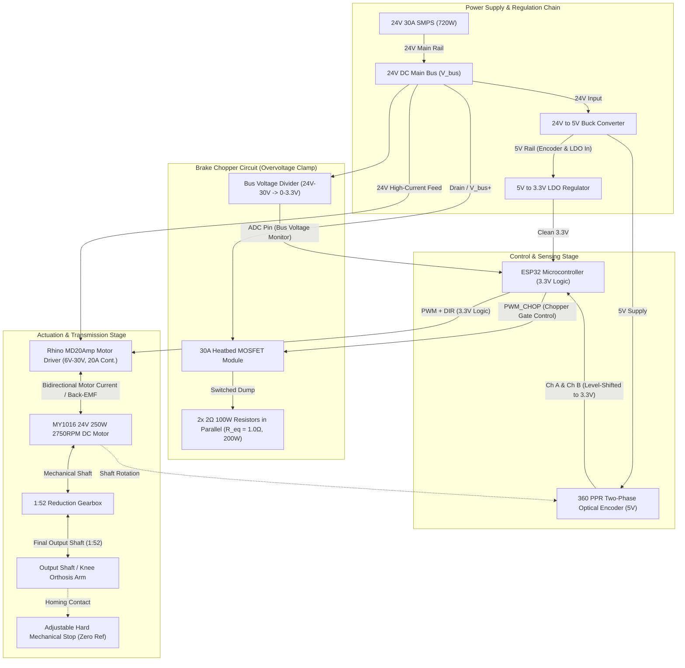
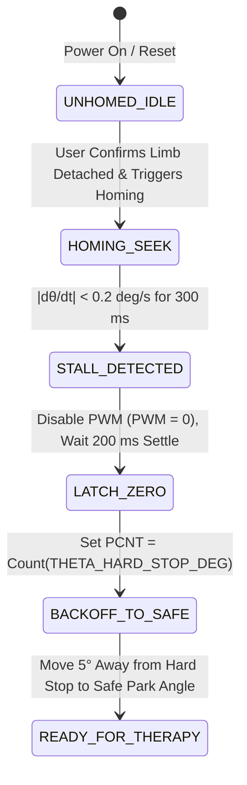
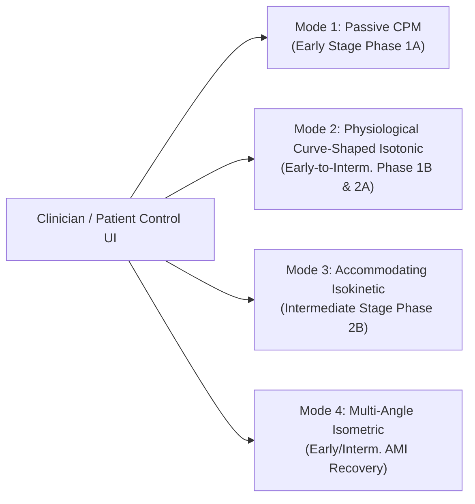
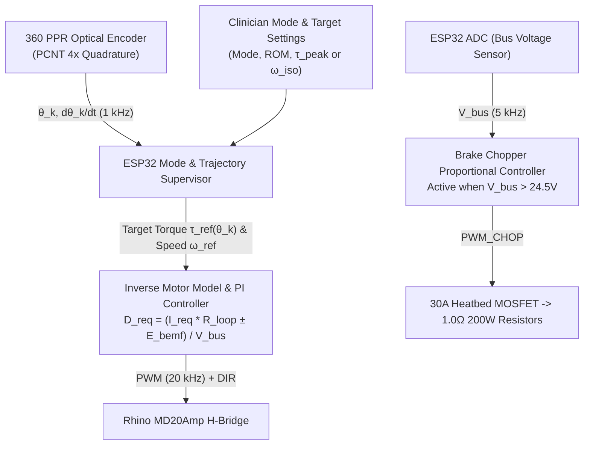

# Single-Arm Motorized Knee Rehabilitation System — Top Hub Motor Control & Clinical Biomechanics Specification

## 1. System Overview

This document details the electro-mechanical architecture, control theory, braking thermodynamics, encoder homing procedures, and clinical rehabilitation targets for the **Single-Arm Motorized Knee Rehabilitation System**. The system is engineered to administer medical-standard **Early-Stage** and **Intermediate-Stage** knee flexion/extension rehabilitation protocols (post-ACL reconstruction, Total Knee Arthroplasty, meniscal repair, and general orthopedic recovery) on one limb at a time.

---

## 2. Hardware Architecture & Bill of Materials

### 2.1 Core Component Specifications

| Subsystem | Component | Key Ratings & Specifications | Functional Role |
| :--- | :--- | :--- | :--- |
| **Main Actuator** | **MY1016 Brushed DC Motor** | $24\,\text{V}$ DC, $250\,\text{W}$ rated, $2750\,\text{RPM}$ rated ($\sim 3300\,\text{RPM}$ no-load), $I_{\text{rated}} \approx 13.5\,\text{A}$, $\tau_{\text{rated}} \approx 0.87\,\text{N}\cdot\text{m}$, $R_a \approx 0.33\,\Omega$ | Primary electro-mechanical torque source (driving & back-driven braking) |
| **Transmission** | **1:52 Reduction Gearbox** | Ratio $G = 52:1$, coupled directly to the final output shaft | Amplifies motor torque by $52\times$ and scales speed to physiological knee velocities |
| **Motor Driver** | **Rhino MD20Amp DC Motor Driver** | $6\,\text{V}\text{–}30\,\text{V}$ DC, 1-Channel Full NMOS H-Bridge, $20\,\text{A}$ Continuous / $60\,\text{A}$ Peak ($10\,\text{s}$), PWM up to $20\,\text{kHz}$, `PWM` + `DIR` logic ($1.8\,\text{V}\text{–}12\,\text{V}$) | Bidirectional 4-quadrant/2-quadrant motor drive, active current limiting ($20\,\text{A}$), and low-side dynamic shorting |
| **Main Power Supply** | **24V 30A SMPS** | $24\,\text{V}$ DC, $30\,\text{A}$ max ($720\,\text{W}$) | Supplies primary DC power bus ($V_{\text{bus}}$) |
| **Brake Chopper Switch** | **3D Printer 30A Heatbed MOSFET Module** | High-current NMOS module ($30\,\text{A}$ continuous), opto-isolated/buffered PWM control input | Switches regenerative braking energy from the $24\,\text{V}$ bus into the braking resistor bank |
| **Braking Resistors** | **2$\times$ $2\,\Omega$, $100\,\text{W}$ Aluminum-Shell Resistors** | Wired **in parallel** $\implies R_{\text{eq}} = 1.0\,\Omega$, $P_{\text{rated}} = 200\,\text{W}$ continuous ($625\,\text{W}$ peak at $25\,\text{V}$) | Dissipates regenerative energy as heat when the motor is back-driven by the patient, clamping $V_{\text{bus}} < 26.5\,\text{V}$ |
| **Position Sensor** | **2-Phase Incremental Optical Rotary Encoder** | $360\,\text{PPR}$ (Pulses Per Revolution), Quadrature A/B channels ($1440\,\text{CPR}$ at $4\times$ decoding), $5\,\text{V}$ supply | Tracks shaft angle ($\theta$) and angular velocity ($\dot{\theta}$) for closed-loop control |
| **Power Regulation** | **24V$\rightarrow$5V Buck + 5V$\rightarrow$3.3V LDO** | Stage 1: $24\,\text{V}$ to $5\,\text{V}$ DC-DC Buck Converter Stage 2: $5\,\text{V}$ to $3.3\,\text{V}$ Linear LDO Regulator | Buck supplies $5\,\text{V}$ to Optical Encoder & LDO input; LDO filters switching ripple to provide clean $3.3\,\text{V}$ for ESP32 |
| **Controller** | **ESP32 Microcontroller** | Dual-core $240\,\text{MHz}$, hardware `MCPWM` / `LEDC`, hardware `PCNT` quadrature decoder, $12\text{-bit}$ ADC | Executes real-time angle/velocity/torque control loops, brake chopper PWM regulation, homing, and UI telemetry |

---

### 2.2 System Block & Power/Signal Flow Diagram

---

## 3. Electro-Mechanical Modeling & Hardware Capability Analysis

To establish realistic clinical targets, we first derive the exact electro-mechanical parameters of the **MY1016 24V 250W motor + 1:52 gearbox + Rhino MD20Amp driver**.

### 3.1 MY1016 Motor Constants
From the rated specifications ($V_{\text{rated}} = 24\,\text{V}$, $P_{\text{mech}} = 250\,\text{W}$, $N_{\text{rated}} = 2750\,\text{RPM}$, $N_0 \approx 3300\,\text{RPM}$, $I_{\text{rated}} \approx 13.5\,\text{A}$, $I_0 \approx 1.0\,\text{A}$):

1. **Rated Angular Velocity ($\omega_{m,\text{rated}}$) & No-Load Velocity ($\omega_{m,0}$):**
   $$\omega_{m,\text{rated}} = \frac{2750 \times 2\pi}{60} \approx 287.98\,\text{rad/s}, \qquad \omega_{m,0} = \frac{3300 \times 2\pi}{60} \approx 345.58\,\text{rad/s}$$

2. **Rated Motor Shaft Torque ($\tau_{m,\text{rated}}$):**
   $$\tau_{m,\text{rated}} = \frac{P_{\text{mech}}}{\omega_{m,\text{rated}}} = \frac{250\,\text{W}}{287.98\,\text{rad/s}} \approx 0.868\,\text{N}\cdot\text{m}$$

3. **Back-EMF Constant ($K_e$) & Torque Constant ($K_t$):**
   $$K_e = K_t \approx \frac{V_{\text{rated}}}{\omega_{m,0}} = \frac{24\,\text{V}}{345.58\,\text{rad/s}} \approx 0.0694\,\text{V}/(\text{rad/s}) = 0.0694\,\text{N}\cdot\text{m/A} \quad (\approx 0.00727\,\text{V/RPM})$$

4. **Armature Winding Resistance ($R_a$) & Loop Resistance ($R_{\text{loop}}$):**
   At $2750\,\text{RPM}$, $E_{\text{bemf}} = K_e \omega_{m,\text{rated}} \approx 20.0\,\text{V}$. With $I_{\text{rated}} \approx 13.5\,\text{A}$:
   $$R_a = \frac{V_{\text{rated}} - E_{\text{bemf}}}{I_{\text{rated}}} = \frac{24.0 - 20.0}{13.5} \approx 0.30\,\Omega \text{ (cold)} \text{ to } 0.35\,\Omega \text{ (warm)}$$
   Including Rhino MD20Amp MOSFET $R_{\text{DS(on)}}$ and wiring resistance, the total armature loop resistance is:
   $$R_{\text{loop}} \approx 0.40\,\Omega$$
   *(Check: Unclamped stall current at $24\,\text{V}$ is $24 / 0.33 \approx 72.7\,\text{A}$, matching the MY1016 datasheet stall specification of $72\,\text{A}$; the Rhino MD20Amp actively clamps current to $20\,\text{A}$ continuous).*

---

### 3.2 Gearbox ($1:52$) Output Kinematics & Asymmetry of Efficiency

With gear reduction ratio $G = 52$:

#### Speed Conversion Relationships
$$\text{RPM}_{\text{out}} = \frac{\text{RPM}_{\text{motor}}}{52}, \qquad \dot{\theta}_k\,(^\circ/\text{s}) = 6 \times \text{RPM}_{\text{out}} = \frac{6}{52}\,\text{RPM}_{\text{motor}} \approx 0.1154 \times \text{RPM}_{\text{motor}}$$

* **Output Speed at Rated Motor Speed ($2750\,\text{RPM}$):** $52.88\,\text{RPM}_{\text{out}} = \mathbf{317.3^\circ/\text{s}}$
* **Output Speed at No-Load Motor Speed ($3300\,\text{RPM}$):** $63.46\,\text{RPM}_{\text{out}} = \mathbf{380.8^\circ/\text{s}}$

#### Torque Conversion: Forward Driving vs. Back-Driven Resistance
A multi-stage $1:52$ gearbox exhibits forward efficiency $\eta_{\text{fwd}} \approx 0.80$ and back-driving efficiency $\eta_{\text{back}} \approx 0.75$, along with a baseline static/viscous reflected friction drag $\tau_{\text{fric}} \approx 3.5\,\text{N}\cdot\text{m}$.

* **When Motor Drives the Knee (Active-Assist / CPM Mode):**
  Gearbox friction opposes the motor, reducing output torque:
  $$\tau_{\text{out,drive}} = G \cdot \eta_{\text{fwd}} \cdot K_t (I_m - I_0) = 52 \times 0.80 \times 0.0694 \cdot (I_m - 1.0) \approx 2.89\,(I_m - 1.0)\,\text{N}\cdot\text{m}$$
* **When Patient Back-Drives the Motor (Resistive / Isotonic / Isokinetic Mode):**
  The patient must overcome **both** the gearbox's mechanical inefficiency and the motor's electromagnetic counter-torque. Therefore, gearbox losses *multiply* the effective resistive torque felt by the patient:
  $$\tau_{\text{out,resist}} = \frac{G}{\eta_{\text{back}}} \cdot K_t I_m + \tau_{\text{fric}} = \frac{52}{0.75} \times 0.0694 \cdot I_m + 3.5 \approx (4.81 \cdot I_m + 3.5)\,\text{N}\cdot\text{m}$$

### 3.3 Summary of Hardware Torque & Speed Envelope

| Operating Regime | Motor Current ($I_m$) | Motor Torque ($\tau_m$) | Driving Torque at Knee ($\tau_{\text{out,drive}}$) | Resistive Torque at Knee ($\tau_{\text{out,resist}}$) | Thermal / Duty Constraints |
| :--- | :---: | :---: | :---: | :---: | :--- |
| **Passive Freewheel (Coast)** | $0.0\,\text{A}$ | $0.0\,\text{N}\cdot\text{m}$ | $0.0\,\text{N}\cdot\text{m}$ | $\sim 3.5\text{–}5.0\,\text{N}\cdot\text{m}$ | Continuous (mechanical friction + inertia only) |
| **Continuous Rated (MY1016 Limit)** | $13.5\,\text{A}$ | $0.87\,\text{N}\cdot\text{m}$ | **$36.1\,\text{N}\cdot\text{m}$** | **$68.4\,\text{N}\cdot\text{m}$** | $100\%$ continuous duty cycle |
| **Driver Continuous Limit (Rhino MD20A)** | $20.0\,\text{A}$ | $1.32\,\text{N}\cdot\text{m}$ | **$54.9\,\text{N}\cdot\text{m}$** | **$99.7\,\text{N}\cdot\text{m}$** (use **$90\,\text{N}\cdot\text{m}$** safe cap) | Continuous for driver; $\sim 3\text{–}5\,\text{min}$ intermittent for motor thermal limit |

> [!IMPORTANT]
> **Mechanical Gearbox Protection:** While the Rhino MD20Amp + MY1016 can electromagnetically generate nearly $100\,\text{N}\cdot\text{m}$ of back-driven resistance at $20\,\text{A}$, software current/PWM limits must cap maximum target knee torque to **$85\text{–}90\,\text{N}\cdot\text{m}$** (or lower if dictated by the mechanical shear rating of the $1:52$ gearbox output stage).

---

## 4. Operating Modes for Motor Control & Resistance Generation

Because the Rhino MD20Amp uses a **Sign-Magnitude (`PWM` + `DIR`) NMOS H-Bridge** and lacks an onboard current sensor, understanding how each electrical operating mode generates resistance across different knee velocities is essential.

### Mode 1: Active Forward Driving (Motoring — Quadrant I & III)
* **Use Case:** Continuous Passive Motion (CPM) and Active-Assisted ROM.
* **Mechanism:** The ESP32 sets `DIR` to match the desired motion direction and modulates `PWM` duty cycle $D \in [0, 1]$ so that $V_{\text{app}} = D \cdot V_{\text{bus}} > E_{\text{bemf}}$.
* **Governing Equation:**
  $$I_m = \frac{D \cdot V_{\text{bus}} - K_e G \omega_k}{R_{\text{loop}}}, \qquad \tau_{\text{knee}} = G \eta_{\text{fwd}} K_t (I_m - I_0)$$
* **Power Flow:** Draws power from the $24\,\text{V}$ SMPS ($P_{\text{psu}} = D \cdot V_{\text{bus}} \cdot I_m$). No brake chopper activation during steady movement.

---

### Mode 2: Dynamic Braking / Armature Shorting (Passive Electromagnetic Damping)
* **Use Case:** Medium-to-high velocity resistive training ($45^\circ/\text{s} \text{ to } 180^\circ/\text{s}$) with zero power drawn from the $24\,\text{V}$ supply.
* **Mechanism:** In Sign-Magnitude mode on the Rhino MD20Amp, holding `PWM = LOW` ($D = 0\%$) turns ON both low-side NMOS FETs, short-circuiting the motor terminals across $R_{\text{loop}} \approx 0.40\,\Omega$. When the patient moves the knee at angular velocity $\omega_k$, the back-driven motor acts as a generator:
  $$E_{\text{bemf}}(\dot{\theta}_k) = K_e G \omega_k \approx 0.0629 \times \dot{\theta}_k\,(^\circ/\text{s})\;\text{[Volts]}$$
* **Short-Circuit Current & Resistive Torque (at $100\%$ Shorting):**
  $$I_{\text{short}}(\dot{\theta}_k) = \frac{E_{\text{bemf}}(\dot{\theta}_k)}{R_{\text{loop}}} \approx 0.157 \times \dot{\theta}_k\,(^\circ/\text{s})\;\text{[Amps]}$$
  $$\tau_{\text{short}}(\dot{\theta}_k) = \frac{G}{\eta_{\text{back}}} K_t I_{\text{short}} + \tau_{\text{fric}} \approx \mathbf{0.758 \times \dot{\theta}_k\,(^\circ/\text{s}) + 3.5\;\text{[N}\cdot\text{m]}}$$

#### Crucial Limitation of Pure Armature Shorting at Low Speeds
| Knee Angular Speed ($\dot{\theta}_k$) | Output Shaft Speed ($\text{RPM}_{\text{out}}$) | Motor Speed ($\text{RPM}_{\text{motor}}$) | Generated $E_{\text{bemf}}$ | Max Shorting Current ($I_{\text{short}}$) | Max Shorting Torque ($\tau_{\text{short}}$) | Clinical Sufficiency |
| :---: | :---: | :---: | :---: | :---: | :---: | :--- |
| **$0^\circ/\text{s}$ (Isometric)** | $0.0\,\text{RPM}$ | $0\,\text{RPM}$ | $0.00\,\text{V}$ | $0.00\,\text{A}$ | **$3.5\,\text{N}\cdot\text{m}$** | Insufficient (only friction) |
| **$15^\circ/\text{s}$** | $2.5\,\text{RPM}$ | $130\,\text{RPM}$ | $0.94\,\text{V}$ | $2.36\,\text{A}$ | **$14.9\,\text{N}\cdot\text{m}$** | Light early rehab only |
| **$30^\circ/\text{s}$** | $5.0\,\text{RPM}$ | $260\,\text{RPM}$ | $1.89\,\text{V}$ | $4.72\,\text{A}$ | **$26.2\,\text{N}\cdot\text{m}$** | Moderate early/interm. rehab |
| **$60^\circ/\text{s}$** | $10.0\,\text{RPM}$ | $520\,\text{RPM}$ | $3.78\,\text{V}$ | $9.45\,\text{A}$ | **$49.0\,\text{N}\cdot\text{m}$** | Strong intermediate rehab |
| **$90^\circ/\text{s}$** | $15.0\,\text{RPM}$ | $780\,\text{RPM}$ | $5.67\,\text{V}$ | $14.17\,\text{A}$ | **$71.7\,\text{N}\cdot\text{m}$** | High intermediate rehab |
| **$120^\circ/\text{s}$** | $20.0\,\text{RPM}$ | $1040\,\text{RPM}$ | $7.56\,\text{V}$ | $18.90\,\text{A}$ | **$94.5\,\text{N}\cdot\text{m}$** | Reaches $20\,\text{A}$ driver limit |

> [!NOTE]
> **Why Shorting Alone Is Not Enough:** As shown above, at **$0^\circ/\text{s}$ (isometric)** or **slow rehabilitation speeds ($10^\circ/\text{s}\text{–}45^\circ/\text{s}$)**, back-EMF is too small ($< 2.8\,\text{V}$) to drive high braking current through $R_{\text{loop}} = 0.40\,\Omega$. To achieve $30\text{–}85\,\text{N}\cdot\text{m}$ of resistance at low speeds, the controller **must** use **Mode 3 (Active Plugging / Counter-Current Injection)**.

---

### Mode 3: Active Counter-Current Braking / Plugging (Quadrant II & IV)
* **Use Case:** Isometric holds ($0^\circ/\text{s}$), low-speed Isotonic resistance ($5^\circ/\text{s}\text{–}60^\circ/\text{s}$), and high-torque Isokinetic resistance where target torque exceeds $\tau_{\text{short}}(\dot{\theta}_k)$.
* **Mechanism:** The ESP32 sets `DIR` **opposite** to the patient's direction of movement and applies a controlled PWM duty cycle $D_{\text{plug}}$. Now, the applied bus voltage $D_{\text{plug}} V_{\text{bus}}$ and the patient's back-EMF $E_{\text{bemf}}(\dot{\theta}_k)$ **add in series** across $R_{\text{loop}}$:
  $$I_m = \frac{D_{\text{plug}} \cdot V_{\text{bus}} + E_{\text{bemf}}(\dot{\theta}_k)}{R_{\text{loop}}}$$
* **Required PWM Duty Cycle to Achieve Any Target Resistive Torque $\tau_{\text{target}}$ at Speed $\dot{\theta}_k$:**
  First, compute required motor current:
  $$I_{\text{req}} = \frac{\tau_{\text{target}} - \tau_{\text{fric}}}{4.81}\;\text{[Amps]}$$
  Then compute the required plugging PWM duty cycle:
  $$D_{\text{plug}}(\tau_{\text{target}}, \dot{\theta}_k) = \frac{I_{\text{req}} \cdot R_{\text{loop}} - 0.0629 \cdot \dot{\theta}_k}{V_{\text{bus}}}$$
  * **Example 1 (Isometric Hold of $60\,\text{N}\cdot\text{m}$ at $\dot{\theta}_k = 0^\circ/\text{s}$):**
    $I_{\text{req}} = (60 - 3.5)/4.81 = 11.75\,\text{A} \implies D_{\text{plug}} = (11.75 \times 0.40 - 0)/24 = \mathbf{19.6\%}$ PWM.
  * **Example 2 ($60\,\text{N}\cdot\text{m}$ Resistance at $\dot{\theta}_k = 30^\circ/\text{s}$):**
    $I_{\text{req}} = 11.75\,\text{A}$, $E_{\text{bemf}} = 1.89\,\text{V} \implies D_{\text{plug}} = (4.70 - 1.89)/24 = \mathbf{11.7\%}$ PWM.

---

### Mode 4: Regenerative Boosting & Brake Chopper Activation
* **When Does $V_{\text{bus}}$ Rise Above $24\,\text{V}$?**
  When the motor is back-driven at moderate-to-high speeds ($\ge 60^\circ/\text{s}$) where $I_{\text{short}}(\dot{\theta}_k) > I_{\text{req}}$ (for example, the patient moves at $120^\circ/\text{s}$ where full shorting would create $94.5\,\text{N}\cdot\text{m}$, but the prescription calls for only $40\,\text{N}\cdot\text{m}$), or during rapid deceleration/direction transitions, the H-bridge must modulate PWM with `DIR` aligned with motion ($V_{\text{app}}$ opposing $E_{\text{bemf}}$) or switch out of low-side shorting.
  During the PWM switching cycle, the motor's armature inductance $L_a$ and the H-bridge MOSFETs/body diodes act as a **synchronous boost converter**, pumping inductive current **back into the $24\,\text{V}$ DC bus**.
  Because the **24V 30A SMPS is unidirectional** (cannot sink reverse current), this pumped charge accumulates on the bus capacitors, causing $V_{\text{bus}}$ to rise rapidly toward the Rhino MD20Amp's $30\,\text{V}$ maximum rating.

#### Brake Chopper Engineering Calculations
* **Resistor Bank:** Two $2\,\Omega, 100\,\text{W}$ aluminum-housed resistors in parallel:
  $$R_{\text{chop}} = \frac{2\,\Omega \times 2\,\Omega}{2\,\Omega + 2\,\Omega} = 1.0\,\Omega, \qquad P_{\text{chop,cont}} = 100\,\text{W} + 100\,\text{W} = 200\,\text{W}$$
* **Peak Dump Current & Power (at $V_{\text{bus}} = 25.0\,\text{V}$, $100\%$ Chopper Duty):**
  $$I_{\text{chop,max}} = \frac{25.0\,\text{V}}{1.0\,\Omega} = 25.0\,\text{A} \quad (< 30\,\text{A MOSFET module rating})$$
  $$P_{\text{chop,peak}} = \frac{(25.0\,\text{V})^2}{1.0\,\Omega} = 625\,\text{W}$$
* **Proportional Chopper Control Law (Executed on ESP32 at $\ge 5\,\text{kHz}$):**
  The ESP32 continuously samples $V_{\text{bus}}$ via a resistor voltage divider (e.g., $100\,\text{k}\Omega / 10\,\text{k}\Omega$, scaling $30\,\text{V} \rightarrow 2.73\,\text{V}$ at the ADC) and drives the 30A MOSFET module gate with PWM duty cycle $D_{\text{chop}}$:
  $$D_{\text{chop}}(V_{\text{bus}}) = \begin{cases} 0\% & \text{if } V_{\text{bus}} \le 24.5\,\text{V} \\ \left(\dfrac{V_{\text{bus}} - 24.5}{26.5 - 24.5}\right) \times 100\% & \text{if } 24.5\,\text{V} < V_{\text{bus}} < 26.5\,\text{V} \\ 100\% & \text{if } V_{\text{bus}} \ge 26.5\,\text{V} \end{cases}$$

---

## 5. Optical Encoder Resolution & Hard-Stop Homing Procedure

### 5.1 Angular Resolution Analysis
The **360 PPR Two-Phase Incremental Optical Encoder** outputs two quadrature square waves (Channels A & B, $90^\circ$ out of phase). Using the ESP32 hardware **Pulse Counter (`PCNT`)** peripheral in $4\times$ quadrature decoding mode (counting rising and falling edges of both A and B):
$$\text{Counts Per Encoder Revolution (CPR)} = 360 \times 4 = 1440\,\text{counts/rev}$$

Depending on mechanical placement:
1. **Mounted on Motor Shaft (High-Speed Side):**
   $$\text{Counts per Output Shaft Rev} = 1440 \times 52 = 74,880\,\text{counts/rev} \implies \Delta\theta_k = \mathbf{0.00481^\circ/\text{count}}\;(\approx 208\,\text{counts/deg})$$
   *Provides ultra-high velocity estimation resolution at low CPM speeds ($1^\circ/\text{s} = 208\,\text{counts/s}$), subject to $\sim 0.5^\circ\text{–}1.5^\circ$ gearbox backlash.*
2. **Mounted on Gearbox Output Shaft (Low-Speed Knee Side):**
   $$\text{Counts per Output Shaft Rev} = 1440\,\text{counts/rev} \implies \Delta\theta_k = \mathbf{0.25^\circ/\text{count}}\;(4\,\text{counts/deg})$$
   *Directly measures true knee arm angle with zero backlash error.*

> [!TIP]
> **5V Encoder to 3.3V ESP32 Interfacing:** Because the optical encoder is powered from the $5\,\text{V}$ buck rail, its A/B outputs must not drive $5\,\text{V}$ directly into $3.3\,\text{V}$ ESP32 GPIOs. If the encoder has **NPN open-collector** outputs, pull A and B up to the **$3.3\,\text{V}$ LDO rail** via $4.7\,\text{k}\Omega$ resistors. If it has **push-pull $5\,\text{V}$** outputs, use a resistive divider ($2.2\,\text{k}\Omega$ series / $3.3\,\text{k}\Omega$ to GND) or high-speed logic level shifter on Channels A and B.

---

### 5.2 Hard Mechanical Stop Homing Procedure (Configurable Reference Angle)
Because an incremental optical encoder loses its absolute position on power-down, a **Hard Mechanical Stop** is used to establish a repeatable datum at startup. Since the physical mounting angle of the hard stop ($\theta_{\text{stop}}$) is not yet fixed in hardware, the firmware parameterizes it via a single calibration constant `THETA_HARD_STOP_DEG` (e.g., $\theta_{\text{stop}} = 0.0^\circ$ if placed at full extension, or $\theta_{\text{stop}} = 125.0^\circ$ if placed at full flexion).

#### Step-by-Step Homing Algorithm
1. **Safety Interlock Check:** Before homing, the UI prompts confirmation that the patient's leg is **not** strapped into the orthosis arm (or, if manual homing is selected, the clinician manually seats the arm against the hard stop and presses *"Zero Encoder"*).
2. **Low-Torque Creep (`HOMING_SEEK`):** The ESP32 commands a slow creep toward the hard stop direction at a capped PWM duty cycle ($D_{\text{home}} \approx 8\text{–}10\%$, limiting contact torque to $< 10\,\text{N}\cdot\text{m}$ and speed to $\sim 3^\circ/\text{s}$).
3. **Contact / Stall Detection (`STALL_DETECTED`):** When the arm contacts the mechanical stop, encoder pulse rate drops to zero. When $|\dot{\theta}_k| < 0.2^\circ/\text{s}$ continuously for $300\,\text{ms}$, contact is confirmed.
4. **Zero-Point Latching (`LATCH_ZERO`):** Motor PWM is immediately set to $0\%$ for $200\,\text{ms}$ to release elastic windup in the gearbox, and the encoder counter is initialized to:
   $$\text{Count}_{\text{init}} = \text{round}\left(\frac{\theta_{\text{stop}}}{\Delta\theta_k}\right)$$
   At any subsequent count $C$, the anatomical knee angle is:
   $$\theta_k(C) = \theta_{\text{stop}} + (C - \text{Count}_{\text{init}}) \cdot \Delta\theta_k$$
5. **Soft Limit Stand-Off (`BACKOFF_TO_SAFE`):** The controller drives the arm $5^\circ$ away from the hard stop and establishes software travel limits $[\theta_{\text{stop}} + 2^\circ,\; \theta_{\text{max,mech}} - 2^\circ]$ so the arm never strikes the mechanical stop during active therapy sessions.

---

## 6. Medical Biomechanics of the Knee & Physiological Resistance Curve

### 6.1 Angle Convention
Throughout clinical literature and this control specification:
* **$\theta_k = 0^\circ$:** Full anatomical knee extension (leg straight).
* **$\theta_k = 90^\circ$:** Seated neutral flexion (tibia perpendicular to femur).
* **$\theta_k = 120^\circ\text{–}135^\circ$:** Deep knee flexion.

### 6.2 Clinical Torque-Angle Relationships
Human knee torque capacity varies dramatically across the Range of Motion (ROM) due to sarcomere **length-tension relationships** and the changing **patellar tendon / hamstring moment arm**:

1. **Quadriceps (Knee Extension: $120^\circ \rightarrow 0^\circ$):**
   * **Peak Torque Zone ($50^\circ\text{–}70^\circ$):** Peak quadriceps torque occurs around **$60^\circ$ of flexion** ($100\%$ capacity), where both the patellar tendon moment arm and vasti fiber length are optimal.
   * **Terminal Extension Drop-Off & ACL/Patellofemoral Shear Zone ($40^\circ \rightarrow 0^\circ$):** Mechanical advantage and muscle length drop rapidly toward $0^\circ$ (falling to $\sim 70\%$ at $30^\circ$, $\sim 45\%$ at $15^\circ$, and $\sim 25\text{–}30\%$ at $0^\circ$). Furthermore, in Open Kinetic Chain (OKC) extension between **$40^\circ$ and $0^\circ$**, the patellar tendon pulls anteriorly on the tibia, generating peak **anterior tibial shear force** (which strains healing ACL grafts) and high **patellofemoral contact stress**.
   * **Deep Flexion Drop-Off ($75^\circ \rightarrow 120^\circ$):** Torque declines to $\sim 60\%$ at $90^\circ$ and $\sim 35\%$ at $120^\circ$, while patellofemoral compressive force increases sharply.

2. **Hamstrings (Knee Flexion: $0^\circ \rightarrow 120^\circ$):**
   * **Hamstring-to-Quadriceps (H/Q) Ratio:** Healthy and rehabilitating knees exhibit a peak hamstring torque equal to **$50\%\text{–}60\%$ of peak quadriceps torque** ($H/Q \approx 0.55$).
   * **Peak Torque Zone ($20^\circ\text{–}35^\circ$):** Hamstrings generate maximum flexion torque near **$25^\circ\text{–}30^\circ$ of flexion** ($100\%$ of hamstring peak).
   * **Flexion Shortening Drop-Off ($45^\circ \rightarrow 120^\circ$):** As the knee bends deeper, the hamstrings shorten and lose leverage, dropping to $\sim 85\%$ at $45^\circ$, $\sim 70\%$ at $60^\circ$, $\sim 50\%$ at $90^\circ$, and $\sim 30\%$ at $120^\circ$.

3. **Limb Gravity Compensation ($\tau_{\text{grav}}$):**
   For a seated patient, the weight of the lower leg, foot, and orthosis arm produces a gravitational torque:
   $$\tau_{\text{grav}}(\theta_k) = \tau_{g,0} \cos(\theta_k), \qquad \tau_{g,0} \approx 10\text{–}14\,\text{N}\cdot\text{m}$$
   Gravity **opposes** extension (peaking at $0^\circ$) and **assists** flexion.

---

### 6.3 Master Target Table: Knee Angle, RPM, Torque, and Motor Control Parameters

The table below synthesizes the clinical torque-angle curves and maps them directly onto our **MY1016 + 1:52 Gearbox + Rhino MD20Amp** hardware across **four progressive rehabilitation tiers**:
1. **Stage 1A — Early Rehab (CPM Passive Mobilization):** Motor drives the limb passively ($1^\circ/\text{s}\text{–}3^\circ/\text{s}$).
2. **Stage 1B — Early Active / Protected Rehab:** Low accommodating resistance ($\tau_{\text{ext,peak}} = 20\,\text{N}\cdot\text{m}$, $\tau_{\text{flex,peak}} = 12\,\text{N}\cdot\text{m}$) at slow speeds ($15^\circ/\text{s}\text{–}30^\circ/\text{s}$).
3. **Stage 2A — Intermediate Rehab Level 1 (Progressive Isotonic/Isokinetic):** Moderate resistance ($\tau_{\text{ext,peak}} = 45\,\text{N}\cdot\text{m}$, $\tau_{\text{flex,peak}} = 25\,\text{N}\cdot\text{m}$) at moderate speeds ($45^\circ/\text{s}\text{–}60^\circ/\text{s}$).
4. **Stage 2B — Intermediate Rehab Level 2 (High-Load Hardware Ceiling):** High resistance ($\tau_{\text{ext,peak}} = 80\,\text{N}\cdot\text{m}$, $\tau_{\text{flex,peak}} = 45\,\text{N}\cdot\text{m}$) at intermediate speeds ($60^\circ/\text{s}\text{–}90^\circ/\text{s}$).

#### Table 6.3A: Angle-Specific Torque Targets Across Rehabilitation Stages

| Knee Angle ($\theta_k$) | Physiological Curve Multiplier (Ext / Flex) | **Stage 1A: Early CPM** Driving Torque Needed (at $1.8^\circ/\text{s} = 0.3\,\text{RPM}_{\text{out}}$) | **Stage 1B: Early Active** Target Resistive Torque Ext / Flex ($\text{N}\cdot\text{m}$) | **Stage 2A: Interm. L1** Target Resistive Torque Ext / Flex ($\text{N}\cdot\text{m}$) | **Stage 2B: Interm. L2** Target Resistive Torque Ext / Flex ($\text{N}\cdot\text{m}$) | Clinical & Anatomical Rationale at Angle |
| :---: | :---: | :---: | :---: | :---: | :---: | :--- |
| **$0^\circ$ (Full Ext)** | $25\% \;/\; 80\%$ | $+15.0\,\text{N}\cdot\text{m}$ (Hold/Drive) | **$5.0 \;/\; 9.6\,\text{N}\cdot\text{m}$** | **$11.3 \;/\; 20.0\,\text{N}\cdot\text{m}$** | **$20.0 \;/\; 36.0\,\text{N}\cdot\text{m}$** | Terminal extension lock; high ACL shear in Ext; strong hamstring leverage in Flex |
| **$15^\circ$** | $45\% \;/\; 95\%$ | $+14.5\,\text{N}\cdot\text{m}$ | **$9.0 \;/\; 11.4\,\text{N}\cdot\text{m}$** | **$20.3 \;/\; 23.8\,\text{N}\cdot\text{m}$** | **$36.0 \;/\; 42.8\,\text{N}\cdot\text{m}$** | High ACL anterior shear zone (taper Ext load); near-peak hamstring length |
| **$30^\circ$** | $70\% \;/\; 100\%$ | $+13.0\,\text{N}\cdot\text{m}$ | **$14.0 \;/\; 12.0\,\text{N}\cdot\text{m}$** | **$31.5 \;/\; 25.0\,\text{N}\cdot\text{m}$** | **$56.0 \;/\; 45.0\,\text{N}\cdot\text{m}$** | **Peak Hamstring Flexion Torque ($30^\circ$)**; transition out of ACL shear zone |
| **$45^\circ$** | $90\% \;/\; 85\%$ | $+10.5\,\text{N}\cdot\text{m}$ | **$18.0 \;/\; 10.2\,\text{N}\cdot\text{m}$** | **$40.5 \;/\; 21.3\,\text{N}\cdot\text{m}$** | **$72.0 \;/\; 38.3\,\text{N}\cdot\text{m}$** | Safe OKC quad loading zone begins ($\ge 45^\circ$); strong quad moment arm |
| **$60^\circ$** | $100\% \;/\; 70\%$ | $+7.5\,\text{N}\cdot\text{m}$ | **$20.0 \;/\; 8.4\,\text{N}\cdot\text{m}$** | **$45.0 \;/\; 17.5\,\text{N}\cdot\text{m}$** | **$80.0 \;/\; 31.5\,\text{N}\cdot\text{m}$** | **Peak Quadriceps Extension Torque ($60^\circ$)**; zero ACL graft strain |
| **$75^\circ$** | $85\% \;/\; 60\%$ | $+4.5\,\text{N}\cdot\text{m}$ | **$17.0 \;/\; 7.2\,\text{N}\cdot\text{m}$** | **$38.3 \;/\; 15.0\,\text{N}\cdot\text{m}$** | **$68.0 \;/\; 27.0\,\text{N}\cdot\text{m}$** | High quad recruitment; declining hamstring moment arm |
| **$90^\circ$** | $60\% \;/\; 50\%$ | $+2.0\,\text{N}\cdot\text{m}$ | **$12.0 \;/\; 6.0\,\text{N}\cdot\text{m}$** | **$27.0 \;/\; 12.5\,\text{N}\cdot\text{m}$** | **$48.0 \;/\; 22.5\,\text{N}\cdot\text{m}$** | Standard seated rest angle ($\tau_{\text{grav}} \approx 0$); high patellofemoral compression |
| **$105^\circ$** | $45\% \;/\; 40\%$ | $-1.5\,\text{N}\cdot\text{m}$ | **$9.0 \;/\; 4.8\,\text{N}\cdot\text{m}$** | **$20.3 \;/\; 10.0\,\text{N}\cdot\text{m}$** | **$36.0 \;/\; 18.0\,\text{N}\cdot\text{m}$** | Deep flexion; soft-tissue capsule stretch |
| **$120^\circ$ (Deep Flex)** | $35\% \;/\; 30\%$ | $-4.0\,\text{N}\cdot\text{m}$ | **$7.0 \;/\; 3.6\,\text{N}\cdot\text{m}$** | **$15.8 \;/\; 7.5\,\text{N}\cdot\text{m}$** | **$28.0 \;/\; 13.5\,\text{N}\cdot\text{m}$** | End-range flexion target for standard TKA/ACLR protocols |

---

#### Table 6.3B: Motor Control Execution Table (RPMs, Currents, Modes, & PWM Targets at Key Operating Points)

| Rehab Stage & Exercise Type | Knee Velocity ($\dot{\theta}_k$) | Output Shaft Speed ($\text{RPM}_{\text{out}}$) | Motor Shaft Speed ($\text{RPM}_{\text{motor}}$) | Knee Angle ($\theta_k$) | Target Knee Torque ($\tau_{\text{knee}}$) | Required Motor Current ($I_m$) | Electrical Operating Mode | H-Bridge PWM Duty ($D_{\text{motor}}$) | Brake Chopper Status ($D_{\text{chop}}$) |
| :--- | :---: | :---: | :---: | :---: | :---: | :---: | :--- | :---: | :--- |
| **Stage 1A: CPM (Passive Ext)** | $1.8^\circ/\text{s}$ | $0.30\,\text{RPM}$ | $15.6\,\text{RPM}$ | $60^\circ \rightarrow 0^\circ$ | $+7.5 \rightarrow +15.0\,\text{N}\cdot\text{m}$ (Driving) | $3.6 \rightarrow 6.2\,\text{A}$ | **Mode 1: Active Forward Drive** | $6.5\% \rightarrow 10.8\%$ | OFF ($0\%$) |
| **Stage 1B: Early Isometric Hold** | $0.0^\circ/\text{s}$ | $0.00\,\text{RPM}$ | $0.0\,\text{RPM}$ | $60^\circ$ (Static) | $25.0\,\text{N}\cdot\text{m}$ (Resistive) | $4.47\,\text{A}$ | **Mode 3: Static Counter-Current** | $7.5\%$ (Opposing) | OFF ($0\%$) |
| **Stage 1B: Early Active Ext** | $24.0^\circ/\text{s}$ | $4.00\,\text{RPM}$ | $208.0\,\text{RPM}$ | $60^\circ$ (Peak) | $20.0\,\text{N}\cdot\text{m}$ (Resistive) | $3.43\,\text{A}$ | **Mode 2: Modulated Shorting** | $0.0\%$ (Low-side short pulsed at $87\%$) | Active on decel ($5\text{–}10\%$) |
| **Stage 2A: Interm. L1 Ext** | $45.0^\circ/\text{s}$ | $7.50\,\text{RPM}$ | $390.0\,\text{RPM}$ | $60^\circ$ (Peak) | $45.0\,\text{N}\cdot\text{m}$ (Resistive) | $8.63\,\text{A}$ | **Mode 3: Active Plugging** | $2.6\%$ (Opposing) + Shorting | Active on transitions ($10\text{–}15\%$) |
| **Stage 2A: Interm. L1 Flex** | $45.0^\circ/\text{s}$ | $7.50\,\text{RPM}$ | $390.0\,\text{RPM}$ | $30^\circ$ (Peak) | $25.0\,\text{N}\cdot\text{m}$ (Resistive) | $4.47\,\text{A}$ | **Mode 2/4: Modulated Braking / Regen** | $4.4\%$ (Aligned to reduce shorting drag) | **ON** ($\sim 10\text{–}20\%$ when $V_{\text{bus}} > 24.5\,\text{V}$) |
| **Stage 2B: Interm. L2 Ext** | $60.0^\circ/\text{s}$ | $10.00\,\text{RPM}$ | $520.0\,\text{RPM}$ | $60^\circ$ (Peak) | $80.0\,\text{N}\cdot\text{m}$ (Resistive) | $15.90\,\text{A}$ | **Mode 3: Active Plugging** | $10.8\%$ (Opposing) | Active on release |
| **Stage 2B: Interm. L2 Ext (Fast)** | $90.0^\circ/\text{s}$ | $15.00\,\text{RPM}$ | $780.0\,\text{RPM}$ | $60^\circ$ (Peak) | $80.0\,\text{N}\cdot\text{m}$ (Resistive) | $15.90\,\text{A}$ | **Mode 3: Light Plugging + Shorting** | $2.9\%$ (Opposing) | Active on decel ($15\text{–}25\%$) |
| **Stage 2B: Interm. L2 Terminal** | $90.0^\circ/\text{s}$ | $15.00\,\text{RPM}$ | $780.0\,\text{RPM}$ | $15^\circ$ (Tapered) | $36.0\,\text{N}\cdot\text{m}$ (Resistive) | $6.76\,\text{A}$ | **Mode 4: Regen Torque Taper** | $12.3\%$ (Aligned to relieve shorting drag) | **ON** ($\sim 20\text{–}35\%$ dumping regen energy) |

---

## 7. Clinical & Industry Evaluation of User / Clinician Control Paradigms

### 7.1 Why "Fixed RPM + Fixed Resistance Simultaneously" Is Physically Invalid
A fundamental principle of mechanics is that **angular velocity ($\dot{\theta}_k$) and interaction torque ($\tau_k$) cannot both be independently fixed at the same time** when a human patient is actively pushing against the actuator:
* If the machine forces a **fixed velocity (RPM)** while the patient pushes with variable muscular effort, the machine's resistance **must vary dynamically** to match the patient's effort (this is **Isokinetic** training).
* Conversely, if the machine applies a **fixed resistance (or fixed angle-torque curve)**, the resulting angular velocity **will vary dynamically** depending on how hard the patient pushes (this is **Isotonic** training).
* Only when the patient is **100% passive (zero voluntary effort)** can the machine dictate a fixed RPM with predictable driving torque (this is **CPM**).

### 7.2 Industry & Medical Gold-Standard Control Modes to Implement
Based on clinical protocols used in commercial medical systems (**Kinetec / OptiFlex CPMs** for early rehab, and **Biodex System 4 / Cybex Humac Norm** for intermediate rehab), the user/clinician interface should be organized into **Four Distinct Clinical Operating Modes** rather than raw motor controls:

#### 1. Mode 1: Continuous Passive Motion (CPM Mode — Early Stage Phase 1A)
* **Clinical Goal:** Restore passive ROM, promote synovial fluid diffusion, prevent scar adhesions without active muscle contraction.
* **What the User/Clinician Sets (Fixed for Session):**
  1. **Extension Limit ($\theta_{\text{min}}$) & Flexion Limit ($\theta_{\text{max}}$):** e.g., $0^\circ \text{ to } 90^\circ$ (incremented by $5^\circ\text{–}10^\circ$ daily).
  2. **Target Speed ($\dot{\theta}_{\text{cpm}}$):** Set in $^\circ/\text{s}$ or $\text{RPM}_{\text{out}}$ (e.g., $1.0^\circ/\text{s} \text{ to } 5.0^\circ/\text{s}$, i.e., $0.17\text{–}0.83\,\text{RPM}_{\text{out}}$).
  3. **End-Range Pause Hold Time ($t_{\text{hold}}$):** $0\text{–}30\,\text{s}$ pause at peak flexion/extension for viscoelastic tissue creep.
  4. **Safety Spasm Reversal Threshold ($\tau_{\text{spasm}}$):** e.g., $15\text{–}25\,\text{N}\cdot\text{m}$ (inferred from velocity error / PWM effort). If the patient guards or spasms, the motor immediately stops and reverses direction.

#### 2. Mode 2: Physiological Curve-Shaped Isotonic Mode (Early-to-Intermediate Phase 1B & 2A)
* **Why Raw Constant Torque Fails Clinically:** If a clinician sets a flat $40\,\text{N}\cdot\text{m}$ resistance across the entire $90^\circ \rightarrow 0^\circ$ arc, the patient can easily move through $60^\circ$ (where the quadriceps are strongest), but will hit a painful biomechanical "sticking point" and unsafe anterior ACL shear between $30^\circ$ and $0^\circ$.
* **The Medical/Industry Approach (Accommodating Curve Scaling):**
  * **What the User/Clinician Sets:**
    1. **Peak Extension Resistance ($\tau_{\text{peak,ext}} \in [5, 80]\,\text{N}\cdot\text{m}$)** and **Peak Flexion Resistance ($\tau_{\text{peak,flex}} \in [5, 45]\,\text{N}\cdot\text{m}$)**.
    2. **Safe ROM Window ($\theta_{\text{min}}, \theta_{\text{max}}$)** and **Pathology Profile** (e.g., *Standard*, *ACL-Protected* which tapers $40^\circ \rightarrow 0^\circ$ torque aggressively, or *Patellofemoral-Protected*).
    3. **Max Safety Velocity Ceiling ($\dot{\theta}_{\text{max}}$):** e.g., $90^\circ/\text{s}$ to prevent uncontrolled ballistic motion.
  * **What the Controller Does Automatically:** At every millisecond, the ESP32 reads the encoder angle $\theta_k$ and scales the target resistance according to the physiological multiplier $M(\theta_k)$ from **Table 6.3A** plus gravity compensation:
    $$\tau_{\text{cmd}}(\theta_k, \dot{\theta}_k) = \tau_{\text{peak}} \cdot M(\theta_k) + \tau_{\text{grav}}(\theta_k)$$
    The patient controls their own movement speed naturally while feeling a smooth, anatomically matched resistance throughout the arc.

#### 3. Mode 3: Accommodating Isokinetic Mode (Constant Angular Velocity — Intermediate Phase 2B)
* **Clinical Goal:** Gold-standard intermediate strengthening and objective limb-symmetry assessment (Biodex/Cybex paradigm).
* **What the User/Clinician Sets (Fixed for Session):**
  1. **Target Isokinetic Velocity ($\omega_{\text{iso}}$):** Selectable clinical presets: **$30^\circ/\text{s}$ ($5\,\text{RPM}_{\text{out}}$)**, **$60^\circ/\text{s}$ ($10\,\text{RPM}_{\text{out}}$)**, **$90^\circ/\text{s}$ ($15\,\text{RPM}_{\text{out}}$)**, or **$120^\circ/\text{s}$ ($20\,\text{RPM}_{\text{out}}$)**.
  2. **Maximum Torque Safety Ceiling ($\tau_{\text{limit}}$):** Capped by angle (using Table 6.3A) up to the hardware limit of **$80\text{–}90\,\text{N}\cdot\text{m}$**.
  3. **ROM Limits ($\theta_{\text{min}}, \theta_{\text{max}}$)** and **Set/Repetition Count**.
* **How the Controller Operates:**
  * When the patient pushes the arm, it accelerates freely with minimal friction until $|\dot{\theta}_k|$ reaches $\omega_{\text{iso}}$.
  * Once $|\dot{\theta}_k| \ge \omega_{\text{iso}}$, a fast closed-loop **PI Speed Clamping Controller** on the ESP32 regulates dynamic shorting and active plugging PWM so that angular velocity **cannot exceed $\omega_{\text{iso}}$**.
  * **Inherent Clinical Safety:** How hard the machine resists is $100\%$ proportional to how hard the patient pushes at that instant. If the patient feels sharp pain at $45^\circ$ and stops pushing, the speed drops below $\omega_{\text{iso}}$ and machine resistance drops to zero instantaneously.

#### 4. Mode 4: Multi-Angle Isometric Mode (Early/Intermediate AMI Recovery)
* **Clinical Goal:** Overcome quadriceps Arthrogenic Muscle Inhibition (AMI) and build strength at fixed, graft-safe joint angles (e.g., $60^\circ$ and $90^\circ$) without joint motion or shear.
* **What the User/Clinician Sets:**
  1. **Target Lock Angle(s):** e.g., $30^\circ, 60^\circ, 90^\circ$.
  2. **Max Holding Torque Limit ($\tau_{\text{iso,max}}$):** e.g., $20\text{–}85\,\text{N}\cdot\text{m}$.
  3. **Work / Rest Timer:** e.g., $5\,\text{s}$ contraction hold, $10\,\text{s}$ rest, $10$ repetitions.
* **How the Controller Operates:** The ESP32 drives the arm to the target angle $\theta_{\text{lock}}$ and runs a stiff **PID Position Lock Loop** ($\theta_{\text{ref}} = \theta_{\text{lock}}$), using active counter-current (Mode 3) to hold the shaft stationary against the patient's push up to $\tau_{\text{iso,max}}$.

---

### 7.3 Recommended Clinician UI Parameter Matrix

| Training Mode | Rehab Stage | Primary Parameter Set by Clinician | Secondary Parameters Set by Clinician | What Remains Fixed vs. Variable During Rep |
| :--- | :--- | :--- | :--- | :--- |
| **1. Passive CPM** | Early (Weeks 1–4) | **Speed:** $1^\circ/\text{s}\text{–}5^\circ/\text{s}$ ($0.17\text{–}0.83\,\text{RPM}_{\text{out}}$) | ROM $[\theta_{\text{min}}, \theta_{\text{max}}]$, Pause Time ($0\text{–}30\,\text{s}$), Spasm Torque Limit ($15\text{–}25\,\text{N}\cdot\text{m}$) | **Speed is Fixed** by motor; Torque varies passively with limb weight & stiffness |
| **2. Physiological Isotonic** | Early Active to Intermediate (Weeks 3–10) | **Peak Resistance ($\tau_{\text{peak}}$):** Ext $10\text{–}80\,\text{N}\cdot\text{m}$, Flex $5\text{–}45\,\text{N}\cdot\text{m}$ | ROM $[\theta_{\text{min}}, \theta_{\text{max}}]$, Curve Profile (Standard / ACL-Safe), Speed Cap | **Angle-Torque Curve is Fixed** ($\tau(\theta_k)$ follows physiological curve); **Speed is Variable** (patient-paced) |
| **3. Accommodating Isokinetic** | Intermediate (Weeks 6–14+) | **Velocity Ceiling ($\omega_{\text{iso}}$):** $30^\circ/\text{s}, 60^\circ/\text{s}, 90^\circ/\text{s}, 120^\circ/\text{s}$ ($5\text{–}20\,\text{RPM}_{\text{out}}$) | ROM $[\theta_{\text{min}}, \theta_{\text{max}}]$, Max Torque Cap ($\le 85\,\text{N}\cdot\text{m}$), Reps | **Max Speed is Fixed** at $\omega_{\text{iso}}$; **Resistance is Variable** (accommodates $100\%$ to patient effort) |
| **4. Multi-Angle Isometric** | Early to Intermediate (Weeks 2–12) | **Lock Angle ($\theta_{\text{lock}}$):** e.g., $60^\circ$ or $90^\circ$ | Torque Yield Limit ($15\text{–}85\,\text{N}\cdot\text{m}$), Hold/Rest Timers ($5\,\text{s} / 10\,\text{s}$) | **Angle is Fixed** ($\dot{\theta}_k = 0^\circ/\text{s}$); Counter-torque matches patient push |

---

## 8. Closed-Loop Control Architecture on ESP32

### Real-Time Control Loop Rates & Peripheral Allocation
1. **Quadrature Decoding (`PCNT` Unit 0):** Hardware edge counting on Channels A & B with digital glitch filter enabled ($1\,\mu\text{s}$ threshold). Velocity $\dot{\theta}_k$ computed at **$1\,\text{kHz}$** via a $2\text{nd}$-order Butterworth low-pass differentiation filter ($f_c = 25\,\text{Hz}$).
2. **Motor Drive PWM (`MCPWM` / `LEDC` Timer 0):** **$20\,\text{kHz}$** PWM output (ultrasonic, silent operation in clinical environments) + `DIR` GPIO driving the Rhino MD20Amp.
3. **Brake Chopper Control Loop (Timer ISR at $5\,\text{kHz}$):** Reads $V_{\text{bus}}$ via ESP32 ADC and updates the 30A MOSFET module PWM (`PWM_CHOP` at $2\text{–}5\,\text{kHz}$) to clamp $V_{\text{bus}} \in [24.5\,\text{V}, 26.5\,\text{V}]$.
4. **Optional Recommended Upgrade (Low-Cost Current Sensor):** Because estimating motor torque purely from $\text{PWM}, \dot{\theta}_k$, and $R_{\text{loop}}$ is sensitive to motor winding temperature changes ($\Delta R_a$), adding an inline **$30\,\text{A}$ Hall-effect current sensor (e.g., ACS712-30A or INA240)** in series with the motor terminal allows true closed-loop current/torque PI control on the ESP32.
