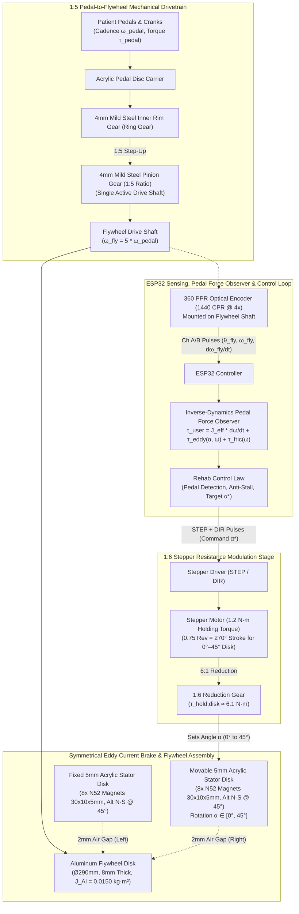
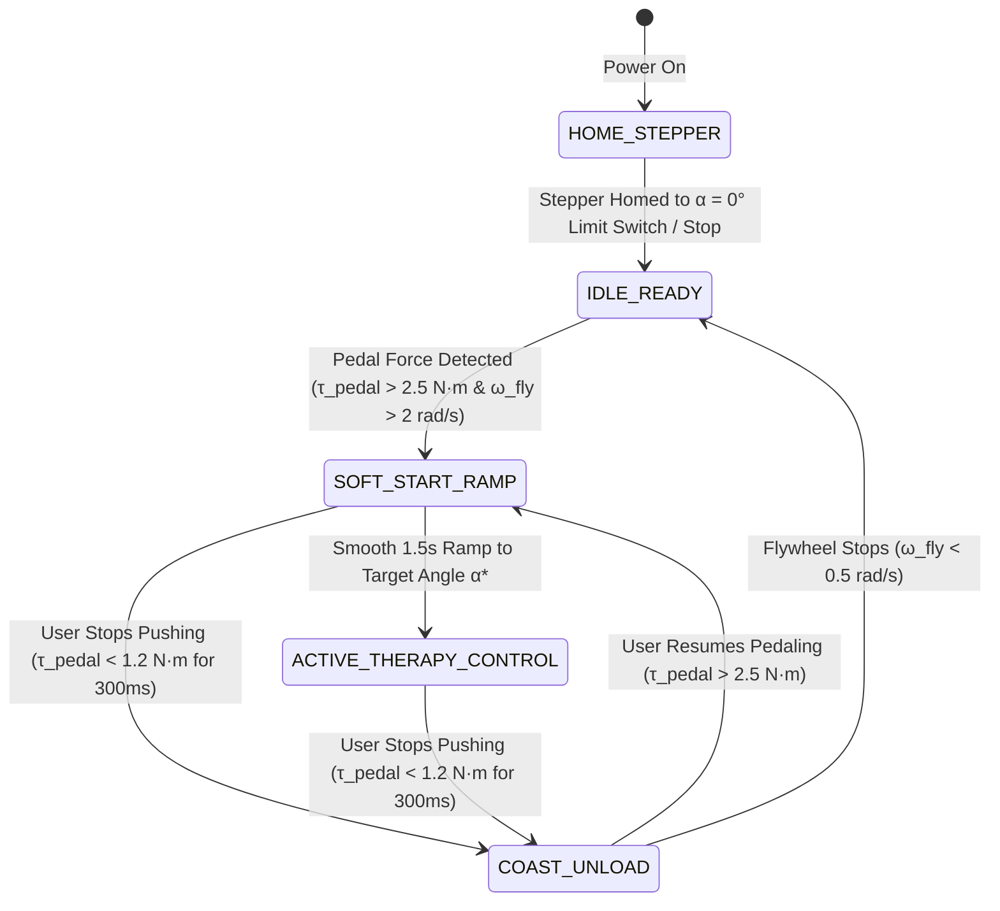

# Bottom-Tier Cycling Rehabilitation System — Symmetrical Eddy Current Brake, Flywheel Drive & Inverse-Dynamics Pedal Force Observer

## 1. System Overview

This document specifies the mechanical design, electromagnetic braking physics, stepper actuation kinematics, and closed-loop ESP32 control algorithm for the **Bottom-Tier Cycling Rehabilitation Module**. 

The system utilizes a **1:5 internal-gear pedal-to-flywheel step-up transmission**, an **$8\,\text{mm} \times 290\,\text{mm}$ aluminum flywheel**, and a **symmetrical double-sided axial-flux N52 Eddy Current Brake (ECB)** whose braking intensity is modulated over a **$0^\circ \text{ to } 45^\circ$ angular stroke** via a **$1:6$ stepper motor drive** ($1.2\,\text{N}\cdot\text{m}$ holding torque). Using a single **$360\,\text{PPR}$ optical encoder** on the flywheel shaft and the exact moment of inertia of the rotating assembly, the controller executes a real-time **Inverse-Dynamics Pedal Force / Torque Observer** to detect patient pedaling effort, estimate leg torque/power without external load cells, and dynamically regulate braking resistance.

---

## 2. Hardware Architecture & Mechanical Specifications

### 2.1 Component & Geometry Summary

| Subsystem | Component / Material | Dimensions & Ratings | Functional Role |
| :--- | :--- | :--- | :--- |
| **Pedal Input & Ring Gear** | Pedals on Acrylic Carrier + **Internal Rim Gear** ($4\,\text{mm}$ Mild Steel) | Driven directly by patient's feet ($\omega_{\text{pedal}}$, $\tau_{\text{pedal}}$) | Transfers lower-limb cycling torque into the primary gear stage |
| **Step-Up Pinion Gear** | **Spur Pinion Gear** ($4\,\text{mm}$ Mild Steel) | **Ratio $1:5$** ($G_{\text{pedal}} = \omega_{\text{fly}} / \omega_{\text{pedal}} = 5$); single active output shaft | Steps up pedal cadence by $5\times$ to generate high eddy-current velocity and $25\times$ reflected flywheel inertia |
| **Flywheel Rotor** | **Solid Aluminum Disk** (Al 6061-T6) | Thickness $d_{\text{Al}} = 8\,\text{mm}$, Diameter $D_{\text{Al}} = 290\,\text{mm}$ ($R_{\text{Al}} = 145\,\text{mm}$), $\rho = 2700\,\text{kg/m}^3$ | Conductive eddy-current rotor and kinetic energy storage ($m_{\text{Al}} = 1.427\,\text{kg}$) |
| **Symmetrical Stator Disks** | **2$\times$ $5\,\text{mm}$ Acrylic Disks** (Left & Right of Flywheel) | **$2\,\text{mm}$ axial air gap** on each side of the $8\,\text{mm}$ Al flywheel | Holds opposing permanent magnet arrays in a symmetrical axial-flux sandwich |
| **Permanent Magnets** | **8$\times$ N52 NdFeB Magnets per Stator** ($16$ total in symmetrical pair) | **$30\,\text{mm} \times 10\,\text{mm} \times 5\,\text{mm}$**, $B_r \approx 1.45\,\text{T}$, spaced equally every **$45^\circ$** in **alternating N–S–N–S** polarity | Generates axial magnetic field $B_z$ across the spinning aluminum flywheel |
| **Resistance Modulator** | **Stepper Motor + $1:6$ Gear Reduction** | Stepper holding torque $\tau_{\text{hold}} = 1.2\,\text{N}\cdot\text{m}$; **6 stepper turns = 1 magnet disk turn** | Rotates the movable magnet stator disk from **$0^\circ \text{ to } 45^\circ$** ($270^\circ$ stepper rotation) to vary flux linkage from minimum to maximum |
| **Flywheel Sensor** | **2-Phase Incremental Optical Encoder** | $360\,\text{PPR}$ ($1440\,\text{CPR}$ with $4\times$ quadrature decoding), $5\,\text{V}$ supply | Measures flywheel angle $\theta_{\text{fly}}$, angular velocity $\omega_{\text{fly}}$, and angular acceleration $\alpha_{\text{fly}} = \ddot{\theta}_{\text{fly}}$ |
| **Controller** | **ESP32 Microcontroller** | Dual-core $240\,\text{MHz}$, Hardware `PCNT` decoder, Stepper `STEP`/`DIR` generator | Runs the Inverse-Dynamics Pedal Force Observer and Closed-Loop Stepper Braking Controller |

---

### 2.2 Mechanical & Control Schematic



---

### 2.3 Cross-Sectional Schematic of the Symmetrical Eddy Current Brake

```text
          FIXED STATOR            SPINNING ROTOR           MOVABLE STATOR (0°–45°)
         (5mm Acrylic)           (8mm Aluminum)               (5mm Acrylic)
              |                        |                            |
              v                        v                            v
          +-------+                +--------+                   +-------+
          |       |   2mm Gap      |        |      2mm Gap      |       |
          |[N   S]| <------------> |   ||   | <---------------> |[N   S]|  <-- 30x10x5mm N52
          |       |                |   ||   |                   |       |      (r_eff ≈ 115mm)
          |       |                |   ||   |                   |       |
  ========+=======+================+========+===================+=======+========  Flywheel Shaft
          |       |                |   ||   |                   |       |      (ω_fly = 5·ω_pedal)
          |[S   N]| <------------> |   ||   | <---------------> |[S   N]|
          |       |                |   ||   |                   |       |
          +-------+                +--------+                   +-------+
                                  Ø290mm Disk                        ^
                                                                     |
                                                       Driven via 1:6 Gear by
                                                     1.2 N·m Stepper (α = 0°..45°)
```

#### Why the $0^\circ \text{ to } 45^\circ$ Rotation Works with 8 Alternating Magnets
Because there are **8 magnets** spaced equally around the circumference, the angular pitch between adjacent alternating poles ($\text{N}$ and $\text{S}$) is:
$$\theta_{\text{pitch}} = \frac{360^\circ}{8} = 45^\circ$$
* **At $\alpha = 0^\circ$ (Minimum Braking / Flux-Canceling Alignment):** Opposing magnets across the $8\,\text{mm}$ aluminum disk face **like poles ($\text{N}\leftrightarrow\text{N}$ and $\text{S}\leftrightarrow\text{S}$)**. The axial magnetic field $B_z$ perpendicular to the aluminum sheet cancels near the mid-plane, reducing eddy-current generation to a negligible minimum ($\tau_{\text{eddy}} \approx \tau_{\text{eddy,min}}$).
* **At $\alpha = 45^\circ$ (Maximum Braking / Flux-Aiding Alignment):** Rotating the movable acrylic disk by exactly one pole pitch ($45^\circ$) aligns opposing magnets with **opposite poles ($\text{N}\leftrightarrow\text{S}$ and $\text{S}\leftrightarrow\text{N}$)**. Magnetic flux now flows directly across the $2\,\text{mm} + 8\,\text{mm} + 2\,\text{mm}$ gap from one stator to the other, maximizing perpendicular flux density $B_z$ and producing maximum eddy-current braking torque.
* **Intermediate Angles ($\alpha \in (0^\circ, 45^\circ)$):** The effective perpendicular flux density squared varies sinusoidally with the overlap phase angle:
  $$u(\alpha) = \sin^2\left(\frac{\pi \alpha}{2 \cdot 45^\circ}\right) = \sin^2(2\alpha) \in [0, 1]$$

---

## 3. Exact Mathematical & Physical Calculations

### 3.1 Moment of Inertia ($J$) & Mass Calculations

#### 1. Aluminum Flywheel Rotor ($\varnothing 290\,\text{mm} \times 8\,\text{mm}$)
* **Radius & Thickness:** $R_{\text{Al}} = 0.145\,\text{m}$, $d_{\text{Al}} = 0.008\,\text{m}$
* **Volume ($V_{\text{Al}}$):**
  $$V_{\text{Al}} = \pi R_{\text{Al}}^2 d_{\text{Al}} = \pi \times (0.145\,\text{m})^2 \times 0.008\,\text{m} = 5.284 \times 10^{-4}\,\text{m}^3$$
* **Mass ($m_{\text{Al}}$) at $\rho_{\text{Al}} = 2700\,\text{kg/m}^3$:**
  $$m_{\text{Al}} = 2700 \times 5.284 \times 10^{-4} = \mathbf{1.427\,\text{kg}}$$
* **Flywheel Disk Moment of Inertia ($J_{\text{Al}}$):**
  $$J_{\text{Al}} = \frac{1}{2} m_{\text{Al}} R_{\text{Al}}^2 = \frac{1}{2} \times 1.427\,\text{kg} \times (0.145\,\text{m})^2 = \mathbf{0.01500\,\text{kg}\cdot\text{m}^2}$$

#### 2. Mild Steel Gears, Shaft & Pedal Assembly Inertia
* **Small Pinion Gear ($4\,\text{mm}$ mild steel, $\rho_{\text{steel}} = 7850\,\text{kg/m}^3$) + Flywheel Shaft + Hub:**
  $$J_{\text{pinion+shaft}} \approx 0.00050\,\text{kg}\cdot\text{m}^2$$
* **Inner Rim Gear ($4\,\text{mm}$ mild steel) + Acrylic Pedal Sheet + Cranks:**
  On the pedal shaft ($\omega_{\text{pedal}} = \omega_{\text{fly}} / 5$), the combined inertia of the steel inner ring gear, acrylic sheet, and pedals is $J_{\text{pedal,assy}} \approx 0.020\,\text{kg}\cdot\text{m}^2$. When reflected to the high-speed flywheel shaft via the $1:5$ gear ratio ($G_{\text{pedal}} = 5$), its contribution is divided by $G_{\text{pedal}}^2 = 25$:
  $$J_{\text{pedal,reflected\to fly}} = \frac{J_{\text{pedal,assy}}}{G_{\text{pedal}}^2} = \frac{0.020}{25} = 0.00080\,\text{kg}\cdot\text{m}^2$$

#### 3. Total Effective Moment of Inertia ($J_{\text{fly,eff}}$ and $J_{\text{pedal,eff}}$)
* **Total Effective Inertia at the Flywheel Shaft (Used in Encoder Reverse Calculation):**
  $$J_{\text{fly,eff}} = J_{\text{Al}} + J_{\text{pinion+shaft}} + \frac{J_{\text{pedal,assy}}}{25} = 0.01500 + 0.00050 + 0.00080 = \mathbf{0.01630\,\text{kg}\cdot\text{m}^2}$$
* **Total Effective Inertia Felt by the Patient at the Pedals:**
  $$J_{\text{pedal,eff}} = G_{\text{pedal}}^2 \cdot J_{\text{fly,eff}} = 25 \times 0.01630 = \mathbf{0.4075\,\text{kg}\cdot\text{m}^2}$$
  *(Because of the $1:5$ step-up gear ratio, the $1.43\,\text{kg}$ aluminum disk provides the smooth rotational momentum feel of a $\sim 38\,\text{kg}$ direct-drive ergometer flywheel at the pedals).*

---

### 3.2 Eddy Current Brake Electromagnetic Torque Model

#### 1. Magnetic Field in the Aluminum Disk ($30\times 10\times 5\,\text{mm}$ N52 Magnets)
* **Single Magnet Dimensions:** Radial length $L_m = 30\,\text{mm}$, circumferential width $W_m = 10\,\text{mm}$, axial thickness $t_m = 5\,\text{mm}$, pole face area $A_m = 3.0 \times 10^{-4}\,\text{m}^2$.
* **Radial Placement:** Centered at effective radius $r_{\text{eff}} = 115\,\text{mm} = 0.115\,\text{m}$ (spanning $r = 100\,\text{mm}$ to $130\,\text{mm}$, leaving a $15\,\text{mm}$ outer aluminum ring up to $R_{\text{Al}} = 145\,\text{mm}$ for low-resistance eddy-current loop closure).
* **Air Gap Flux Density ($B_{z,\text{max}}$):**
  For N52 NdFeB ($B_r = 1.45\,\text{T}$), the axial field of a single $30\times 10\times 5\,\text{mm}$ block at the mid-plane of the aluminum disk ($z = 2\,\text{mm air gap} + 4\,\text{mm half-thickness} = 6\,\text{mm}$ from each magnet face) is $B_1(6\,\text{mm}) \approx 0.205\,\text{T}$. In the **symmetrical flux-aiding configuration ($\alpha = 45^\circ$)**, the two opposing magnets superimpose constructively:
  $$B_{z,\text{max}} \approx 2 \times 0.205\,\text{T} \approx \mathbf{0.41\,\text{T}} \quad (\text{effective RMS over footprint } B_{\text{eff}} \approx 0.40\,\text{T})$$

#### 2. Analytical Braking Torque Formula ($\tau_{\text{eddy,fly}}$)
When the aluminum disk (conductivity $\sigma_{\text{Al}} \approx 3.2 \times 10^7\,\text{S/m}$, thickness $d_{\text{Al}} = 0.008\,\text{m}$) rotates at angular velocity $\omega_{\text{fly}}$ ($\text{rad/s}$) through $N_m = 8$ alternating pole zones, the induced eddy currents produce a Lorentz braking torque governed by the Kloss-Smythe induction relation:
$$\tau_{\text{eddy,fly}}(\alpha, \omega_{\text{fly}}) = K_{\text{eddy,max}} \cdot \sin^2(2\alpha) \cdot \frac{\omega_{\text{fly}}}{1 + (\omega_{\text{fly}} / \omega_{\text{crit}})^2}$$
where:
* **Maximum Low-Speed Damping Coefficient ($K_{\text{eddy,max}}$):**
  $$K_{\text{eddy,max}} = c_e N_m \sigma_{\text{Al}} d_{\text{Al}} A_m r_{\text{eff}}^2 B_{\text{eff}}^2$$
  Using geometric return-path factor $c_e \approx 0.55$:
  $$K_{\text{eddy,max}} = 0.55 \times 8 \times (3.2 \times 10^7) \times 0.008 \times (3.0 \times 10^{-4}) \times (0.115)^2 \times (0.40)^2 \approx \mathbf{0.715\,\text{N}\cdot\text{m}/(\text{rad/s})}$$
* **Critical Inductive Reaction Speed ($\omega_{\text{crit}}$):**
  At high speeds, self-inductance of the eddy loops in the $8\,\text{mm}$ sheet causes flux phase lag around $\omega_{\text{crit}} \approx \mathbf{80\,\text{rad/s}}$ ($\approx 764\,\text{RPM}_{\text{fly}}$ or $153\,\text{RPM}_{\text{pedal}}$, well above normal rehabilitation cycling cadences).

#### 3. Performance Lookup Table Across Cadences & Stepper Angles

Recall the $1:5$ transmission relationships:
$$\text{RPM}_{\text{fly}} = 5 \times \text{RPM}_{\text{pedal}}, \qquad \omega_{\text{fly}} = \frac{2\pi \cdot \text{RPM}_{\text{fly}}}{60}, \qquad \tau_{\text{pedal,eddy}} = 5 \times \tau_{\text{eddy,fly}}$$

| Pedal Cadence ($\text{RPM}_{\text{pedal}}$) | Flywheel Speed ($\text{RPM}_{\text{fly}}$ / $\omega_{\text{fly}}$) | **$\alpha = 10^\circ$ (Light)**<br>Flywheel / **Pedal Torque** | **$\alpha = 22.5^\circ$ ($50\%$ Flux)**<br>Flywheel / **Pedal Torque** | **$\alpha = 32^\circ$ (Med-High)**<br>Flywheel / **Pedal Torque** | **$\alpha = 45^\circ$ ($100\%$ Max)**<br>Flywheel / **Pedal Torque** | Max Dissipated Braking Power ($P_{\text{max}}$ at $\alpha=45^\circ$) |
| :---: | :---: | :---: | :---: | :---: | :---: | :---: |
| **$20\,\text{RPM}$** (Very Slow Early Rehab) | $100\,\text{RPM}$ ($10.47\,\text{rad/s}$) | $0.86\,\text{N}\cdot\text{m}$ / **$4.3\,\text{N}\cdot\text{m}$** | $3.68\,\text{N}\cdot\text{m}$ / **$18.4\,\text{N}\cdot\text{m}$** | $5.95\,\text{N}\cdot\text{m}$ / **$29.8\,\text{N}\cdot\text{m}$** | $7.36\,\text{N}\cdot\text{m}$ / **$36.8\,\text{N}\cdot\text{m}$** | $77\,\text{W}$ |
| **$30\,\text{RPM}$** (Slow Rehab) | $150\,\text{RPM}$ ($15.71\,\text{rad/s}$) | $1.26\,\text{N}\cdot\text{m}$ / **$6.3\,\text{N}\cdot\text{m}$** | $5.41\,\text{N}\cdot\text{m}$ / **$27.1\,\text{N}\cdot\text{m}$** | $8.75\,\text{N}\cdot\text{m}$ / **$43.8\,\text{N}\cdot\text{m}$** | $10.82\,\text{N}\cdot\text{m}$ / **$54.1\,\text{N}\cdot\text{m}$** | $170\,\text{W}$ |
| **$45\,\text{RPM}$** (Moderate Rehab) | $225\,\text{RPM}$ ($23.56\,\text{rad/s}$) | $1.81\,\text{N}\cdot\text{m}$ / **$9.1\,\text{N}\cdot\text{m}$** | $7.75\,\text{N}\cdot\text{m}$ / **$38.8\,\text{N}\cdot\text{m}$** | $12.53\,\text{N}\cdot\text{m}$ / **$62.7\,\text{N}\cdot\text{m}$** | $15.50\,\text{N}\cdot\text{m}$ / **$77.5\,\text{N}\cdot\text{m}$** | $365\,\text{W}$ |
| **$60\,\text{RPM}$** (Standard Cycling) | $300\,\text{RPM}$ ($31.42\,\text{rad/s}$) | $2.28\,\text{N}\cdot\text{m}$ / **$11.4\,\text{N}\cdot\text{m}$** | $9.75\,\text{N}\cdot\text{m}$ / **$48.8\,\text{N}\cdot\text{m}$** | $15.76\,\text{N}\cdot\text{m}$ / **$78.8\,\text{N}\cdot\text{m}$** | $19.50\,\text{N}\cdot\text{m}$ / **$97.5\,\text{N}\cdot\text{m}$** | $613\,\text{W}$ |
| **$75\,\text{RPM}$** (Fast Functional) | $375\,\text{RPM}$ ($39.27\,\text{rad/s}$) | $2.65\,\text{N}\cdot\text{m}$ / **$13.3\,\text{N}\cdot\text{m}$** | $11.33\,\text{N}\cdot\text{m}$ / **$56.7\,\text{N}\cdot\text{m}$** | $18.32\,\text{N}\cdot\text{m}$ / **$91.6\,\text{N}\cdot\text{m}$** | $22.66\,\text{N}\cdot\text{m}$ / **$113.3\,\text{N}\cdot\text{m}$** | $890\,\text{W}$ |

---

### 3.3 Stepper Motor ($1.2\,\text{N}\cdot\text{m}$) & $1:6$ Gear Kinematics

1. **Angular Stroke & Step Resolution:**
   * Desired Magnetic Disk Range: $\alpha \in [0^\circ, 45^\circ]$.
   * With a **$1:6$ gear ratio** ($G_{\text{step}} = 6$), the stepper shaft rotates:
     $$\Delta\theta_{\text{stepper,max}} = 6 \times 45^\circ = \mathbf{270^\circ} \quad (\text{or } 0.75\text{ revolutions})$$
   * Stepper Resolution (for a standard $1.8^\circ/\text{step}$, $200\,\text{steps/rev}$ motor):
     * **Full-Step ($1\times$):** $150\,\text{steps}$ across full $0^\circ\text{–}45^\circ$ stroke $\implies \mathbf{0.30^\circ/\text{step}}$ at the magnet disk.
     * **$8\times$ Microstepping ($1600\,\text{steps/rev}$):** $1200\,\text{microsteps}$ across $0^\circ\text{–}45^\circ \implies \mathbf{0.0375^\circ/\text{microstep}}$ at the magnet disk.
     * **$16\times$ Microstepping ($3200\,\text{steps/rev}$):** $2400\,\text{microsteps}$ across $0^\circ\text{–}45^\circ \implies \mathbf{0.01875^\circ/\text{microstep}}$ at the magnet disk.

2. **Holding & Dynamic Torque Verification:**
   * **Available Holding Torque at Magnet Disk:**
     $$\tau_{\text{disk,hold}} = \tau_{\text{step,hold}} \times G_{\text{step}} \times \eta_{\text{gear}} = 1.2\,\text{N}\cdot\text{m} \times 6 \times 0.85 = \mathbf{6.12\,\text{N}\cdot\text{m}}$$
   * **Available Dynamic Torque (at $\sim 1.5\,\text{rev/s}$ stepper speed $\implies 0.5\,\text{s}$ full-stroke response):**
     $$\tau_{\text{disk,dyn}} \approx 0.75\,\text{N}\cdot\text{m} \times 6 \times 0.85 = \mathbf{3.83\,\text{N}\cdot\text{m}}$$

> [!IMPORTANT]
> **Eddy-Current Reaction Drag on the Movable Stator Disk:** By Newton's third law, the circumferential eddy-current drag on the spinning aluminum flywheel exerts an equal and opposite reaction torque on the stator magnets ($\frac{1}{2}\tau_{\text{eddy,fly}}$ on each of the two symmetrical stator disks). At high braking ($\tau_{\text{eddy,fly}} = 12\,\text{N}\cdot\text{m} \implies 6\,\text{N}\cdot\text{m}$ per stator disk), this reaction torque tries to back-drive the movable stator disk. Keep stepper driver **holding current enabled ($70\%\text{–}100\%$) at all times during cycling**, and bound continuous flywheel braking torque to $\tau_{\text{eddy,fly}} \le 11\,\text{N}\cdot\text{m}$ ($\tau_{\text{pedal}} \le 55\,\text{N}\cdot\text{m}$) or use a high-friction/worm $1:6$ stage so the movable stator cannot be back-driven.

---

## 4. Reverse Calculation: Detecting Pedal Force & Estimating User Torque

### 4.1 Inverse-Dynamics Governing Equations

The single **$360\,\text{PPR}$ optical encoder** ($1440\,\text{CPR}$ at $4\times$ quadrature decoding on the ESP32 `PCNT` unit) is mounted on the flywheel shaft:
$$\Delta\theta_{\text{fly}} = \frac{360^\circ}{1440} = 0.25^\circ/\text{count} = 0.004363\,\text{rad/count}$$
*(Because of the $1:5$ ratio, one full pedal revolution produces $5 \times 1440 = \mathbf{7200\,\text{encoder counts}}$, giving $0.05^\circ$ resolution at the pedals!)*

By Newton-Euler rotational dynamics on the flywheel shaft:
$$J_{\text{fly,eff}} \cdot \ddot{\theta}_{\text{fly}}(t) = \tau_{\text{user,fly}}(t) - \tau_{\text{eddy,fly}}\big(\alpha(t), \omega_{\text{fly}}(t)\big) - \tau_{\text{loss,fly}}\big(\omega_{\text{fly}}(t)\big)$$
where:
* $\tau_{\text{user,fly}}(t) = \dfrac{\tau_{\text{pedal}}(t)}{G_{\text{pedal}}} = \dfrac{\tau_{\text{pedal}}(t)}{5}$ is the user's input torque transmitted to the flywheel shaft.
* $\tau_{\text{loss,fly}}(\omega_{\text{fly}}) = \tau_{c0} + b_{\text{visc}}\omega_{\text{fly}}$ is the parasitic bearing + mild-steel gear mesh friction (typically $\tau_{c0} \approx 0.18\,\text{N}\cdot\text{m}$, $b_{\text{visc}} \approx 0.004\,\text{N}\cdot\text{m}\cdot\text{s/rad}$, calibrated automatically via a 5-second spin-down test at $\alpha = 0^\circ$).

#### Reverse Calculation of Instantaneous User Pedal Torque & Force
Rearranging the equation of motion gives the **Inverse-Dynamics Torque Estimator**:
$$\hat{\tau}_{\text{user,fly}}(t) = \underbrace{J_{\text{fly,eff}} \cdot \hat{\ddot{\theta}}_{\text{fly}}(t)}_{\text{Inertial Accel/Decel Torque}} + \underbrace{K_{\text{eddy,max}} \sin^2\big(2\alpha(t)\big) \frac{\omega_{\text{fly}}(t)}{1 + (\omega_{\text{fly}}(t)/\omega_{\text{crit}})^2}}_{\text{Known Eddy Braking Torque } \hat{\tau}_{\text{eddy,fly}}} + \underbrace{\big(\tau_{c0} + b_{\text{visc}}\omega_{\text{fly}}(t)\big)}_{\text{Parasitic Friction } \hat{\tau}_{\text{loss,fly}}}$$

Scaling by the $1:5$ gear ratio yields the **Actual Torque & Tangential Force Applied by the Patient on the Pedals** (for crank length $L_{\text{crank}}$, e.g. $0.170\,\text{m}$):
$$\hat{\tau}_{\text{pedal}}(t) = 5 \cdot \hat{\tau}_{\text{user,fly}}(t), \qquad \hat{F}_{\text{pedal}}(t) = \frac{\hat{\tau}_{\text{pedal}}(t)}{L_{\text{crank}}}$$

---

### 4.2 Physical Interpretation: How the Algorithm Distinguishes Pedaling vs. Coasting

Even when the flywheel is spinning rapidly ($\omega_{\text{fly}} > 0$), the reverse calculation immediately tells whether the patient is pushing on the pedals or coasting:

1. **Case A — Patient Stops Pedaling (Coasting / Zero Pedal Force):**
   If the patient rests their feet or stops applying force ($\tau_{\text{pedal}} = 0$), the flywheel decelerates solely under eddy-current braking and friction at a known natural deceleration rate:
   $$\ddot{\theta}_{\text{coast}}\big(\alpha, \omega_{\text{fly}}\big) = -\frac{\hat{\tau}_{\text{eddy,fly}}(\alpha, \omega_{\text{fly}}) + \hat{\tau}_{\text{loss,fly}}(\omega_{\text{fly}})}{J_{\text{fly,eff}}} < 0$$
   When the measured angular acceleration $\hat{\ddot{\theta}}_{\text{fly}}(t)$ equals $\ddot{\theta}_{\text{coast}}$, the two terms in the reverse calculation cancel out:
   $$\hat{\tau}_{\text{user,fly}}(t) = J_{\text{fly,eff}}\,\ddot{\theta}_{\text{coast}} + \hat{\tau}_{\text{eddy,fly}} + \hat{\tau}_{\text{loss,fly}} = \mathbf{0\,\text{N}\cdot\text{m}} \implies \textbf{NO PEDAL FORCE DETECTED}$$

2. **Case B — Patient Pedals at Constant Speed ($\ddot{\theta}_{\text{fly}} \approx 0$):**
   The inertial term $J_{\text{fly,eff}} \ddot{\theta}_{\text{fly}}$ is zero, so the user is supplying $100\%$ of the eddy-current and friction torque:
   $$\hat{\tau}_{\text{pedal}}(t) = 5 \cdot \big[\hat{\tau}_{\text{eddy,fly}}(\alpha, \omega_{\text{fly}}) + \hat{\tau}_{\text{loss,fly}}(\omega_{\text{fly}})\big] > 0 \implies \textbf{STEADY PEDAL FORCE DETECTED}$$

3. **Case C — Patient Accelerates the Flywheel ($\ddot{\theta}_{\text{fly}} > 0$) or Slows Down Gradually ($\ddot{\theta}_{\text{coast}} < \ddot{\theta}_{\text{fly}} < 0$):**
   Even if the patient is slowing down, as long as their deceleration is *less negative* than the natural coast-down deceleration ($\hat{\ddot{\theta}}_{\text{fly}} > \ddot{\theta}_{\text{coast}}$), $\hat{\tau}_{\text{pedal}}(t) > 0$, proving the patient is still applying assistive force to the pedals!

---

### 4.3 Derivative-Free Momentum Disturbance Observer (Noise-Immune Implementation)

Directly double-differentiating discrete encoder counts ($\theta \rightarrow \omega \rightarrow \ddot{\theta}$) amplifies quantization noise. Instead, the ESP32 implements a **Luenberger Momentum Disturbance Observer (DOB)**, which mathematically computes $\hat{\tau}_{\text{user,fly}}(t)$ with a first-order low-pass filter of bandwidth $L_{\text{obs}} = 2\pi f_{\text{obs}}$ ($f_{\text{obs}} = 6\,\text{Hz} \implies L_{\text{obs}} = 37.7\,\text{rad/s}$) **without ever differentiating velocity**:

$$\dot{z}(t) = -L_{\text{obs}} \cdot z(t) - L_{\text{obs}} \left[ L_{\text{obs}} J_{\text{fly,eff}} \omega_{\text{fly}}(t) - \hat{\tau}_{\text{eddy,fly}}\big(\alpha(t), \omega_{\text{fly}}(t)\big) - \hat{\tau}_{\text{loss,fly}}\big(\omega_{\text{fly}}(t)\big) \right]$$
$$\hat{\tau}_{\text{user,fly}}(t) = z(t) + L_{\text{obs}} J_{\text{fly,eff}} \omega_{\text{fly}}(t)$$

*(Verification: Taking the time derivative shows $\hat{\tau}_{\text{user,fly}}(s) = \frac{L_{\text{obs}}}{s + L_{\text{obs}}} \big[ J_{\text{fly,eff}} s \omega_{\text{fly}}(s) + \hat{\tau}_{\text{eddy,fly}}(s) + \hat{\tau}_{\text{loss,fly}}(s) \big]$, which is the exact inverse-dynamics equation filtered at $f_{\text{obs}} = 6\,\text{Hz}$!)*

---

## 5. Closed-Loop Control Algorithm & State Machine

### 5.1 Why Integrating Pedal-Force Detection into the Control Loop Is Essential
In a rehabilitation ergometer, if the control algorithm regulates constant torque or constant power ($P = \tau \cdot \omega$) blindly without checking $\hat{\tau}_{\text{pedal}}$:
1. **The Coasting Lock-Up Hazard:** When a tired patient pauses pedaling while the flywheel is still spinning, $\omega_{\text{fly}}$ begins to drop. Since eddy-current torque $\tau_{\text{eddy}} \propto \sin^2(2\alpha)\,\omega_{\text{fly}}$ drops as speed falls, a naive controller drives the stepper motor all the way to **$\alpha = 45^\circ$ (maximum braking)** trying to maintain target torque/power! This slams the flywheel to a stop and leaves the brake locked at maximum resistance when the patient tries to start pedaling again.
2. **Solution via Pedal-Force Observer:** By monitoring $\hat{\tau}_{\text{pedal}}(t)$, the controller immediately detects when the patient stops pushing (`PEDAL_ACTIVE == false`) and **retracts the stepper to a light standby angle ($\alpha_{\text{idle}} = 5^\circ$)**, allowing free coasting and effortless re-starting.

---

### 5.2 Complete Control State Machine



---

### 5.3 Inverse Control Law: Computing Target Stepper Angle $\alpha^*$

When `PEDAL_ACTIVE == true`, the ESP32 computes the required flywheel eddy-current braking torque $\tau_{\text{eddy,req}}$ based on the selected clinical rehabilitation mode:

1. **Mode A — Constant Pedal Resistance Torque ($\tau_{\text{pedal,target}}$ set by clinician, e.g. $10\text{–}55\,\text{N}\cdot\text{m}$):**
   $$\tau_{\text{eddy,req}} = \frac{\tau_{\text{pedal,target}}}{5} - \hat{\tau}_{\text{loss,fly}}(\omega_{\text{fly}})$$
2. **Mode B — Constant Power / Ergometer Mode ($P_{\text{target}}$ set by clinician, e.g. $25\text{–}250\,\text{W}$):**
   $$\tau_{\text{eddy,req}} = \frac{P_{\text{target}}}{\omega_{\text{fly}}} - \hat{\tau}_{\text{loss,fly}}(\omega_{\text{fly}})$$
3. **Mode C — Isokinetic Cadence-Clamping Mode ($\text{RPM}_{\text{pedal,target}}$ fixed, e.g. $45\,\text{RPM}$):**
   $$\tau_{\text{eddy,req}} = K_p (\omega_{\text{fly}} - 5\omega_{\text{pedal,target}}) + K_i \int (\omega_{\text{fly}} - 5\omega_{\text{pedal,target}})\,dt$$
4. **Mode D — Effort-Proportional / Accommodating Biofeedback Mode:**
   Braking resistance scales proportionally with the reverse-calculated user pedal effort $\hat{\tau}_{\text{pedal}}$ to prevent joint overload if the patient fatigues.

#### Inversion of the Eddy-Current Model to Command Stepper Angle $\alpha^*$
Given $\tau_{\text{eddy,req}}$ and measured flywheel velocity $\omega_{\text{fly}}$, the maximum achievable eddy torque at the current speed is:
$$\tau_{\text{eddy,max}}(\omega_{\text{fly}}) = K_{\text{eddy,max}} \cdot \frac{\omega_{\text{fly}}}{1 + (\omega_{\text{fly}} / \omega_{\text{crit}})^2}$$
We compute the normalized flux command $u_{\text{cmd}} \in [0, 1]$:
$$u_{\text{cmd}} = \text{clamp}\left(\frac{\tau_{\text{eddy,req}}}{\tau_{\text{eddy,max}}(\omega_{\text{fly}})},\; 0.0,\; 1.0\right)$$
Inverting $u_{\text{cmd}} = \sin^2(2\alpha^*)$ yields the exact target magnetic disk angle $\alpha^*$ (in degrees) and target stepper motor step count $S^*$:
$$\alpha^* = \frac{1}{2} \arcsin\left(\sqrt{u_{\text{cmd}}}\right) \times \frac{180^\circ}{\pi} \quad \in [0^\circ, 45^\circ]$$
$$S^* = \text{round}\left( \frac{\alpha^*}{45.0^\circ} \times S_{\text{max}} \right) \quad \text{where } S_{\text{max}} = 1200\text{ steps (at } 8\times \text{ microstepping)}$$

---

### 5.4 ESP32 Real-Time Control & Pedal-Force Observer Algorithm (Reference C/C++ Implementation)

```cpp
// ============================================================================
// BOTTOM-TIER CYCLING REHAB: INVERSE-DYNAMICS OBSERVER & STEPPER ECB CONTROL
// Execution Rate: 100 Hz (dt = 0.010 s) on ESP32 Timer Interrupt / RTOS Task
// ============================================================================

#include <math.h>

// --- 1. Physical & Geometric Constants ---
constexpr float GEAR_PEDAL_TO_FLY  = 5.0f;      // 1:5 inner rim to pinion step-up
constexpr float GEAR_STEP_TO_DISK  = 6.0f;      // 1:6 stepper to magnet disk
constexpr float J_FLY_EFF          = 0.01630f;  // Total effective inertia at flywheel shaft [kg*m^2]
constexpr float K_EDDY_MAX         = 0.715f;    // Max eddy damping coeff [N*m/(rad/s)]
constexpr float OMEGA_CRIT         = 80.0f;     // Eddy inductive critical speed [rad/s]
constexpr float TAU_C0_FRIC        = 0.18f;     // Coulomb friction at flywheel shaft [N*m]
constexpr float B_VISC_FRIC        = 0.004f;    // Viscous friction coeff [N*m*s/rad]
constexpr float CRANK_LENGTH_M     = 0.170f;    // Pedal crank arm radius [m]

// --- 2. Sensor & Actuator Constants ---
constexpr float ENC_CPR_4X         = 1440.0f;   // 360 PPR * 4x quadrature
constexpr float RAD_PER_COUNT      = (2.0f * M_PI) / ENC_CPR_4X;
constexpr int   STEPS_AT_45_DEG    = 1200;      // 0.75 stepper rev at 1600 steps/rev (8x microstep)

// --- 3. Observer & Pedal Detection Thresholds ---
constexpr float OBS_BW_RAD_S       = 37.7f;     // 6 Hz Momentum Observer bandwidth
constexpr float PEDAL_ON_THRESH_NM = 2.5f;      // Pedal torque to trigger ACTIVE_PEDALING [N*m]
constexpr float PEDAL_OFF_THRESH_NM= 1.2f;      // Pedal torque below which user is COASTING [N*m]
constexpr float COAST_DEBOUNCE_S   = 0.30f;     // 300 ms debounce before unloading brake

// --- State Variables ---
float z_obs              = 0.0f;   // Internal state of Momentum Disturbance Observer
float omega_fly_filt     = 0.0f;   // Filtered flywheel angular speed [rad/s]
float alpha_disk_deg     = 0.0f;   // Current magnet disk angle [0.0 to 45.0 deg]
float coast_timer_s      = 0.0f;   // Timer for coasting detection
bool  is_user_pedaling   = false;  // Detected pedaling status flag
float active_work_joules = 0.0f;   // Cumulative patient mechanical work [J]

// Compute modeled eddy-current torque on flywheel shaft [N*m]
float computeEddyTorqueFly(float alpha_deg, float omega_fly) {
    if (omega_fly <= 0.05f) return 0.0f;
    float alpha_rad = alpha_deg * (M_PI / 180.0f);
    float sin_term  = sinf(2.0f * alpha_rad);
    float u_alpha   = sin_term * sin_term; // sin^2(2*alpha) in [0, 1]
    float kloss     = omega_fly / (1.0f + (omega_fly / OMEGA_CRIT) * (omega_fly / OMEGA_CRIT));
    return K_EDDY_MAX * u_alpha * kloss;
}

// Main 100 Hz Control Loop Step
void updateCyclingRehabControl(int32_t delta_enc_counts, float dt, float target_pedal_torque_nm) {
    // 1. Velocity Estimation from 360 PPR Optical Encoder (with 15 Hz low-pass filter)
    float omega_raw  = (delta_enc_counts * RAD_PER_COUNT) / dt;
    float lpf_alpha  = 0.48f; // ~15 Hz cutoff at 100 Hz sample rate
    omega_fly_filt   = lpf_alpha * omega_raw + (1.0f - lpf_alpha) * omega_fly_filt;

    // 2. Evaluate Known Resistant Torques on Flywheel Shaft
    float tau_eddy_fly = computeEddyTorqueFly(alpha_disk_deg, omega_fly_filt);
    float tau_loss_fly = (omega_fly_filt > 0.1f) ? (TAU_C0_FRIC + B_VISC_FRIC * omega_fly_filt) : 0.0f;

    // 3. Reverse Calculation via Derivative-Free Momentum Disturbance Observer
    //    Estimates tau_user_fly = J_fly_eff * d(omega_fly)/dt + tau_eddy_fly + tau_loss_fly
    float dz = -OBS_BW_RAD_S * z_obs
               - OBS_BW_RAD_S * (OBS_BW_RAD_S * J_FLY_EFF * omega_fly_filt - tau_eddy_fly - tau_loss_fly);
    z_obs += dz * dt;
    float tau_user_fly_est = z_obs + OBS_BW_RAD_S * J_FLY_EFF * omega_fly_filt;

    // 4. Convert to Patient Pedal Torque [N*m], Pedal Force [N], and Power [W]
    float tau_pedal_est   = GEAR_PEDAL_TO_FLY * tau_user_fly_est;
    float force_pedal_est = tau_pedal_est / CRANK_LENGTH_M;
    float omega_pedal     = omega_fly_filt / GEAR_PEDAL_TO_FLY;
    float power_user_w    = (tau_pedal_est > 0.0f) ? (tau_pedal_est * omega_pedal) : 0.0f;

    // 5. Detect Whether User Is Actively Applying Force on Pedals (Hysteresis + Debounce)
    if (tau_pedal_est >= PEDAL_ON_THRESH_NM && omega_fly_filt > 1.5f) {
        is_user_pedaling = true;
        coast_timer_s    = 0.0f;
        active_work_joules += power_user_w * dt;
    } else if (tau_pedal_est < PEDAL_OFF_THRESH_NM || omega_fly_filt <= 0.8f) {
        coast_timer_s += dt;
        if (coast_timer_s >= COAST_DEBOUNCE_S) {
            is_user_pedaling = false;
        }
    }

    // 6. Compute Target Magnetic Disk Angle alpha_cmd [0° to 45°]
    float alpha_target_deg = 0.0f;
    if (!is_user_pedaling) {
        // User is coasting or stopped -> unload brake to 5° so flywheel doesn't lock up
        alpha_target_deg = 5.0f;
    } else {
        // User is actively pedaling -> compute required eddy torque at flywheel
        float tau_eddy_req = (target_pedal_torque_nm / GEAR_PEDAL_TO_FLY) - tau_loss_fly;
        if (tau_eddy_req < 0.0f) tau_eddy_req = 0.0f;

        float tau_eddy_max_now = computeEddyTorqueFly(45.0f, omega_fly_filt);
        if (tau_eddy_max_now > 0.1f) {
            float u_cmd = tau_eddy_req / tau_eddy_max_now;
            if (u_cmd > 1.0f) u_cmd = 1.0f;
            alpha_target_deg = 0.5f * asinf(sqrtf(u_cmd)) * (180.0f / M_PI);
        }
    }

    // 7. Rate-Limit Stepper Slew (Max 30 deg/s of disk = 180 deg/s of stepper) & Command Steps
    float max_step_deg = 30.0f * dt;
    if (alpha_target_deg > alpha_disk_deg + max_step_deg) alpha_disk_deg += max_step_deg;
    else if (alpha_target_deg < alpha_disk_deg - max_step_deg) alpha_disk_deg -= max_step_deg;
    else alpha_disk_deg = alpha_target_deg;

    int32_t target_stepper_steps = lroundf((alpha_disk_deg / 45.0f) * STEPS_AT_45_DEG);
    // commandStepperToPosition(target_stepper_steps);
}
```

---

## 6. Automated Friction & Eddy-Model Self-Calibration Routine

Because air-gap tolerances ($\pm 0.2\,\text{mm}$) and aluminum alloy conductivity vary slightly in fabrication, the ESP32 can calibrate $\tau_{c0}, b_{\text{visc}}$, and $K_{\text{eddy,max}}$ automatically using only the flywheel encoder and known inertia $J_{\text{fly,eff}} = 0.01630\,\text{kg}\cdot\text{m}^2$:

1. **Step 1 — Zero-Field Friction Calibration ($\alpha = 0^\circ$):**
   With the stepper homed to $\alpha = 0^\circ$ (flux-canceled), spin the pedals up to $\sim 50\,\text{RPM}$ ($\omega_{\text{fly}} \approx 26\,\text{rad/s}$) and let go ($\tau_{\text{pedal}} = 0$). Record the coast-down curve $\omega_{\text{fly}}(t)$:
   $$-J_{\text{fly,eff}} \frac{d\omega_{\text{fly}}}{dt} = \tau_{c0} + b_{\text{visc}} \omega_{\text{fly}}$$
   A linear regression of $-J_{\text{fly,eff}} \dot{\omega}_{\text{fly}}$ vs. $\omega_{\text{fly}}$ yields exact values for $\tau_{c0}$ and $b_{\text{visc}}$.
2. **Step 2 — Full-Field Eddy Constant Calibration ($\alpha = 45^\circ$):**
   Move the stepper to $\alpha = 45^\circ$ ($1200\,\text{microsteps}$), spin up to $50\,\text{RPM}$, and release. The additional deceleration directly measures $K_{\text{eddy,max}}$:
   $$K_{\text{eddy,max}} = \frac{-J_{\text{fly,eff}} \dot{\omega}_{\text{fly}} - (\tau_{c0} + b_{\text{visc}}\omega_{\text{fly}})}{\omega_{\text{fly}} / \big(1 + (\omega_{\text{fly}}/\omega_{\text{crit}})^2\big)}$$
