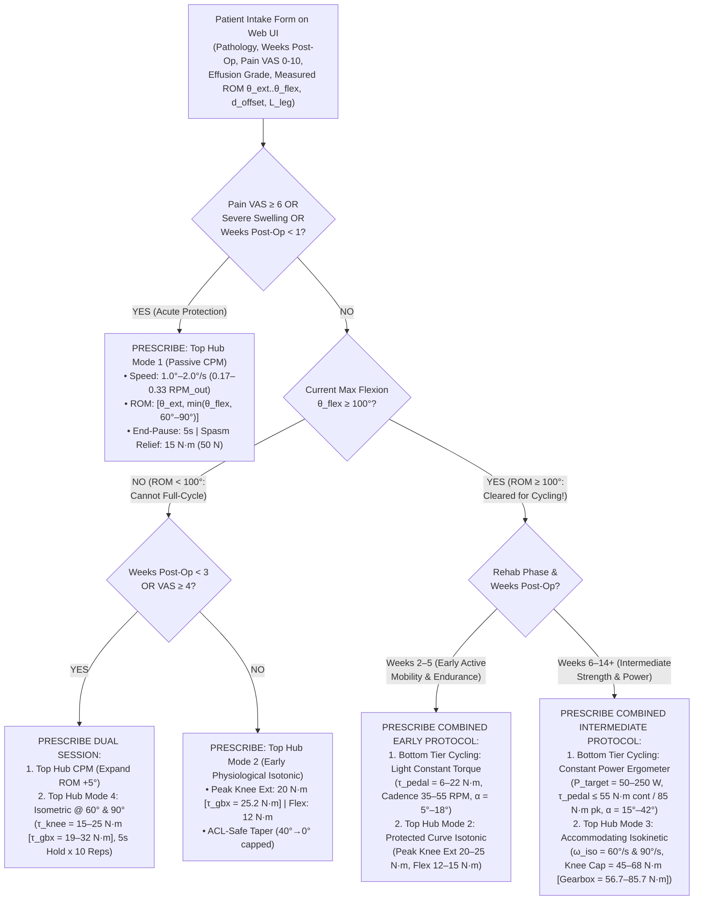
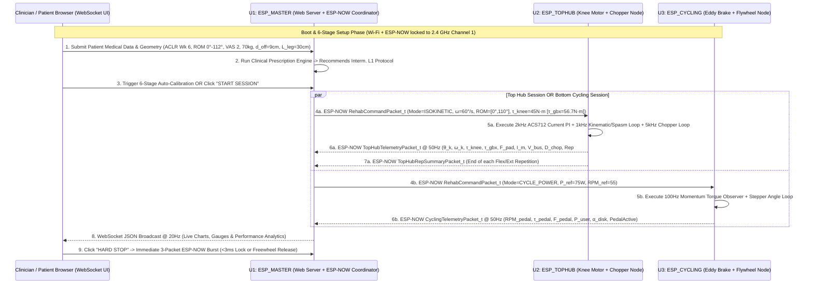
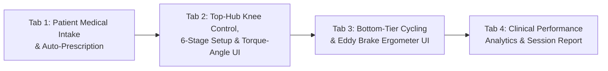

# Integrated Dual-Tier Rehabilitation System (`U1`, `U2`, `U3`) — 3-ESP Distributed Network (ESP-NOW), Clinical Web Application & Evidence-Based Prescription Engine

> [!NOTE]
> **Repository Cross-Reference Index (`Project Doula — VK26-IITI-HT-0240`):**
> * **Master Index & Top-Hub Knee Module (`U2: ESP_TOPHUB`):** [`README.md`](README.md)
> * **Bottom-Tier Cycling & Symmetrical Eddy Brake (`U3: ESP_CYCLING`):** [`README_CYCLING_EDDY_BRAKE.md`](README_CYCLING_EDDY_BRAKE.md)
> * **Pin-by-Pin Hardware Wiring & Commissioning Guide:** [`WIRING_AND_COMMISSIONING_GUIDE.md`](WIRING_AND_COMMISSIONING_GUIDE.md)
> * **Electrical & Mechanical Schematics:** [`System_Schematics_3Page.pdf`](System_Schematics_3Page.pdf) | [`Sheet 1`](schematic_page1_master_power_network.svg) | [`Sheet 2`](schematic_page2_top_hub_control.svg) | [`Sheet 3`](schematic_page3_bottom_cycling_ecb.svg) | [`Sheet 4 BOM`](schematic_page4_bom.svg)
> * **SolidWorks 3D CAD & SKF Bearing Models:** [`Doula_DP_parts_only/Doula_DP_parts_only/`](Doula_DP_parts_only/Doula_DP_parts_only/)

---

## 1. Executive Summary

This document specifies the **complete system-level architecture** integrating the **Top-Hub Motorized Knee Flexion/Extension Subsystem (`U2`)** and the **Bottom-Tier Symmetrical Eddy-Current Cycling Subsystem (`U3`)** under a unified **3-ESP32 Distributed Control Network**:

1. **`U1` (`ESP_MASTER` — Web Server & Clinical Decision Coordinator):** Hosts an asynchronous HTTP + WebSocket clinical web application (`ESPAsyncWebServer` + `LittleFS` at `http://192.168.4.1`), collects patient clinical intake data, executes an **Evidence-Based Clinical Decision & Prescription Algorithm** grounded in orthopedic rehabilitation literature (AAOS, MOON ACL Group, Brigham & Women's TKA/ACLR Protocols), triggers the 6-Stage Automated Setup & Calibration routine, broadcasts $<3\,\text{ms}$ Emergency Hard-Stop commands, and aggregates real-time telemetry to compute biomechanical performance reports.
2. **`U2` (`ESP_TOPHUB` — Top-Hub Knee Flexion/Extension Node):** Executes $2\,\text{kHz}$ closed-loop PI armature current control (`U203: ACS712-30A` on `GPIO35`) and $1\,\text{kHz}$ non-collinear offset-pivot kinematic/torque/spasm control ($d_{\text{offset}} = 8\text{–}10\,\text{cm}, L_{\text{leg}} = 30\,\text{cm}$) on the **MY1016 $24\,\text{V}$ $250\,\text{W}$ DC Motor (`M1`) + $1:52$ Gearbox (`GBX1`, $\eta = 85\%$, $60\,\text{N}\cdot\text{m}$ rated / $100\,\text{N}\cdot\text{m}$ peak)** via the **Rhino MD20Amp (`U201`)** driver, reads the **$360\,\text{PPR}$ Motor-Shaft NPN Optical Encoder (`ENC1`, $74,880\,\text{CPR}$)**, regulates the **$30\,\text{A}$ 2-Screw MOSFET Series Brake Chopper (`U202` + `R1 || R2` $= 1.0\,\Omega, 200\,\text{W}$)** at $5\,\text{kHz}$, and streams $50\,\text{Hz}$ joint kinematics, pad force, and torque data to `ESP_MASTER` via **ESP-NOW**.
3. **`U3` (`ESP_CYCLING` — Bottom-Tier Cycling & Eddy-Current Brake Node):** Executes the $100\,\text{Hz}$ **Derivative-Free Momentum Disturbance Observer** using the **$360\,\text{PPR}$ Flywheel NPN Optical Encoder (`ENC2`, $7200\,\text{counts/pedal rev}$)** and effective inertia ($J_{\text{fly,eff}} = 0.01630\,\text{kg}\cdot\text{m}^2$) to detect active pedal force, estimate patient pedal torque ($\hat{\tau}_{\text{pedal}}$), and modulate the **$1.2\,\text{N}\cdot\text{m}$ Stepper Motor (`M2`) + $1:6$ Gear (`GBX2`)** via `U301` (`TB6600/DM542`) across $\alpha \in [0^\circ, 45^\circ]$, streaming $50\,\text{Hz}$ cycling telemetry to `ESP_MASTER` via **ESP-NOW**.

---

## 2. Four-Page Electrical, Mechanical & BOM Schematic Package

The complete schematic with **component designators matching your exact hardware specification** (`PSU1, U1..U5, U201..U203, U301, M1, M2, GBX1, GBX2, STOP1, ENC1, ENC2, R1, R2` parallel braking resistors, `R3, R5, R7, R9` $80\,\Omega$ NPN encoder series damping resistors, `R11, R12` $73.33\,\text{k}\Omega / 4.6\,\text{k}\Omega$ bus voltage divider, `R13, R14` $22\,\text{k}\Omega / 22\,\text{k}\Omega$ `ACS712` divider, and `R15, R16` PWM safety pull-down resistors) and **clean Net Labels** (`+24V_BUS`, `GND (STAR)`, `+5V_BUCK`, `+3V3_LDO`, `MD_PWM`, `MD_DIR`, `CHOP_PWM`, `VBUS_SENSE`, `ACS712_SENSE`, `ENC1_CHA_3V3`, `ENC1_CHB_3V3`, `STEP_PUL`, `STEP_DIR`, `ENC2_CHA_3V3`, `ENC2_CHB_3V3`) is provided in both a **Combined 4-Page Vector PDF** and **4 Individual SVG Sheets**:

* **Combined 4-Page Vector PDF (3 Schematic Sheets + 1 Master BOM Page):** [`System_Schematics_3Page.pdf`](System_Schematics_3Page.pdf)
* **Sheet 1 (Power Bus, CC/CV Buck-LDO Chain, Steel Chassis Earth & Master ESP32 `U1`):** [`schematic_page1_master_power_network.svg`](schematic_page1_master_power_network.svg)
* **Sheet 2 (Top Hub Node `U2`, Rhino MD20Amp, Inline `ACS712-30A`, Series Chopper & `ENC1`):** [`schematic_page2_top_hub_control.svg`](schematic_page2_top_hub_control.svg)
* **Sheet 3 (Bottom Cycling Node `U3`, $1.2\,\text{N}\cdot\text{m}$ Stepper ECB, $1:5$ Drivetrain & `ENC2`):** [`schematic_page3_bottom_cycling_ecb.svg`](schematic_page3_bottom_cycling_ecb.svg)
* **Sheet 4 (Master Bill of Materials & Verified Resistor Inventory Allocation):** [`schematic_page4_bom.svg`](schematic_page4_bom.svg)

---

### 2.1 Master Component Reference & Net Label Index Across All 3 Sheets

| Component ID | Sheet | Component Name / Value | Connected Net Labels | Functional Description |
| :---: | :---: | :--- | :--- | :--- |
| **`PSU1`** | 1 | $24\,\text{V}\;30\,\text{A}$ SMPS ($720\,\text{W}$) | `AC_L`, `AC_N`, `PE`, `+24V_BUS`, `GND` | Main $24\,\text{V}$ DC power supply (`PE/FG` bonded to Steel Chassis) |
| **`U4`** | 1 | $24\,\text{V}\rightarrow 5\,\text{V}$ CC/CV Buck Converter | `+24V_BUS`, `GND`, `+5V_BUCK` | Tuned to $\text{CV} = 5.05\,\text{V}$, $\text{CC} = 1.90\,\text{A}$ for `ENC1`, `ENC2`, `U203` (`ACS712`), and `U5` input |
| **`U5`** | 1 | $5\,\text{V}\rightarrow 3.3\,\text{V}$ LDO Regulator | `+5V_BUCK`, `GND`, `+3V3_LDO` | Converts $+5.05\,\text{V}$ Buck output to clean $+3.30\,\text{V}$ for `U1`, `U2`, `U3` (`3V3` pin) |
| **`U1`** | 1 | ESP32-S NodeMCU V1.1 (`ESP_MASTER`) | `+3V3_LDO`, `GND` | Hosts Web UI Server (`192.168.4.1`), Clinical Engine, Setup & $<3\,\text{ms}$ Hard-Stop Hub |
| **`U2`** | 2 | ESP32-S NodeMCU V1.1 (`ESP_TOPHUB`) | `+3V3_LDO`, `GND`, `MD_PWM`, `MD_DIR`, `CHOP_PWM`, `VBUS_SENSE`, `ACS712_SENSE`, `ENC1_CHA/B_3V3` | Top-Hub $1\,\text{kHz}$ knee flexion/extension, Spasm/Hard-Stop & brake chopper controller |
| **`U201`** | 2 | Rhino MD20Amp Motor Driver | `+24V_BUS`, `GND`, `MD_PWM` (`R15=220k`), `MD_DIR`, `M+/M-` | $6\text{–}30\,\text{V}$, $20\,\text{A}$ continuous ($60\,\text{A}$ peak) 1-channel DC motor driver |
| **`U203` + `R13, R14`** | 2 | `ACS712-30A` Hall Sensor + $22\,\text{k}\Omega / 22\,\text{k}\Omega$ Divider | `M+ (IP+/IP-)`, `+5V_BUCK`, `GND`, `ACS712_SENSE` (`IO35`) | Inline $\pm 30\,\text{A}$ bidirectional motor current sensor ($1.250\,\text{V}$ @ $0\,\text{A}$, $33.0\,\text{mV/A}$ at `IO35`) |
| **`M1` + `GBX1` + `STOP1`** | 2 | MY1016 ($24\,\text{V}, 250\,\text{W}$) + $1:52$ Gearbox ($85\%$) | `M+`, `M-` | $1:52$ gearbox ($\eta=85\%$, $60\,\text{N}\cdot\text{m}$ rated, $100\,\text{N}\cdot\text{m}$ peak, $\le 50\,\text{arcmin}$) + Hard Stop zero datum |
| **`U202` + `R16`** | 2 | $30\,\text{A}$ Heatbed MOSFET (2-Screw Variant) | `Power+` (from `R1||R2`), `Power-` (`GND`), `CHOP_PWM` (`R16=22k`) | Low-side PWM brake chopper switching the series $1.0\,\Omega$ resistor bank to `GND` |
| **`R1`, `R2`** | 2 | $2\times$ $2.0\,\Omega, 100\,\text{W}$ Al-Shell Resistors | `+24V_BUS` (Lead A) $\rightarrow$ `U202 Power+` (Lead B) | Wired in parallel ($R_{\text{eq}} = 1.0\,\Omega, 200\,\text{W}$) and placed in series with 2-screw `U202` |
| **`R11`, `R12`** | 2 | $3\times 220\,\text{k}\Omega\parallel$ ($73.33\,\text{k}\Omega$) & $4.6\,\text{k}\Omega$ | `+24V_BUS` $\rightarrow$ `VBUS_SENSE` (`U2 IO34`) | $24\,\text{V}\rightarrow 1.417\,\text{V}$ ADC voltage divider for brake chopper bus monitoring (`VBUS_MULT = 16.942f`) |
| **`ENC1` + `R3, R5`** | 2 | $360\,\text{PPR}$ NPN Encoder (on `M1` Shaft) | `+5V_BUCK`, `GND`, `ENC1_CHA_3V3`, `ENC1_CHB_3V3` | NPN Open-Collector encoder ($74,880\,\text{cnt/rev}$) with $80\,\Omega$ series damping + `INPUT_PULLUP` (NO `GND` resistor) |
| **`U3`** | 3 | ESP32-S NodeMCU V1.1 (`ESP_CYCLING`) | `+3V3_LDO`, `GND`, `STEP_PUL`, `STEP_DIR`, `ENC2_CHA/B_3V3` | Executes $100\,\text{Hz}$ Momentum Torque Observer & Stepper ECB controller |
| **`U301`** | 3 | `TB6600 / DM542` Stepper Driver | `+24V_BUS`, `GND`, `PUL+` (`IO18`), `DIR+` (`IO19`), `PUL-/DIR-` (`GND`) | Opto-isolated bipolar stepper driver controlled by `U3` (`ENA+/ENA-` left open) |
| **`M2` + `GBX2`** | 3 | $1.2\,\text{N}\cdot\text{m}$ Stepper + $1:6$ Gear Stage | `COIL A+/A-`, `COIL B+/B-` | Rotates movable magnet stator `STAT2` from $0^\circ \text{ to } 45^\circ$ ($6$ stepper turns $= 1$ disk turn) |
| **`ENC2` + `R7, R9`** | 3 | $360\,\text{PPR}$ NPN Encoder (Flywheel) | `+5V_BUCK`, `GND`, `ENC2_CHA_3V3`, `ENC2_CHB_3V3` | NPN Open-Collector flywheel encoder with $80\,\Omega$ series damping + `INPUT_PULLUP` (NO `GND` resistor) |
| **`GR1`, `GP1`, `FLY1`, `STAT1/2`** | 3 | $1:5$ Mild Steel Gears + $\varnothing 290\times 8\,\text{mm}$ Al Disk + $2\times 8$ N52 Magnets | Mechanical Assembly | $4\,\text{mm}$ steel inner rim to pinion ($1:5$) driving Al flywheel with symmetrical $2\,\text{mm}$-gap N52 stators |

---

## 3. Evidence-Based Medical Research & Automated Prescription Engine

### 3.1 Clinical Literature Foundation
Modern orthopedic knee rehabilitation (following **ACL Reconstruction [ACLR]**, **Total Knee Arthroplasty [TKA]**, **Meniscal Repair**, or **Patellofemoral Pain Syndrome [PFPS]**) uses **criterion-based progression** rather than arbitrary fixed timelines (Moon Knee Group; Wilk et al., *JOSPT*; AAOS Clinical Practice Guidelines; Brigham & Women's Hospital Protocols):

1. **Range of Motion (ROM) Gatekeepers for Modality Selection:**
   * **Stationary Cycling Minimum ROM Criterion ($\theta_{\text{flex,max}} \ge 100^\circ\text{–}110^\circ$):** Biomechanical kinematics of a standard bicycle crank require **$100^\circ\text{–}110^\circ$ of knee flexion** and near-full extension ($\le 10^\circ$) to complete a full $360^\circ$ pedal revolution without compensatory hip hiking or pelvic rocking.
     * *Clinical Rule:* If a patient's current pain-free flexion is **$< 100^\circ$**, full-revolution Bottom-Tier Cycling is **contraindicated/locked**, and the system automatically prescribes **Top-Hub Passive CPM** or **Top-Hub Active-Assisted ROM** to safely expand flexion toward $105^\circ+$.
   * **ACL Graft & Patellofemoral Shear Precaution Zone ($0^\circ\text{–}40^\circ$ Open-Chain Extension):**
     * During Open Kinetic Chain (OKC) knee extension on the Top Hub, anterior tibial shear force from the patellar tendon peaks between **$40^\circ$ and $0^\circ$** (Beynnon & Fleming, *AJSM*).
     * *Clinical Rule:* For ACLR patients in **Weeks 0–6**, OKC resistive extension is either restricted to safe isometric angles ($60^\circ$ and $90^\circ$, where ACL strain is $\approx 0\%$) or restricted to a $90^\circ \rightarrow 45^\circ$ arc, whereas **Bottom-Tier Closed-Kinetic-Chain (CKC) Cycling** (once ROM $\ge 100^\circ$) produces significantly lower anterior tibial shear and is prioritized for early endurance and synovial fluid pumping.
2. **Pain (VAS $0\text{–}10$) & Effusion Auto-Regulating Rules:**
   * **VAS $\ge 6$ or Severe Effusion:** Active resistive loading (Isotonic/Isokinetic/Heavy Cycling) triggers **Arthrogenic Muscle Inhibition (AMI)** of the quadriceps. The system restricts training to **Top-Hub Slow Passive CPM ($1^\circ/\text{s}\text{–}2^\circ/\text{s}$)** or **Sub-Maximal Pain-Free Isometrics ($60^\circ$)**.
   * **VAS $3\text{–}5$ (Mild-Moderate):** Permits **Early Protected Active-Assisted / Light Curve-Shaped Isotonic** (Top Hub $\tau_{\text{peak}} \le 20\,\text{N}\cdot\text{m}$) and **Unloaded/Light Reciprocal Cycling** (Bottom Tier $\alpha = 0^\circ\text{–}12^\circ$, $\tau_{\text{pedal}} \le 8\,\text{N}\cdot\text{m}$).
   * **VAS $0\text{–}2$ & Trace/Zero Effusion:** Clears progression into **Intermediate Curve-Shaped Isotonic**, **Accommodating Isokinetic ($60^\circ/\text{s}\text{–}120^\circ/\text{s}$)**, and **Progressive Ergometer Cycling ($15\text{–}85\,\text{N}\cdot\text{m}$)**.

---

### 3.2 Automated Clinical Decision Tree (Executed on `U1: ESP_MASTER`)



---

### 3.3 Evidence-Based Clinical Prescription Matrix (Correlated with Offset-Pivot Factor $\Gamma(\theta_k) = 1 + \frac{d_{\text{offset}}}{L_{\text{leg}}}\sin\theta_k$)

*(Note: For default geometry $d_{\text{offset}} = 9.0\,\text{cm}, L_{\text{leg}} = 30.0\,\text{cm}$, $\Gamma(60^\circ) = 1.260$ and $F_{\text{pad}} = \tau_{\text{knee}} / 0.30\,\text{m}$. Thus, Stage 2B Intermediate L1 $\tau_{\text{knee}} = 45\,\text{N}\cdot\text{m}$ equals $\tau_{\text{gbx}} = 56.7\,\text{N}\cdot\text{m} \le \mathbf{60\,\text{N}\cdot\text{m}}$ Gearbox Continuous Rating, and Stage 2C Intermediate L2 $\tau_{\text{knee}} = 68\,\text{N}\cdot\text{m}$ equals $\tau_{\text{gbx}} = 85.7\,\text{N}\cdot\text{m} \le \mathbf{87.4\,\text{N}\cdot\text{m}}$ [$20\,\text{A}$ Rhino MD20Amp limit] and $< \mathbf{100\,\text{N}\cdot\text{m}}$ Gearbox Peak Rating!)*

| Pathology & Stage | Post-Op Timeline | Required Entry Criteria (ROM & VAS) | Auto-Recommended **Top-Hub Mode & Targets** (`U2: ESP_TOPHUB`) | Auto-Recommended **Bottom-Tier Cycling Mode & Targets** (`U3: ESP_CYCLING`) | Clinical Objective |
| :--- | :---: | :--- | :--- | :--- | :--- |
| **Phase 1A: Acute Post-Op** (TKA / ACLR / Meniscus) | Days $1\text{–}14$ (Weeks $0\text{–}2$) | Any ROM ($0^\circ\text{–}70^\circ$), VAS $\le 7$ | **Mode 1: Passive CPM**<br>$\dot{\theta}_k = 1.2^\circ\text{–}2.4^\circ/\text{s}$ ($0.2\text{–}0.4\,\text{RPM}$), Pause $= 5\,\text{s}$, $\tau_{\text{spasm}} = 15\,\text{N}\cdot\text{m}$ ($F_{\text{pad}} = 50\,\text{N}$) | *Locked / Contraindicated* ($\theta_{\text{flex}} < 100^\circ$) | Prevent arthrofibrosis, promote synovial diffusion, reduce edema |
| **Phase 1B: Early Protected Activation** | Weeks $2\text{–}4$ | $\theta_{\text{flex}} \in [75^\circ, 100^\circ]$, VAS $\le 4$ | **Mode 4: Multi-Angle Isometric** ($60^\circ, 90^\circ$ at $\tau_{\text{knee}} = 20\text{–}25\,\text{N}\cdot\text{m}$ [$\tau_{\text{gbx}} = 25\text{–}32\,\text{N}\cdot\text{m}$])<br>+ **Mode 1: CPM** to $105^\circ$ | *Pendulum Rocking Only* or **Zero-Load Coast** ($\alpha = 0^\circ\text{–}5^\circ$, $\tau_{\text{pedal}} \le 5\,\text{N}\cdot\text{m}$ once $\theta_{\text{flex}} \ge 100^\circ$) | Overcome quadriceps AMI without ACL/patellofemoral shear |
| **Phase 2A: Early-to-Interm. Transition** | Weeks $4\text{–}6$ | $\theta_{\text{flex}} \ge 105^\circ$, Ext lag $< 5^\circ$, VAS $\le 3$ | **Mode 2: Physiological Curve Isotonic**<br>$\tau_{\text{knee,ext}} = 20\text{–}25\,\text{N}\cdot\text{m}$ [$\tau_{\text{gbx}} \le 31.5\,\text{N}\cdot\text{m}$], $\tau_{\text{knee,flex}} = 12\text{–}15\,\text{N}\cdot\text{m}$ (ACL taper $40^\circ\rightarrow 0^\circ$) | **Constant Torque Cycling**<br>$\tau_{\text{pedal}} = 10\text{–}22\,\text{N}\cdot\text{m}$ ($\alpha \approx 8^\circ\text{–}18^\circ$), Cadence $40\text{–}55\,\text{RPM}$, $10\text{–}15\,\text{min}$ | Repetitive CKC joint nutrition, early neuromuscular coordination |
| **Phase 2B: Intermediate Strengthening L1** *(Continuous Rated)* | Weeks $6\text{–}10$ | $\theta_{\text{flex}} \ge 115^\circ$, Full Ext $0^\circ$, VAS $\le 2$ | **Mode 2 (Isotonic)** & **Mode 3 (Isokinetic @ $60^\circ/\text{s}$)**<br>$\tau_{\text{knee,cap}} = \mathbf{45.0\,\text{N}\cdot\text{m}}$ ($F_{\text{pad}} = 150\,\text{N}$, $\tau_{\text{gbx}} = \mathbf{56.7\,\text{N}\cdot\text{m}} \le 60\,\text{N}\cdot\text{m}$ Rated, $I_m = 12.8\,\text{A}$) | **Constant Power (Ergometer)**<br>$P_{\text{target}} = 50\text{–}110\,\text{W}$ ($\tau_{\text{pedal}} = 20\text{–}40\,\text{N}\cdot\text{m}$, $\alpha \approx 16^\circ\text{–}28^\circ$), $50\text{–}65\,\text{RPM}$ | Hypertrophy, angle-specific torque curve restoration, aerobic base |
| **Phase 2C: Intermediate Strengthening L2** *(High-Load $20\,\text{A}$)* | Weeks $10\text{–}16+$ | $\theta_{\text{flex}} \ge 125^\circ$, Trace/Zero Effusion, VAS $\le 1$ | **Mode 3: Accommodating Isokinetic**<br>$\omega_{\text{iso}} = 60^\circ/\text{s}, 90^\circ/\text{s}, 120^\circ/\text{s}$, $\tau_{\text{knee,cap}} = \mathbf{68.0\,\text{N}\cdot\text{m}}$ ($F_{\text{pad}} = 226.7\,\text{N}$, $\tau_{\text{gbx}} = \mathbf{85.7\,\text{N}\cdot\text{m}} < 100\,\text{N}\cdot\text{m}$ Max, $I_m = 19.6\,\text{A}$) | **Isokinetic / High-Power Cycling**<br>$P_{\text{target}} = 120\text{–}250\,\text{W}$ ($\tau_{\text{pedal}} \le 55\,\text{N}\cdot\text{m}$ cont / $85\,\text{N}\cdot\text{m}$ peak, $\alpha \approx 25^\circ\text{–}42^\circ$), $60\text{–}75\,\text{RPM}$ | Maximize H/Q ratio ($0.55\text{–}0.65$), limb symmetry index ($\text{LSI} > 80\%$) |

---

## 4. Distributed 3-ESP Communication Architecture (ESP-NOW + Wi-Fi Coexistence)

### 4.1 Network Topology & RF Channel Coexistence



#### Critical Engineering Rule for Wi-Fi + ESP-NOW Coexistence on `ESP_MASTER`
Because `U1` (`ESP_MASTER`) simultaneously hosts a Wi-Fi Access Point (`SSID: "KneeRehab_Clinical_Hub"`, `IP: 192.168.4.1`) and communicates via **ESP-NOW** with `U2` and `U3`, all three ESP32 radios **must operate on the exact same 2.4 GHz Wi-Fi channel (`WIFI_CHANNEL = 1`)**:
* On `U1` (`ESP_MASTER`): Start SoftAP explicitly on Channel 1 (`WiFi.softAP(ssid, pass, 1, 0, 4);`) before initializing `esp_now_init()`.
* On `U2` (`ESP_TOPHUB`) & `U3` (`ESP_CYCLING`): Set station mode and lock primary channel to Channel 1 (`esp_wifi_set_channel(1, WIFI_SECOND_CHAN_NONE);`).
* **Safety Heartbeat Watchdog:** `U1` transmits a heartbeat packet every $100\,\text{ms}$. If `U2` or `U3` misses $5$ consecutive heartbeats ($> 500\,\text{ms}$ link timeout), `U2` automatically engages compliant `HARD_STOP_LOCKED` (or ramps PWM to $0\%$) and `U3` retracts the stepper brake to $\alpha = 5^\circ$.

---

### 4.2 Binary ESP-NOW Packet Structures (Shared Header `rehab_espnow_protocol.h`)

All ESP-NOW payloads are packed C structures (`__attribute__((packed))`) under the $250\text{-byte}$ ESP-NOW frame limit, protected by a $16\text{-bit}$ CCITT-CRC checksum and correlated across `U1`, `U2`, and `U3`:

```cpp
#ifndef REHAB_ESPNOW_PROTOCOL_H
#define REHAB_ESPNOW_PROTOCOL_H

#include <stdint.h>

enum NodeID : uint8_t {
    NODE_MASTER  = 0x01, // U1: Web Server & Clinical Coordinator
    NODE_TOPHUB  = 0x02, // U2: Top Hub Knee Flexion/Extension
    NODE_CYCLING = 0x03  // U3: Bottom Tier Cycling & Eddy Brake
};

enum PacketType : uint8_t {
    PKT_HEARTBEAT_CMD     = 0x10, // Master -> Worker: Mode, Targets, Geometry, Hard-Stop, Setup
    PKT_TOPHUB_TELEMETRY  = 0x20, // U2 -> Master (50 Hz real-time stream)
    PKT_TOPHUB_REP_SUMMARY= 0x21, // U2 -> Master (Sent at completion of each rep)
    PKT_CYCLING_TELEMETRY = 0x30  // U3 -> Master (50 Hz real-time stream)
};

enum HardStopMode : uint8_t {
    ESTOP_NORMAL            = 0,  // Normal therapy operation
    ESTOP_HARD_STOP_LOCKED  = 1,  // <3ms Electronic Brake Hold with 75N Compliant Yield Ceiling
    ESTOP_HARD_STOP_RELEASE = 2   // Zero-Torque Freewheel / Arm Pressure Release
};

// 1. Master -> Worker Command Packet (40 Bytes)
struct __attribute__((packed)) RehabCommandPacket_t {
    uint8_t  pkt_type;           // PKT_HEARTBEAT_CMD (0x10)
    uint8_t  target_node;        // NODE_TOPHUB or NODE_CYCLING
    uint16_t seq_num;            // Rolling sequence counter
    uint8_t  op_mode;            // 0=IDLE, 1=SETUP_FULL_25S, 2=SETUP_QUICK_6S, 3=CPM, 4=ISOTONIC, 5=ISOKINETIC, 6=ISOMETRIC, 7=CYCLE_TORQUE, 8=CYCLE_POWER
    uint8_t  pathology_profile;  // 0=STANDARD, 1=ACL_PROTECTED, 2=TKA, 3=PFPS
    uint8_t  estop_active;       // 0=NORMAL, 1=HARD_STOP_LOCKED, 2=HARD_STOP_RELEASED
    float    d_offset_m;         // Top-Hub vertical pivot offset above knee [m] (default 0.090m, range 0.08-0.10m)
    float    L_leg_m;            // Tibial pad distance from knee pivot [m] (default 0.300m, range 0.20-0.40m)
    float    rom_min_deg;        // Extension limit [deg] (e.g., 0.0°)
    float    rom_max_deg;        // Flexion limit [deg] (e.g., 110.0°)
    float    target_vel_deg_s;   // Target speed [deg/s] (Top Hub) or Target Cadence [RPM] (Cycling)
    float    target_torque_ext;  // Peak Knee Extension Torque [N*m] (≤68 N*m) or Target Pedal Torque [N*m]
    float    target_torque_flex; // Peak Knee Flexion Torque [N*m] (≤40 N*m) or Target Power [W]
    uint16_t crc16;              // CRC-16-CCITT checksum
};

// 2. Top Hub (U2) -> Master Real-Time Telemetry Packet (48 Bytes @ 50 Hz)
struct __attribute__((packed)) TopHubTelemetryPacket_t {
    uint8_t  pkt_type;           // PKT_TOPHUB_TELEMETRY (0x20)
    uint8_t  node_id;            // NODE_TOPHUB (0x02)
    uint16_t seq_num;
    uint8_t  state_flags;        // Bit0: Homed, Bit1: Calibrated, Bit2: Chopper_Active, Bit3: Spasm_Stop, Bit4: HardStop_Locked
    uint16_t current_rep;        // Completed repetitions in current set
    float    knee_angle_deg;     // True anatomical knee angle θ_k [deg] (inverse offset-pivot mapped)
    float    knee_vel_deg_s;     // Instantaneous anatomical angular velocity dθ_k/dt [deg/s]
    float    knee_torque_nm;     // Anatomical interaction torque at knee τ_knee [N*m]
    float    gearbox_torque_nm;  // Gearbox shaft torque τ_gbx = Γ(θ_k) * τ_knee [N*m] (Rated 60, Max 100 N*m)
    float    pad_force_newtons;  // Normal patient leg force at shin pad F_pad = τ_knee / L_leg [N]
    float    motor_current_amps; // Measured ACS712-30A bidirectional armature current I_m [A] (IO35)
    float    target_curve_nm;    // Instantaneous physiological target knee torque τ_ref(θ_k) [N*m]
    float    vbus_volts;         // Measured 24V bus voltage [V] (IO34 via R11/R12)
    float    chopper_duty_pct;   // Brake chopper PWM duty cycle [0-100%] (IO27)
    uint16_t crc16;
};

// 3. Top Hub (U2) -> Master Per-Repetition Summary Packet (40 Bytes, Event-Driven)
struct __attribute__((packed)) TopHubRepSummaryPacket_t {
    uint8_t  pkt_type;           // PKT_TOPHUB_REP_SUMMARY (0x21)
    uint16_t rep_index;          // 1..N
    float    achieved_rom_min;   // Peak extension reached in rep [deg]
    float    achieved_rom_max;   // Peak flexion reached in rep [deg]
    float    peak_torque_ext_nm; // Peak quadriceps extension torque [N*m]
    float    angle_at_peak_ext;  // Angle where peak quad torque occurred [deg]
    float    peak_torque_flex_nm;// Peak hamstring flexion torque [N*m]
    float    angle_at_peak_flex; // Angle where peak hamstring torque occurred [deg]
    float    rep_work_joules;    // Mechanical work ∫ τ·dθ during repetition [J]
    float    vel_cov_pct;        // Velocity coefficient of variation (smoothness) [%]
    uint16_t crc16;
};

// 4. Cycling Node (U3) -> Master Real-Time Telemetry Packet (40 Bytes @ 50 Hz)
struct __attribute__((packed)) CyclingTelemetryPacket_t {
    uint8_t  pkt_type;           // PKT_CYCLING_TELEMETRY (0x30)
    uint8_t  node_id;            // NODE_CYCLING (0x03)
    uint16_t seq_num;
    uint8_t  pedal_state_flags;  // Bit0: Stepper_Homed, Bit1: USER_PEDALING_ACTIVE, Bit2: Coasting_Unloaded, Bit3: EStop_Unloaded
    float    pedal_rpm;          // Patient pedal cadence [RPM] (= ω_fly / 5)
    float    flywheel_rpm;       // Flywheel shaft speed [RPM]
    float    user_pedal_torque;  // Reverse-calculated patient pedal torque τ_pedal [N*m]
    float    user_pedal_force_n; // Tangential pedal force F_pedal = τ_pedal / 0.17m [N]
    float    eddy_brake_torque;  // Current eddy brake torque reflected to pedals [N*m]
    float    stepper_angle_deg;  // Current magnet stator disk angle α [0.0° to 45.0°]
    float    user_power_watts;   // Instantaneous active mechanical power [W]
    float    total_work_joules;  // Cumulative active patient work in session [J]
    uint16_t crc16;
};

#endif
```

---

## 5. Web Application User Interface Design & Functionality

The single-page clinical web app is served directly from `U1` (`ESP_MASTER` flash filesystem via `LittleFS` at `http://192.168.4.1`) and updates at $20\,\text{Hz}$ over a persistent WebSocket (`ws://192.168.4.1/ws`). It is organized into **four primary clinical views**:



### 5.1 View 1: Patient Clinical Intake & Smart Prescription Wizard
* **Inputs Collected:**
  * **Patient Profile & Offset-Pivot Geometry:** Age, Body Mass ($\text{kg}$, used to normalize torque in $\text{N}\cdot\text{m/kg}$), Injured Limb (Left / Right), Contralateral Baseline Peak Torque (for $\text{LSI}\%$), **Pivot Vertical Offset $d_{\text{offset}}$** (default $9.0\,\text{cm}$, configurable $8\text{–}10\,\text{cm}$), and **Tibial Pad Distance $L_{\text{leg}}$** (default $30.0\,\text{cm}$, configurable $20\text{–}40\,\text{cm}$).
  * **Surgical / Pathology Classification:** `ACLR (Patellar/Hamstring Graft)`, `Total Knee Arthroplasty (TKA)`, `Meniscal Repair`, `PCL Reconstruction`, `Patellofemoral Pain (PFPS)`, or `General Strengthening`.
  * **Time Since Surgery / Injury:** Days / Weeks Post-Op.
  * **Current Symptom Status:** Visual Analog Pain Scale (**VAS $0\text{–}10$** slider) and Joint Effusion / Swelling Grade (`None`, `Trace`, `Moderate`, `Severe`).
  * **Measured Safe ROM Envelope:** Extension limit $\theta_{\text{ext}}$ (e.g., $0^\circ$) and Flexion limit $\theta_{\text{flex}}$ (e.g., $110^\circ$) — captured either via slider or live from the Top-Hub encoder in passive measurement mode.
* **Automated Output Card:**
  * Displays the **Recommended Rehabilitation Phase** (e.g., *Phase 2A: Early-to-Intermediate Transition*), highlights any active biomechanical safety locks (e.g., *"ACL Anterior Shear Taper Active between $40^\circ\text{ and }0^\circ$"* or *"Cycling Unlocked: Flexion $\ge 100^\circ$ verified"*), and provides a one-click **"Apply Recommended Prescription"** button alongside a **"Clinician Manual Override"** toggle.

### 5.2 View 2: Top-Hub Knee Flexion/Extension Control, 6-Stage Setup & Live Biofeedback
* **Homing, 6-Stage Setup & Emergency Hard-Stop Bar:**
  * **Setup & Calibration Controls:** One-click buttons for **Full 6-Stage Setup & Parameter ID ($25\,\text{s}$)** (identifies $\hat{V}_{\text{ADC,0}}, \hat{R}_{\text{loop}}, \hat{V}_{\text{brush}}, \hat{K}_e, \hat{K}_t, \hat{\tau}_{\text{fric}}, \hat{\theta}_{\text{backlash}}, \hat{\tau}_{\text{grav}}$) and **Quick Homing ($6\,\text{s}$)** against `STOP1`.
  * **Live Hardware Telemetry Gauges:** Displays `HOMED / CALIBRATED` status, live $24\,\text{V}$ DC Bus Voltage ($V_{\text{bus}}$ from `GPIO34`), Brake Chopper duty cycle ($D_{\text{chop}}\%$ on `GPIO27`), inline `ACS712-30A` Armature Current ($I_m \in [-20, +20]\,\text{A}$ on `GPIO35`), Patient Pad Force ($F_{\text{pad}}$ in $\text{N}$ / $\text{kgf}$), Anatomical Knee Torque ($\tau_{\text{knee}}$), and Gearbox Shaft Torque ($\tau_{\text{gbx}} = \Gamma(\theta_k)\tau_{\text{knee}}$).
  * **Dual-Mode Emergency Hard-Stop Buttons (`< 3 ms` ESP-NOW Burst):**
    * 🛑 **`HARD STOP (LOCK POSITION)` (`Spacebar`):** Decelerates arm in $<25\,\text{ms}$ and holds $\theta_{\text{freeze}}$ with a $75\,\text{N}$ ($22.5\,\text{N}\cdot\text{m}$) compliant yield ceiling so an elevated leg never drops.
    * 🔓 **`RELEASE ARM (FREEWHEEL)` (`Esc`):** Sets `PWM = 0%` with zero counter-current for effortless manual repositioning or unstrapping.
* **Mode Selector & Parameter Controls:**
  * **Mode 1 (Passive CPM):** Set Speed ($1.0^\circ/\text{s}\text{–}5.0^\circ/\text{s}$), ROM Window $[\theta_{\text{min}}, \theta_{\text{max}}]$, End-Range Pause Hold ($0\text{–}30\,\text{s}$), and Spasm Relief Threshold ($\tau_{\text{spasm}} = 12\text{–}24\,\text{N}\cdot\text{m} \Longleftrightarrow F_{\text{pad}} = 40\text{–}80\,\text{N}$, triggering instant $3^\circ\text{–}5^\circ$ tension-relieving backoff).
  * **Mode 2 (Physiological Curve Isotonic):** Set Peak Anatomical Knee Extension Resistance ($5\text{–}68\,\text{N}\cdot\text{m} \Longleftrightarrow F_{\text{pad}} = 17\text{–}227\,\text{N} \Longleftrightarrow \tau_{\text{gbx}} \le 85.7\,\text{N}\cdot\text{m}$), Peak Flexion Resistance ($5\text{–}40\,\text{N}\cdot\text{m}$), and Pathology Curve Shape (*Standard*, *ACL-Safe*, *PFPS-Safe*).
  * **Mode 3 (Accommodating Isokinetic):** Set Constant Velocity Ceiling ($30^\circ/\text{s}, 60^\circ/\text{s}, 90^\circ/\text{s}, 120^\circ/\text{s}$) and Anatomical Knee Torque Cap ($\le 45\,\text{N}\cdot\text{m}$ continuous rated [$\tau_{\text{gbx}} \le 56.7\,\text{N}\cdot\text{m}$] or $\le 68\,\text{N}\cdot\text{m}$ high-load [$\tau_{\text{gbx}} \le 85.7\,\text{N}\cdot\text{m} < 100\,\text{N}\cdot\text{m}$ max]).
  * **Mode 4 (Multi-Angle Isometric):** Select Lock Angle ($30^\circ, 60^\circ, 75^\circ, 90^\circ$), Torque Yield Limit ($15\text{–}68\,\text{N}\cdot\text{m}$), and Work/Rest Timers.
* **Real-Time Biofeedback Canvas:**
  * Live **Torque vs. Knee Angle ($\tau_{\text{knee}}$ vs. $\theta_k$) XY Plot** showing the target physiological torque envelope shaded in blue and the patient's real-time torque trajectory plotted overtop to encourage full recruitment across the arc.

### 5.3 View 3: Bottom-Tier Cycling & Eddy-Current Ergometer Control
* **Live Pedal Effort Detection Banner:** Displays a real-time badge driven by `U3`'s Momentum Disturbance Observer:
  * 🟢 **`ACTIVE PEDALING DETECTED`** ($\hat{\tau}_{\text{pedal}} \ge 2.5\,\text{N}\cdot\text{m}$): Shows instantaneous reverse-calculated Patient Pedal Torque ($\text{N}\cdot\text{m}$), Tangential Foot Force ($\text{N}$), and Power ($\text{W}$).
  * 🟡 **`COASTING / RESTING — BRAKE AUTO-UNLOADED`** ($\hat{\tau}_{\text{pedal}} < 1.2\,\text{N}\cdot\text{m}$): Shows stepper automatically parked at $\alpha = 5^\circ$ anti-stall standby.
* **Cycling Mode Controls:**
  * **Constant Pedal Torque Mode:** Set target $\tau_{\text{pedal}} \in [5, 55]\,\text{N}\cdot\text{m}$ continuous non-backdriving range (up to $85\,\text{N}\cdot\text{m}$ peak; `U3` automatically adjusts stepper angle $\alpha \in [0^\circ, 45^\circ]$ as cadence varies).
  * **Constant Power (Ergometer) Mode:** Set target $P_{\text{target}} \in [20, 250]\,\text{W}$.
  * **Direct Magnetic Angle Mode:** Manually command stator overlap angle $\alpha \in [0^\circ, 45^\circ]$ in $0.5^\circ$ increments.

---

## 6. How Worker ESP Telemetry Is Processed into Clinical Performance Metrics

`U1` (`ESP_MASTER`) processes the incoming $50\,\text{Hz}$ telemetry (`TopHubTelemetryPacket_t` and `CyclingTelemetryPacket_t`) and per-rep summary packets (`TopHubRepSummaryPacket_t`) from `U2` and `U3` to generate six quantitative clinical performance metrics at the end of every session:

| Clinical Performance Metric | Source Node | Mathematical Formula Computed on `ESP_MASTER` | Clinical Interpretation & Progression Threshold |
| :--- | :---: | :--- | :--- |
| **1. Normalized Peak Torque ($\text{PT/BW}$)** | `U2` (`ESP_TOPHUB`) | $$\text{PT}_{\text{norm}} = \frac{\max_i(\tau_{\text{ext,peak},i})}{M_{\text{body}}\,(\text{kg})}\;\left[\frac{\text{N}\cdot\text{m}}{\text{kg}}\right]$$ | Tracks absolute strength recovery relative to patient weight (Early target: $>0.5\,\text{N}\cdot\text{m/kg}$; Interm. target: $>1.2\,\text{N}\cdot\text{m/kg}$) |
| **2. Hamstring-to-Quadriceps Ratio ($H/Q$)** | `U2` (`ESP_TOPHUB`) | $$H/Q = \frac{\text{Mean Peak Flexion Torque}}{\text{Mean Peak Extension Torque}} \times 100\%$$ | Healthy dynamic knee stability requires **$H/Q \in [50\%, 65\%]$**. Values $< 45\%$ indicate hamstring deficit and elevated ACL strain risk |
| **3. Torque-Angle Deficit Detection** | `U2` (`ESP_TOPHUB`) | $$\Delta\tau(\theta_k) = \tau_{\text{ref}}(\theta_k) - \tau_{\text{actual}}(\theta_k)\quad \forall \theta_k \in [\theta_{\text{min}}, \theta_{\text{max}}]$$ | Pinpoints exact angular zones of quadriceps Arthrogenic Muscle Inhibition (AMI) or pain avoidance (e.g., dip at $30^\circ\text{–}45^\circ$) |
| **4. Muscular Fatigue Index ($\text{FI}\%$)** | `U2` & `U3` | $$\text{FI}(\%) = \left(1 - \frac{\bar{W}_{\text{last 3 reps}}}{\bar{W}_{\text{first 3 reps}}}\right) \times 100\%$$ | Measures endurance across a set. If $\text{FI} > 25\%$, the web app recommends reducing peak target resistance by $15\%$ |
| **5. Active Pedaling Duty Ratio & Power Consistency** | `U3` (`ESP_CYCLING`) | $$\eta_{\text{active}} = \frac{T_{\text{pedaling}}(\hat{\tau}_{\text{pedal}} > 2.5\,\text{N}\cdot\text{m})}{T_{\text{session,total}}} \times 100\%$$ | Evaluates true active patient engagement vs. flywheel coasting using the reverse-calculated pedal force observer |
| **6. Bilateral Pedal Torque Symmetry ($\text{LSI}_{\text{cycle}}$)** | `U3` (`ESP_CYCLING`) | Compares peak $\hat{\tau}_{\text{pedal}}$ during Left-Leg downstroke ($\theta_{\text{pedal}} \in [30^\circ, 150^\circ]$) vs. Right-Leg downstroke ($\theta_{\text{pedal}} \in [210^\circ, 330^\circ]$) over $7200$ flywheel encoder counts/rev: $$\text{LSI}_{\text{cycle}} = \frac{\bar{\tau}_{\text{peak,injured}}}{\bar{\tau}_{\text{peak,uninjured}}} \times 100\%$$ | Provides sensorless left-vs-right leg symmetry tracking during cycling; progression to advanced rehab requires **$\text{LSI} \ge 80\%$** |
