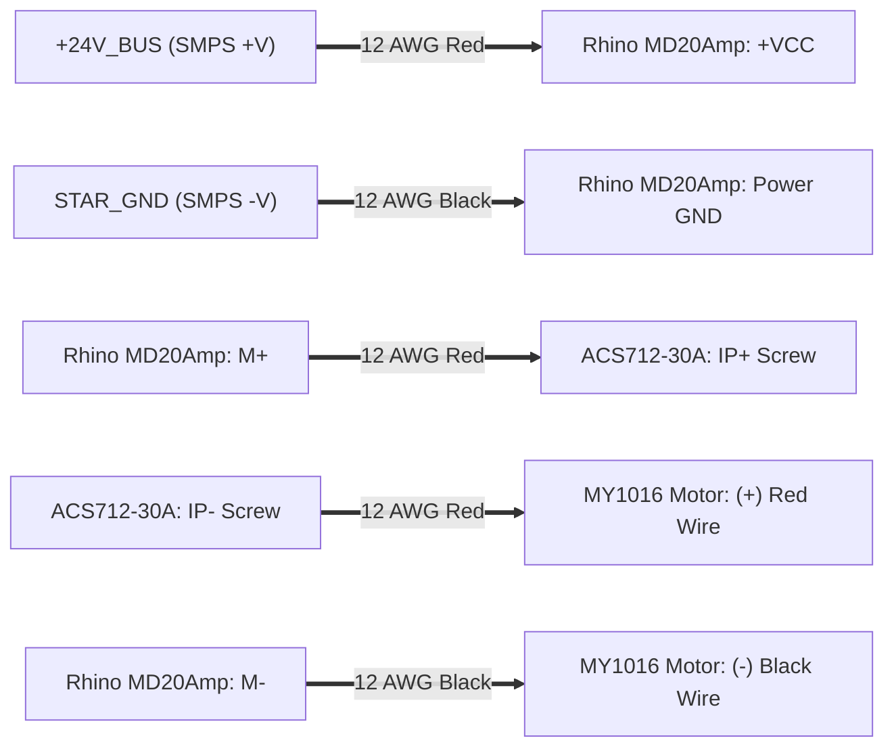

# Complete Hardware Wiring, Potentiometer Tuning, Steel-Chassis Isolation & Pre-Power Commissioning Guide

This document provides the **exact pin-by-pin wiring instructions** for the entire Dual-Tier Knee Rehabilitation System using three **ESP32-S NodeMCU V1.1** boards (`U1: ESP_MASTER`, `U2: ESP_TOPHUB`, `U3: ESP_CYCLING`), along with exact potentiometer tuning procedures for the CC/CV Buck Converter, signal resistor networks, steel chassis earthing/isolation rules, and a mandatory pre-power-on multimeter checklist.

---

## 1. Master Power Distribution & Regulator Tuning (`PSU1`, `U4` Buck, `U5` LDO)

### 1.1 24V 30A SMPS (`PSU1`) Connections
Your $24\,\text{V}\;30\,\text{A}$ ($720\,\text{W}$) SMPS has a 9-screw terminal strip. Wire it as follows:

| SMPS Terminal Label | Wire Gauge & Color | Destination / Connection | Critical Notes |
| :--- | :--- | :--- | :--- |
| **`L` (Line / Live)** | $1.5\,\text{mm}^2$ ($16\,\text{AWG}$) Red/Brown | $230\,\text{V}$ AC Mains Live (via $10\,\text{A}$ DPST Mains Switch + $6\,\text{A}$ Fuse) | Never leave `L` or `N` terminals exposed; use the plastic terminal cover |
| **`N` (Neutral)** | $1.5\,\text{mm}^2$ ($16\,\text{AWG}$) Black/Blue | $230\,\text{V}$ AC Mains Neutral | — |
| **`FG` / `PE` (`⏚`)** | $1.5\,\text{mm}^2$ ($16\,\text{AWG}$) Green-Yellow | Mains Earth **AND** bolted to the **Steel Chassis Earth Stud** | **Mandatory for patient safety on a steel frame!** Scrape paint to bare steel under a star washer |
| **`+V` (3 terminals)** | $12\,\text{AWG}$ ($3.3\text{–}4.0\,\text{mm}^2$) Red | **Insulated `+24V_BUS` Distribution Block** | Use separate $12\text{–}14\,\text{AWG}$ runs from the block to Rhino MD20Amp, Heatbed MOSFET, and Stepper Driver |
| **`-V` / `COM` (3 terminals)** | $12\,\text{AWG}$ ($3.3\text{–}4.0\,\text{mm}^2$) Black | **Insulated `STAR_GND` Busbar** | **Do NOT bolt `-V` (`DC GND`) to the steel chassis to carry current!** All returns must use insulated copper wire back to `STAR_GND` |
| **`+V ADJ` Trimpot** | Small Phillips Screwdriver | Fine-tune unloaded SMPS output to **$24.00\,\text{V}$ DC** | Measure with multimeter before connecting any downstream boards |

---

### 1.2 Tuning the 24V $\rightarrow$ 5V CC/CV Buck Converter (`U4`)
Your adjustable DC-DC Buck Converter has **four connections** (`IN+`, `IN-`, `OUT+`, `OUT-`) and **two blue multi-turn brass-screw potentiometers**:
1. **CV Trimpot (Constant Voltage):** Located closest to the output capacitor / `OUT+` side.
2. **CC Trimpot (Constant Current Limit):** Located closest to the current-sense shunt resistor / op-amp IC.

> [!CAUTION]
> **DO NOT CONNECT THE BUCK CONVERTER OUTPUT TO THE LDO, ESP32s, ENCODERS, OR ACS712 BEFORE TUNING!**
> Factory buck converters often ship set to $12\,\text{V}\text{–}20\,\text{V}$. Connecting an untuned buck converter will permanently destroy the $5\,\text{V}$ optical encoders, the ACS712 sensor, and the LDO/ESP32s in milliseconds.

#### Step-by-Step Potentiometer Tuning Procedure (With Output Disconnected)
1. **Wire Input Only:** Connect `IN+` to `+24V_BUS` ($18\text{–}20\,\text{AWG}$ Red) and `IN-` to `STAR_GND` ($18\text{–}20\,\text{AWG}$ Black). Leave `OUT+` and `OUT-` **completely disconnected**.
2. **Tune Voltage (CV Potentiometer) to $\mathbf{5.05\,\text{V}}$:**
   * Set your digital multimeter (DMM) to **DC Volts ($20\,\text{V}$ range)** and clip the probes to `OUT+` and `OUT-`.
   * Power on the $24\,\text{V}$ SMPS.
   * Turn the **CV (Voltage) potentiometer** counter-clockwise to lower the voltage (if the reading does not change initially, turn up to $10\text{–}15$ full turns until the internal worm gear catches).
   * Adjust slowly until the multimeter reads **exactly $5.05\,\text{V}$** (acceptable window: $5.00\,\text{V}\text{–}5.10\,\text{V}$).
3. **Tune Current Limit (CC Potentiometer) to $\mathbf{1.8\,\text{A}\text{–}2.0\,\text{A}}$:**
   * *Why $1.8\text{–}2.0\,\text{A}$?* Three ESP32s transmitting Wi-Fi/ESP-NOW draw $\sim 0.6\text{–}0.9\,\text{A}$ average with $1.4\,\text{A}$ RF peaks, two optical encoders draw $\sim 0.08\,\text{A}$, and the ACS712 draws $\sim 0.015\,\text{A}$ ($\text{Total} \approx 0.7\text{–}1.5\,\text{A}$). Setting CC too low ($< 1.0\,\text{A}$) will cause the $5\,\text{V}$ rail to drop out when Wi-Fi transmits; setting it to **$1.8\text{–}2.0\,\text{A}$** gives full headroom while protecting against accidental short circuits.
   * **How to Measure & Set CC Exactly:**
     1. Turn the **CC (Current) potentiometer** $15$ turns counter-clockwise (minimum current).
     2. Move your multimeter red probe into the **`10A` Fused Current Jack** and select **DC Amps ($10\,\text{A}$)**.
     3. Touch the multimeter probes across `OUT+` and `OUT-` of the buck converter (because CV is already $5.05\,\text{V}$ and CC is at minimum, the buck converter safely enters Constant-Current mode and its red `CC` LED lights up).
     4. Slowly turn the **CC potentiometer clockwise** until your multimeter reads **$1.90\,\text{A}$** ($1.80\text{–}2.00\,\text{A}$).
     5. Remove the probes, turn off power, and **immediately move your multimeter red lead back from the `10A` jack to the `V/Ω` jack**!
4. **Mark the Screws:** Put a small dot of nail polish or marker on both brass screws so chassis vibrations cannot untune them.

---

### 1.3 Wiring the 5V $\rightarrow$ 3.3V LDO Regulator (`U5`) & Powering the ESP32-S NodeMCU V1.1 Boards
1. **Buck to `+5V_BUCK` Rail:**
   * `U4` Buck `OUT+` ($5.05\,\text{V}$) $\rightarrow$ **`+5V_BUCK` Terminal Strip** (feeds `ENC1`, `ENC2`, `ACS712`, `HX711/INA125`, and `U5` LDO `VIN`).
   * `U4` Buck `OUT-` $\rightarrow$ Connected internally to `IN-` (`STAR_GND`).
2. **LDO (`U5`: $5\,\text{V} \rightarrow 3.3\,\text{V}$, rated $\ge 1.5\,\text{A}$ e.g. `LD1117V33` / `AMS1117-3.3` module or high-current $3.3\,\text{V}$ LDO):**
   * `U5` **`VIN` (`IN+`)** $\rightarrow$ Connect to **`+5V_BUCK`** ($5.05\,\text{V}$).
   * `U5` **`GND` (`IN-`/`OUT-`)** $\rightarrow$ Connect to **`STAR_GND`**.
   * `U5` **`VOUT` (`3.3V`)** $\rightarrow$ Verify with multimeter that it reads **$3.30\,\text{V} \pm 0.05\,\text{V}$**, then connect to the **`+3V3_LDO` Rail** feeding the **`3V3`** pin of `U1`, `U2`, and `U3`.
   * *Practical Capacitance Tip:* Place a $100\,\mu\text{F}$ electrolytic capacitor + $100\,\text{nF}$ ceramic capacitor between `3V3` and `GND` right next to each ESP32-S NodeMCU V1.1 board to absorb Wi-Fi/ESP-NOW current spikes.

> [!WARNING]
> **USB Flashing Precaution on ESP32-S NodeMCU V1.1:**
> Because each NodeMCU V1.1 has its own onboard AMS1117-3.3 regulator fed from the micro-USB port, **disconnect the external `+3V3_LDO` wire from the ESP32's `3V3` pin whenever you plug that ESP32 into your laptop's USB port for flashing** (or use a modified USB cable with the red $+5\,\text{V}$ wire cut, keeping only `D+`, `D-`, and `GND`). Alternatively, you may feed `+5V_BUCK` ($5.05\,\text{V}$) into the **`VIN` (`5V`)** pin of each NodeMCU V1.1 and let each board's onboard 3.3V LDO regulate its own $3.3\,\text{V}$ rail independently!

---

## 2. Exact Pinout & Wiring for All Three ESP32-S NodeMCU V1.1 Boards

On the **ESP32-S NodeMCU V1.1** development board, pins are labeled on the bottom/top silkscreen as `3V3`, `GND`, `VIN`, and `IOxx` / `Pxx` / `Dxx`.

> [!IMPORTANT]
> **Critical ESP32 Hardware Rule (`ADC1` vs. `ADC2`):**
> Because Wi-Fi and ESP-NOW are active on all three ESP32s, **`ADC2` pins (`GPIO0, 2, 4, 12, 13, 14, 15, 25, 26, 27`) CANNOT be used for `analogRead()`**! Every analog sensor (`VBUS_SENSE`, `ACS712`, Analog Strain Gauge) **must** be wired to **`ADC1` pins (`GPIO34`, `GPIO35`, `GPIO36/VP`, `GPIO39/VN`)**. Notice also that `GPIO34`, `GPIO35`, `GPIO36`, and `GPIO39` are **input-only** pins and have no internal pull-up/pull-down resistors.

---

### 2.1 `U1`: Master ESP32 (`ESP_MASTER` — Web GUI Server & ESP-NOW Coordinator)
`U1` runs the Wi-Fi SoftAP (`192.168.4.1`), serves the Clinical Web GUI, and coordinates `U2` and `U3` over ESP-NOW.

| `U1` NodeMCU V1.1 Pin Silkscreen | GPIO # | Connected Net / Wire | Destination |
| :--- | :---: | :--- | :--- |
| **`3V3`** (or **`VIN`** if using $5\,\text{V}$) | Power | `+3V3_LDO` ($3.30\,\text{V}$) | Output of `U5` $3.3\,\text{V}$ LDO |
| **`GND`** (Wire at least 2 `GND` pins) | Ground | `STAR_GND` | Central DC Ground Busbar |
| **`IO4`** *(Optional Physical E-Stop Button)* | `GPIO4` | `HW_ESTOP_BTN` | Optional physical mushroom E-Stop switch to `GND` (`INPUT_PULLUP`) |

---

### 2.2 `U2`: Top-Hub ESP32 (`ESP_TOPHUB` — Knee Motor, Chopper, ACS712, Encoder 1, Spasm Sensor)

| `U2` NodeMCU V1.1 Pin Silkscreen | GPIO # | Signal Direction | Net Label | Exact Destination |
| :--- | :---: | :---: | :--- | :--- |
| **`3V3`** | Power | Power In | `+3V3_LDO` | Output of `U5` $3.3\,\text{V}$ LDO |
| **`GND`** (Use 2 pins) | Ground | Return | `STAR_GND` | Central DC Ground Busbar |
| **`IO34` / `P34`** (`ADC1_CH6`) | **`GPIO34`** | Analog In ($0\text{–}3.3\,\text{V}$) | `VBUS_SENSE` | Midpoint of **`R11` ($100\,\text{k}\Omega$) & `R12` ($10\,\text{k}\Omega$)** Bus Voltage Divider |
| **`IO35` / `P35`** (`ADC1_CH7`) | **`GPIO35`** | Analog In ($0\text{–}3.3\,\text{V}$) | `ACS712_SENSE` | Midpoint of **`R13` ($2.2\,\text{k}\Omega$) & `R14` ($3.3\,\text{k}\Omega$)** from `ACS712` `OUT` pin |
| **`IO32` / `P32`** (`PCNT0`) | **`GPIO32`** | Digital In ($3.3\,\text{V}$) | `ENC1_CHA_3V3` | Midpoint of **`R3` ($2.2\,\text{k}\Omega$) & `R4` ($3.3\,\text{k}\Omega$)** from Top-Hub Encoder Phase A |
| **`IO33` / `P33`** (`PCNT0`) | **`GPIO33`** | Digital In ($3.3\,\text{V}$) | `ENC1_CHB_3V3` | Midpoint of **`R5` ($2.2\,\text{k}\Omega$) & `R6` ($3.3\,\text{k}\Omega$)** from Top-Hub Encoder Phase B |
| **`IO25` / `P25`** (`MCPWM`) | **`GPIO25`** | PWM Out ($20\,\text{kHz}$) | `MD_PWM` | **Rhino MD20Amp** `PWM` pin (via $10\,\text{k}\Omega$ pull-down to `GND`) |
| **`IO26` / `P26`** | **`GPIO26`** | Digital Out | `MD_DIR` | **Rhino MD20Amp** `DIR` pin |
| **`IO27` / `P27`** (`LEDC` $5\,\text{kHz}$) | **`GPIO27`** | PWM Out ($5\,\text{kHz}$) | `CHOP_PWM` | **30A Heatbed MOSFET** `Control +` pin (via $10\,\text{k}\Omega$ pull-down to `GND`) |
| **`IO36` / `SVP` (`VP`)** *(If Analog Amp)* **`IO21` & `IO22`** *(If `HX711`)* | **`GPIO36`** or **`21`/`22`** | Analog In (`ADC1_CH0`) or Digital `DOUT`/`SCK` | `PAD_FORCE_SENSE` | **Pad Strain Gauge / Load Cell Amplifier** (`INA125` Analog Out $\rightarrow$ `GPIO36`, or `HX711` `DT` $\rightarrow$ `GPIO21`, `SCK` $\rightarrow$ `GPIO22`) |

---

### 2.3 `U3`: Bottom-Cycling ESP32 (`ESP_CYCLING` — Stepper Eddy Brake & Flywheel Encoder 2)

| `U3` NodeMCU V1.1 Pin Silkscreen | GPIO # | Signal Direction | Net Label | Exact Destination |
| :--- | :---: | :---: | :--- | :--- |
| **`3V3`** | Power | Power In | `+3V3_LDO` | Output of `U5` $3.3\,\text{V}$ LDO |
| **`GND`** (Use 2 pins) | Ground | Return | `STAR_GND` | Central DC Ground Busbar |
| **`IO32` / `P32`** (`PCNT0`) | **`GPIO32`** | Digital In ($3.3\,\text{V}$) | `ENC2_CHA_3V3` | Midpoint of **`R7` ($2.2\,\text{k}\Omega$) & `R8` ($3.3\,\text{k}\Omega$)** from Flywheel Encoder Phase A |
| **`IO33` / `P33`** (`PCNT0`) | **`GPIO33`** | Digital In ($3.3\,\text{V}$) | `ENC2_CHB_3V3` | Midpoint of **`R9` ($2.2\,\text{k}\Omega$) & `R10` ($3.3\,\text{k}\Omega$)** from Flywheel Encoder Phase B |
| **`IO18` / `P18`** | **`GPIO18`** | Pulse Out | `STEP_PUL` | **Stepper Motor Driver (`U301`)** `PUL+` / `STEP` input |
| **`IO19` / `P19`** | **`GPIO19`** | Digital Out | `STEP_DIR` | **Stepper Motor Driver (`U301`)** `DIR+` / `DIR` input |

---

## 3. Component-by-Component Detailed Wiring Instructions

### 3.1 Top-Hub Motor Driver (`U201`: Rhino MD20Amp) & `ACS712 30A` Current Sensor Module
The **Rhino MD20Amp** has 4 large power screw terminals (`+VCC`, `GND`, `M+`, `M-`) and a 3-pin logic header (`PWM`, `DIR`, `GND`).
The **ACS712 30A Module** has 2 large green screw terminals (`IP+`, `IP-`) for the high-current path and a 3-pin male header (`VCC`, `OUT`, `GND`).

1. **High-Current Power Side ($12\,\text{AWG}$ stranded copper wire with crimped ferrules/spades):**
   * **Rhino `+VCC`** $\rightarrow$ Connect directly to **`+24V_BUS`**.
   * **Rhino Power `GND`** $\rightarrow$ Connect directly to **`STAR_GND`**.
   * **Rhino `M+`** $\rightarrow$ Connect to **`IP+` screw terminal of the `ACS712 30A` module**.
   * **`ACS712 30A` `IP-` screw terminal** $\rightarrow$ Connect to **MY1016 Motor `+` (Red) lead**.
   * **Rhino `M-`** $\rightarrow$ Connect directly to **MY1016 Motor `-` (Black) lead**.
   * *(Why wire the ACS712 between `M+` and the Motor instead of on `+VCC`? Because during Mode 2 dynamic braking, the motor current circulates through the motor and the Rhino's lower MOSFETs while `+VCC` current is zero. Placing the ACS712 inline with `M+` measures true motor current in all 4 modes!)*
2. **Rhino Logic Side:**
   * **Rhino `PWM`** $\rightarrow$ Connect to `U2` **`GPIO25`** (`IO25`). **Add a $10\,\text{k}\Omega$ pull-down resistor between `GPIO25` and `GND`** so the motor stays at $0\%$ PWM during the $200\,\text{ms}$ ESP32 bootup before GPIOs initialize!
   * **Rhino `DIR`** $\rightarrow$ Connect to `U2` **`GPIO26`** (`IO26`).
   * **Rhino Logic `GND`** $\rightarrow$ Connect to `U2` **`GND`**.
3. **ACS712 30A Low-Voltage Side & Level-Shifting Resistors (`R13`, `R14`):**
   * **ACS712 `VCC`** $\rightarrow$ Connect to **`+5V_BUCK`** ($5.05\,\text{V}$).
   * **ACS712 `GND`** $\rightarrow$ Connect to `U2` **`GND`**.
   * **ACS712 `OUT`** $\rightarrow$ Do **not** wire directly to the ESP32! Wire through the $2.2\,\text{k}\Omega / 3.3\,\text{k}\Omega$ divider:
     $$\text{ACS712 }\texttt{OUT} \xrightarrow{\quad R_{13} = 2.2\,\text{k}\Omega \quad} \bullet \xrightarrow{\quad \text{to } U_2\;\texttt{GPIO35} \quad} \qquad \text{and from } \bullet \xrightarrow{\quad R_{14} = 3.3\,\text{k}\Omega \quad} \texttt{GND}$$
     *(Optional Noise Filter: Place a $10\,\text{nF}$ ($0.01\,\mu\text{F}$) ceramic capacitor in parallel with $R_{14}$ from `GPIO35` to `GND` to filter $20\,\text{kHz}$ PWM switching spikes).*

---

### 3.2 30A Heatbed MOSFET Brake Chopper (`U202`) & Braking Resistors (`R1 || R2`)
Your 3D Printer 30A Heatbed MOSFET Module has **two small control pins** (`Control +` and `Control -`) and **high-current screw terminals** for power and the load.

#### 1. High-Current Wiring ($12\text{–}14\,\text{AWG}$ Wire)
* **First, wire the two $2\,\Omega, 100\,\text{W}$ Aluminum-Housed Resistors (`R1` and `R2`) in PARALLEL:**
  * Tie the left terminal of `R1` and the left terminal of `R2` together $\rightarrow$ Call this **Resistor Bank Lead A**.
  * Tie the right terminal of `R1` and the right terminal of `R2` together $\rightarrow$ Call this **Resistor Bank Lead B**.
  * **Multimeter Check:** Measure resistance between **Lead A** and **Lead B** before connecting—it must read **$1.0\,\Omega \pm 0.15\,\Omega$** (plus your multimeter probe resistance of $\sim 0.1\text{–}0.2\,\Omega$).
* **Connecting to the Heatbed MOSFET Module:**
  * **If your module has 4 screw terminals (`DC IN +`, `DC IN -`, `HOTBED +` / `OUT+`, `HOTBED -` / `OUT-`):**
    * `DC IN +` (`Power +`) $\rightarrow$ Connect to **`+24V_BUS`**.
    * `DC IN -` (`Power -`) $\rightarrow$ Connect to **`STAR_GND`**.
    * `HOTBED +` (`OUT+`) $\rightarrow$ Connect to **Resistor Bank Lead A**.
    * `HOTBED -` (`OUT-`) $\rightarrow$ Connect to **Resistor Bank Lead B**.
  * **If your module only uses 2 high-current screw terminals (`Power +` [Drain] and `Power -` [Source]):**
    * Connect **`+24V_BUS`** directly to **Resistor Bank Lead A**.
    * Connect **Resistor Bank Lead B** to the MOSFET's **`Power +` (Drain)** terminal.
    * Connect the MOSFET's **`Power -` (Source)** terminal to **`STAR_GND`**.

#### 2. The Two Control Pins (`Control +` and `Control -`)
* **`Control +` (Red wire / `+` mark on 2-pin JST header or screw block):** Connect to `U2` **`GPIO27`** (`IO27`).
* **`Control -` (Black wire / `-` mark on 2-pin JST header or screw block):** Connect to `U2` **`GND`**.
* **Mandatory Pull-Down Resistor:** Solder a **$10\,\text{k}\Omega$ resistor between `GPIO27` and `GND`**. This guarantees that while the ESP32 is resetting or turned off, the MOSFET gate stays strictly OFF so the $1.0\,\Omega$ resistor bank does not continuously dump $576\,\text{W}$ from the $24\,\text{V}$ supply!
* **Important Practical Check on the Heatbed Module's Optocoupler Voltage:**
  Some 3D printer heatbed MOSFET modules have an onboard series resistor ($R_{\text{opto}} = 1\,\text{k}\Omega\text{–}4.7\,\text{k}\Omega$) on the `Control +/-` pins designed for $12\text{–}24\,\text{V}$ 3D printer mainboards.
  * **Bench Test:** With $24\,\text{V}$ connected to `DC IN +/-` (and a multimeter on `OUT+/-` instead of the resistors for the first test), touch `Control +` to $+3.3\,\text{V}$.
  * If the small red indicator LED on the MOSFET module lights up brightly and the output switches fully to $24.0\,\text{V}$, your module triggers directly from $3.3\,\text{V}$!
  * If $3.3\,\text{V}$ is too low to turn the internal optocoupler fully ON (which would cause the MOSFET to operate in its linear region and overheat), drive the `Control -` pin with a simple `2N2222` / `BC547` NPN transistor whose collector goes to `Control -`, emitter to `GND`, base via $1\,\text{k}\Omega$ to `GPIO27`, and tie `Control +` to **`+5V_BUCK`** (or `+24V_BUS`).

---

### 3.3 Stepper Motor Driver (`U301`) & $1.2\,\text{N}\cdot\text{m}$ Stepper Motor (`M2`)
Depending on whether your Stepper Driver (`U301`) is an industrial opto-isolated driver (**TB6600 / DM542** with 6 control screws `PUL+`, `PUL-`, `DIR+`, `DIR-`, `ENA+`, `ENA-`) or a 4-pin logic driver (`STEP`, `DIR`, `EN`, `GND`):

#### 1. Power & Motor Coils ($16\text{–}18\,\text{AWG}$)
* **`VCC` / `+V`** $\rightarrow$ Connect to **`+24V_BUS`**.
* **`GND`** $\rightarrow$ Connect to **`STAR_GND`**.
* **`A+` and `A-`** $\rightarrow$ Connect to **Coil A** of the $1.2\,\text{N}\cdot\text{m}$ Stepper Motor *(Verify Coil A pair with a multimeter: the two motor wires that have $\sim 1.5\text{–}3.5\,\Omega$ continuity between them belong to Coil A)*.
* **`B+` and `B-`** $\rightarrow$ Connect to **Coil B** of the Stepper Motor *(The other pair of motor wires with $\sim 1.5\text{–}3.5\,\Omega$ continuity)*.
* **Current DIP Switch Setting on Driver:** Set the driver's peak/RMS current DIP switches (`SW1–SW3`) to match your $1.2\,\text{N}\cdot\text{m}$ NEMA 23 / NEMA 17 stepper's rated current (typically **$2.0\,\text{A}\text{–}2.8\,\text{A}$ peak**), and set microstepping (`SW4–SW6`) to **$8\times$ ($1600\,\text{steps/rev}$)** or **$4\times$ ($800\,\text{steps/rev}$)** for ultra-smooth stator disk positioning.

#### 2. Control Signals from `U3` (`ESP_CYCLING`)
* **If using a 4-Pin Driver (`STEP`, `DIR`, `GND`):**
  * `STEP` $\rightarrow$ `U3` **`GPIO18`** (`IO18`)
  * `DIR` $\rightarrow$ `U3` **`GPIO19`** (`IO19`)
  * `GND` $\rightarrow$ `U3` **`GND`**
* **If using an Opto-Isolated Driver (`TB6600` / `DM542` with `PUL+`, `PUL-`, `DIR+`, `DIR-`, `ENA+`, `ENA-`):**
  * Connect **`PUL-`** and **`DIR-`** together to `U3` **`GND`**.
  * Connect **`PUL+`** to `U3` **`GPIO18`** (`IO18`).
  * Connect **`DIR+`** to `U3` **`GPIO19`** (`IO19`).
  * Leave **`ENA+`** and **`ENA-`** **unconnected** (on TB6600/DM542, leaving `ENA` disconnected enables the driver by default; driving `ENA` turns the motor off).

---

### 3.4 Both 360 PPR Optical Encoders (`ENC1` on Top Hub & `ENC2` on Flywheel)

Standard industrial $360\,\text{PPR}$ incremental rotary encoders (`LPD3806-360BM-G5-24C` or `E6B2-CWZ6C`) have a shielded 5-wire cable:
* **Red Wire:** $+5\,\text{V}$ DC Power $\rightarrow$ Connect to **`+5V_BUCK`** ($5.05\,\text{V}$).
* **Black Wire:** $0\,\text{V}$ Common $\rightarrow$ Connect to **`STAR_GND`** (at the respective ESP32).
* **Green Wire:** **Phase A Output (`OUT_A`)**
* **White Wire:** **Phase B Output (`OUT_B`)**
* **Bare Braided Shield Wire:** Connect to **`GND` at the ESP32 end ONLY** (leave the encoder-body end of the shield unconnected so chassis currents cannot flow through the cable shield!).

#### CRITICAL Note on Open-Collector (NPN) vs. Voltage-Output Encoders
Most $5\text{–}24\,\text{V}$ industrial $360\,\text{PPR}$ optical encoders (such as the `LPD3806-360BM-G5-24C`) have **NPN Open-Collector outputs** (meaning the wire pulls to `GND` when active, and floats when high—it requires a pull-up resistor!).
* **How to wire `OUT_A` and `OUT_B` so it works safely with BOTH Push-Pull $5\,\text{V}$ encoders AND NPN Open-Collector encoders:**
  1. **If your encoder is Push-Pull $5\,\text{V}$ output:** Use the schematic's **$2.2\,\text{k}\Omega$ series / $3.3\,\text{k}\Omega$ to `GND` voltage divider** (`R3/R4` and `R5/R6` for `ENC1`; `R7/R8` and `R9/R10` for `ENC2`):
     $$\texttt{OUT\_A} \xrightarrow{\;2.2\,\text{k}\Omega\;} \texttt{GPIO32} \xrightarrow{\;3.3\,\text{k}\Omega\;} \texttt{GND}, \qquad \texttt{OUT\_B} \xrightarrow{\;2.2\,\text{k}\Omega\;} \texttt{GPIO33} \xrightarrow{\;3.3\,\text{k}\Omega\;} \texttt{GND}$$
  2. **If your encoder is NPN Open-Collector (`LPD3806` type):** With only a divider to `GND`, an open-collector output will stay at $0\,\text{V}$ because nothing pulls it up! For an NPN Open-Collector encoder, simply connect a **$2.2\,\text{k}\Omega$ (or $3.3\,\text{k}\Omega$) pull-up resistor from `GPIO32` to `+3V3_LDO`** and another **$2.2\,\text{k}\Omega$ pull-up resistor from `GPIO33` to `+3V3_LDO`** (and connect `OUT_A` $\rightarrow$ `GPIO32`, `OUT_B` $\rightarrow$ `GPIO33`). Because the pull-up goes to $+3.3\,\text{V}$ (`+3V3_LDO`), the signal swings cleanly between $0.0\,\text{V}$ and $3.30\,\text{V}$ with zero risk of exceeding $3.3\,\text{V}$!
  * *Quick Multimeter Check to Know Which Encoder You Have:* Power the encoder with $+5\,\text{V}$ (Red) and `GND` (Black) with `Green` and `White` unconnected, and measure DC voltage from `Green` to `GND` while slowly turning the shaft. If it jumps between $0\,\text{V}$ and $5.0\,\text{V}$, use the **Divider**; if it stays near $0\,\text{V}$ ($< 0.5\,\text{V}$) at all angles, it is **NPN Open-Collector**—add the pull-up to `+3V3_LDO`!

---

### 3.5 Complete Summary Table of All Signal Resistors

| Resistor ID | Value & Rating | Pin 1 Connection | Pin 2 Connection | Exact Function |
| :---: | :---: | :--- | :--- | :--- |
| **`R1`, `R2`** | **$2.0\,\Omega, 100\,\text{W}$** Aluminum-Shell | Heatbed MOSFET `OUT+` | Heatbed MOSFET `OUT-` | Wired **in parallel** ($R_{\text{eq}} = 1.0\,\Omega, 200\,\text{W}$) to dump regenerative braking energy |
| **`R3`** | **$2.2\,\text{k}\Omega$**, $1/4\,\text{W}$ ($1\%$) | `ENC1` `OUT_A` (Green) | `U2` `GPIO32` (`ENC1_CHA_3V3`) | Top-Hub Encoder Ch A upper divider (or pull-up to `+3V3_LDO` if NPN open-collector) |
| **`R4`** | **$3.3\,\text{k}\Omega$**, $1/4\,\text{W}$ ($1\%$) | `U2` `GPIO32` (`ENC1_CHA_3V3`) | `STAR_GND` | Top-Hub Encoder Ch A lower divider to `GND` |
| **`R5`** | **$2.2\,\text{k}\Omega$**, $1/4\,\text{W}$ ($1\%$) | `ENC1` `OUT_B` (White) | `U2` `GPIO33` (`ENC1_CHB_3V3`) | Top-Hub Encoder Ch B upper divider (or pull-up to `+3V3_LDO` if NPN open-collector) |
| **`R6`** | **$3.3\,\text{k}\Omega$**, $1/4\,\text{W}$ ($1\%$) | `U2` `GPIO33` (`ENC1_CHB_3V3`) | `STAR_GND` | Top-Hub Encoder Ch B lower divider to `GND` |
| **`R7`** | **$2.2\,\text{k}\Omega$**, $1/4\,\text{W}$ ($1\%$) | `ENC2` `OUT_A` (Green) | `U3` `GPIO32` (`ENC2_CHA_3V3`) | Flywheel Encoder Ch A upper divider (or pull-up to `+3V3_LDO` if NPN open-collector) |
| **`R8`** | **$3.3\,\text{k}\Omega$**, $1/4\,\text{W}$ ($1\%$) | `U3` `GPIO32` (`ENC2_CHA_3V3`) | `STAR_GND` | Flywheel Encoder Ch A lower divider to `GND` |
| **`R9`** | **$2.2\,\text{k}\Omega$**, $1/4\,\text{W}$ ($1\%$) | `ENC2` `OUT_B` (White) | `U3` `GPIO33` (`ENC2_CHB_3V3`) | Flywheel Encoder Ch B upper divider (or pull-up to `+3V3_LDO` if NPN open-collector) |
| **`R10`** | **$3.3\,\text{k}\Omega$**, $1/4\,\text{W}$ ($1\%$) | `U3` `GPIO33` (`ENC2_CHB_3V3`) | `STAR_GND` | Flywheel Encoder Ch B lower divider to `GND` |
| **`R11`** | **$100\,\text{k}\Omega$**, $1/4\,\text{W}$ ($1\%$) | `+24V_BUS` | `U2` `GPIO34` (`VBUS_SENSE`) | Upper resistor of $11:1$ Bus Voltage Sensor ($24\,\text{V} \rightarrow 2.18\,\text{V}$; $30\,\text{V} \rightarrow 2.73\,\text{V}$) |
| **`R12`** | **$10\,\text{k}\Omega$**, $1/4\,\text{W}$ ($1\%$) | `U2` `GPIO34` (`VBUS_SENSE`) | `STAR_GND` | Lower resistor of $11:1$ Bus Voltage Sensor (**Solder `R12` securely—if `R12` comes loose, $24\,\text{V}$ reaches `GPIO34`!**) |
| **`R13`** | **$2.2\,\text{k}\Omega$**, $1/4\,\text{W}$ ($1\%$) | `ACS712-30A` `OUT` pin | `U2` `GPIO35` (`ACS712_SENSE`) | Scales ACS712 $2.50\,\text{V}$ midpoint down by $0.60\times$ to $1.50\,\text{V}$ at ESP32 ADC |
| **`R14`** | **$3.3\,\text{k}\Omega$**, $1/4\,\text{W}$ ($1\%$) | `U2` `GPIO35` (`ACS712_SENSE`) | `STAR_GND` | Lower divider resistor for ACS712 output |
| **`R15`** *(Safety)* | **$10\,\text{k}\Omega$**, $1/4\,\text{W}$ | `U2` `GPIO25` (`MD_PWM`) | `STAR_GND` | Pull-down resistor keeping Rhino MD20Amp OFF during ESP32 boot/reset |
| **`R16`** *(Safety)* | **$10\,\text{k}\Omega$**, $1/4\,\text{W}$ | `U2` `GPIO27` (`CHOP_PWM`) | `STAR_GND` | Pull-down resistor keeping 30A Brake Chopper MOSFET OFF during ESP32 boot/reset |

---

## 4. Practical Wiring Guidelines for a Conductive Steel Chassis

Because your entire mechanical frame is fabricated from **mild steel**, following strict industrial earthing, isolation, and EMI practices will prevent electrical shocks, blown ESP32s, and erratic encoder counts:

1. **Bond AC Protective Earth (`PE` / `FG`) to the Steel Frame—Never `DC GND` as a Current Path:**
   * Drill a dedicated **M5 or M6 Earth Stud** on the main steel chassis. Grind away any paint, primer, or rust in a $15\,\text{mm}$ circle around the hole down to shiny bare steel.
   * Crimp ring terminals onto two Green-Yellow $16\,\text{AWG}$ wires: run one from the 3-pin AC Mains inlet `PE` pin to the SMPS `FG` (`⏚`) terminal, and the second from `FG` to the Steel Chassis Earth Stud with a serrated star lock-washer.
   * **Keep `DC GND` (`SMPS -V`) on Insulated Wires:** Do **not** bolt motor negative wires to the steel frame like a car chassis. Every component's `GND` must travel through insulated black copper wire back to a single **Insulated Copper `STAR_GND` Busbar** right next to the SMPS `-V` terminals.
2. **Bolt the $100\,\text{W}$ Aluminum Braking Resistors (`R1`, `R2`) to the Steel Frame as a Heatsink—With Insulated Lugs:**
   * The gold aluminum shells of `R1` and `R2` are electrically isolated from their internal resistance wire ($\text{dielectric rating} > 1000\,\text{V}$), so bolting their flat bases directly to a thick steel chassis member (with a thin layer of thermal paste) turns your steel frame into a massive heatsink!
   * **Precaution:** The exposed solder tabs sticking out the ends of `R1` and `R2` are only $4\,\text{mm}$ above the steel surface. Slip **heat-shrink tubing** over the solder joints so a bumped wire can never short `+24V_BUS` to the steel chassis!
3. **Separate High-Current PWM Wires from Encoder & Sensor Wires:**
   * The wires between the **Rhino MD20Amp (`M+`, `M-`) and MY1016 Motor** carry $20\,\text{A}$ chopped at $20\,\text{kHz}$. **Twist the Red (`M+`) and Black (`M-`) motor wires tightly together** (3–4 twists per $10\,\text{cm}$) along their entire length to cancel radiated magnetic fields.
   * Route the **Encoder (`ENC1`, `ENC2`), `ACS712`, and Strain Gauge** cables along the **opposite side** of the steel tube (at least $10\,\text{cm}$ away from the motor power wires). If a sensor wire must cross a power wire, cross them at a **$90^\circ$ right angle**—never bundle them parallel in the same zip-tie!
4. **Do NOT Enclose the ESP32 Antennas Inside a Closed Steel Box:**
   * Steel acts as a Faraday cage for $2.4\,\text{GHz}$ Wi-Fi and ESP-NOW signals. Mount `U1`, `U2`, and `U3` inside **plastic (ABS / Acrylic / 3D-printed PLA/PETG) enclosures** mounted on Nylon standoffs, with the black PCB antenna end of each ESP32-S NodeMCU V1.1 sticking clear of any metal plates by at least $3\,\text{cm}$.
5. **Protect Wires Passing Through Steel Holes:**
   * Sharp drilled or laser-cut steel edges will vibrate through PVC wire insulation and cause a dead short. Always insert **rubber grommets** or wrap **spiral cable wrap / corrugated conduit** wherever wires pass around steel corners or near the moving $1:52$ top-hub arm and $1:5$ bottom cycling gears.

---

## 5. Mandatory Pre-Power-On Multimeter Checklist (Staged Bring-Up Protocol)

**Never power on the entire system at once on the first try.** Follow this 5-stage bring-up checklist in exact order using a digital multimeter:

### Stage A: Unpowered Continuity & Resistance Checks (Mains Cord Unplugged!)
- [ ] **1. Steel Chassis Isolation Check:** Set DMM to Continuity / Resistance ($\Omega$). Measure between the **Steel Chassis** and:
  * **`+24V_BUS`:** Must read **Open Circuit ($\text{OL}$ / $> 1\,\text{M}\Omega$)**.
  * **`+5V_BUCK`:** Must read **Open Circuit ($\text{OL}$)**.
  * **`+3V3_LDO`:** Must read **Open Circuit ($\text{OL}$)**.
  * **Resistor Bank Leads (`OUT+` and `OUT-`):** Must read **Open Circuit ($\text{OL}$)** to the steel frame.
  * **AC Mains Plug Earth Pin (`PE`):** Must read **$< 0.5\,\Omega$ (Beep!)** to the steel frame.
- [ ] **2. Power Rail Short-Circuit Check:** Measure resistance across each power rail before applying power:
  * **`+24V_BUS` to `STAR_GND`:** Must read high resistance ($> 5\,\text{k}\Omega$; it may slowly climb as SMPS capacitors charge from the DMM).
  * **`+5V_BUCK` to `STAR_GND`:** Must read $> 1\,\text{k}\Omega$ (not $0\,\Omega$!).
  * **`+3V3_LDO` to `STAR_GND`:** Must read $> 500\,\Omega$ (not $0\,\Omega$!).
- [ ] **3. Voltage Divider Ground Integrity Check (`R12`, `R14`, `R4`, `R6`, `R8`, `R10`):**
  * Measure resistance from `U2` **`GPIO34`** (`VBUS_SENSE`) to `GND`: **Must read $10.0\,\text{k}\Omega \pm 2\%$**. *(If this reads $\text{OL}$, `R12` is not connected to `GND` and $24\,\text{V}$ would destroy `GPIO34`!)*
  * Measure resistance from `U2` **`GPIO34`** to `+24V_BUS`: **Must read $100.0\,\text{k}\Omega \pm 2\%$**.
  * Measure resistance from `U2` **`GPIO35`** (`ACS712_SENSE`) to `GND`: **Must read $3.3\,\text{k}\Omega \pm 5\%$**.
- [ ] **4. Braking Resistor Bank Check:**
  * Measure across `OUT+` and `OUT-` of the parallel braking resistors (`R1 || R2`): **Must read $1.0\,\Omega\text{–}1.2\,\Omega$**.

---

### Stage B: Power Stage Bring-Up (With ESP32s, Encoders & Motors Unplugged)
- [ ] **1. Disconnect** the ESP32s from their sockets/headers, unplug the motor leads (`M+`, `M-`), and disconnect the Buck Converter output wire.
- [ ] **2. Plug in AC Mains & Switch On SMPS:**
  * Measure `+24V_BUS` to `STAR_GND`: Adjust SMPS trimpot to **$24.00\,\text{V}$ DC**.
  * Measure voltage at the `VBUS_SENSE` wire (`GPIO34` node) to `GND`: **Must read $\mathbf{2.18\,\text{V}}$ DC** ($\frac{10}{100+10} \times 24.0\,\text{V}$). This confirms `GPIO34` is $100\%$ safe!
- [ ] **3. Tune Buck Converter (`U4`) & Verify LDO (`U5`):**
  * Tune `U4` **CV pot** to **$5.05\,\text{V}$** and **CC pot** to **$1.9\,\text{A}$** (per Section 1.2).
  * Turn off power, connect `U4` `OUT+` to `+5V_BUCK` (feeding `U5` LDO and `ACS712`), and power back on.
  * Measure `+3V3_LDO` output of `U5`: **Must read $\mathbf{3.30\,\text{V} \pm 0.05\,\text{V}}$**.
  * Measure `ACS712` raw `OUT` pin ($I_m = 0\,\text{A}$): **Must read $\mathbf{2.52\,\text{V}}$** ($0.5 \times 5.05\,\text{V}$).
  * Measure `ACS712_SENSE` (`GPIO35` node after the $2.2\,\text{k}\Omega / 3.3\,\text{k}\Omega$ divider): **Must read $\mathbf{1.51\,\text{V}}$ DC**—right in the sweet spot for `U2`!

---

### Stage C: Sensor & Encoder Bring-Up (Motors Still Disconnected)
- [ ] **1. Power off**, install `U1`, `U2`, and `U3` (ESP32-S NodeMCU V1.1 boards), and connect `ENC1` and `ENC2`.
- [ ] **2. Power on** and rotate the Top-Hub shaft (`ENC1`) and Flywheel shaft (`ENC2`) slowly by hand while measuring `GPIO32` and `GPIO33` on `U2` and `U3`:
  * Both pins must toggle cleanly between **$\approx 0.0\,\text{V}$ and $\approx 3.0\text{–}3.3\,\text{V}$** (never above $3.35\,\text{V}$!).
- [ ] **3. Check Brake Chopper Idle State:**
  * Verify that the red indicator LED on the **30A Heatbed MOSFET (`U202`)** is **OFF** and the aluminum braking resistors (`R1`, `R2`) remain completely cold at room temperature.

---

### Stage D: Motor & Direction Verification (With Orthosis Arm Detached from Hard Stop / Patient)
- [ ] **1. Power off** and connect the MY1016 motor (through the ACS712-30A) and the $1.2\,\text{N}\cdot\text{m}$ Stepper Motor.
- [ ] **2. Keep the Top-Hub Orthosis Arm in the middle of its travel ($\sim 45^\circ\text{–}60^\circ$)**, completely clear of the mechanical hard stop and with no limb attached.
- [ ] **3. Power on** and connect a phone/laptop to the Master ESP32 Wi-Fi network (`KneeRehab_Clinical_Hub` at `http://192.168.4.1`).
- [ ] **4. Run Stage 1 & Stage 2 of the Automated Setup Routine** on the Web GUI while keeping one hand on the $24\,\text{V}$ mains switch:
  * Confirm the arm creeps slowly ($\sim 3^\circ/\text{s}$) toward the hard stop, detects stall current ($\le 2.5\,\text{A}$) on the ACS712, backs off $5^\circ$, and latches the encoder angle cleanly.
